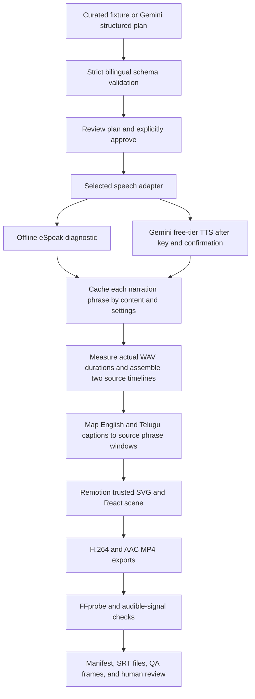

# VideoCraft: pipeline prototype architecture

Status: implementation sketch for the first local experiment. The approved product scope remains in [PRD.md](PRD.md).

## What this milestone proves

Two curated educational topics, an illustrated water-cycle template and a general concept-flow diagram, and one language choice: English narration/subtitles or Telugu narration/subtitles. A local Node.js server provides plan editing, approval, job progress, previews, and downloads; its renderer subprocess runs the same CLI pipeline. This milestone does not include the Next.js application, shared authentication, MongoDB, R2, Instagram, or hosted scheduling.

The initial run uses an explicitly labeled **offline diagnostic**: a curated bilingual script and local eSpeak NG robotic speech. It is a real narrated MP4 render, but it is not evidence of AI script quality, neural voice quality, or fluent Telugu pronunciation. A native Telugu review and an API-backed run are still required.

## Data flow

## Components

| Component | Responsibility |
|---|---|
| `scripts/local-server.ts` | Loopback-only HTTP API, local project persistence, stale-approval protection, single-job coordination, media streaming/downloads |
| `src/local/` | Browser review screen, bilingual plan editing, one video-language choice with matching subtitles, separate accent control, approval, progress, video library |
| `scripts/cli.ts` | Explicit mode selection, plan review boundary, output lock, cached speech, rendering, persisted manifest |
| `src/pipeline/schema.ts` | Reject invalid language text, unsupported templates/phases, duplicate cue IDs |
| `src/pipeline/providers.ts` | Separate offline and Gemini adapters; no implicit provider fallback; live requests fail closed |
| `src/pipeline/wav.ts` | Validate PCM audio and calculate exact sample durations |
| `src/pipeline/timing.ts` | Frame-based source timelines and corresponding SRT captions |
| `src/video/WaterCycle.tsx` | Deterministic illustrated water-cycle or process-flow scene, source-language labels, chosen subtitles, text fitting, local fonts |
| `src/pipeline/probe.ts` | Inspect actual exported codecs, dimensions, duration, and audible audio track |
| `fixtures/water-cycle.json` | Reviewable source and translated text, stable scene/phrase anchors |
| `fixtures/lessons.json` | Longer water-cycle narration and seed-growth process lesson, sliced into 30/60/90-second sample plans |

## Synchronization contract

- Each source narration phrase is synthesized separately and measured from its WAV samples.
- Its subtitle uses the same language and measured phrase window as narration. Subtitle language is derived from the selected video language, never independently selected.
- Scene phases change on the first associated phrase. Animation is a pure function of the frame; browser timing never drives a render.
- Gaps and clip assembly are included in the frame map. Subtitle timing is rounded to 30 fps; the nominal rounding error is at most half a frame. Spare target time is distributed into short visual-reading holds; captions remain until their phrase window ends, consistently in MP4 and SRT.
- Phrase-level precision does not imply word-level alignment. Spoken delivery/prosody and semantic animation cues still need human review.
- Do not truncate audio to force a duration. The selected 30/60/90-second target controls the timeline; reject speech exceeding target + 3 seconds or the 90-second absolute cap. Longer samples have more narration, not just a longer silent tail.

## State and failure handling

`plan saved → approved → speech cached → timeline assembled → rendering → media validated → complete`

Any error writes `status: failed` and a sanitized reason to the run manifest. The previous clips remain reusable. An exclusive workspace lock (`.cache/pipeline.lock`) prevents simultaneous runs from modifying shared bundle/audio paths. On normal failure it is released; after a process crash its PID can be checked before manually removing the stale lock.

There are no automatic API retries, paid fallbacks, cloud uploads, purchases, or deployments. A 429 pauses the live path. No secrets are bundled into the video or stored in the manifest.

The studio stores projects at `output/projects/<uuid>/project.json` and each render in its own `<job-uuid>` directory. An approved plan snapshot is written before the child renderer starts. Approval includes the exact plan and output-settings hashes. Saves use a previous-version hash to prevent another tab from overwriting newer edits. Writes use temporary files and rename. A restart marks previously running jobs interrupted; the user retries explicitly, retaining earlier outputs and cached speech. This is local persistence, not a durable cloud queue or multi-user database.

HTTP binds to `127.0.0.1` only. Host/origin checks and a required custom JSON header protect mutations from other sites. Media paths are constrained to the real output directory, and byte-range responses support browser seeking. The server never returns local API keys. The local process should remain running during renders; it has no background service installation or always-on scheduling.

## Free-only execution

The offline demo requires no keys and makes no provider calls. Remotion eligibility was confirmed for the user's organization (three people or fewer); other installations must check their own eligibility. Local eSpeak NG is diagnostic software under GPL-3.0; preserve upstream notices and review distribution requirements before packaging it with a shipped product.

The Gemini adapter requires both a local API key and `GEMINI_FREE_TIER_CONFIRMED=true`. This confirms that the operator checked the project's billing/free-tier status; it is not a billing verification API. The adapter only allows reviewed model IDs and cannot guarantee that a previously free project remains free if someone changes its billing settings externally. Keep billing disabled for these experiments.

## Next architectural decisions after the live experiment

1. Select actual English/Indian-accent and Telugu voices after listening tests.
2. Confirm exact duration and prosody under real AI speech; decide whether native word timing is needed.
3. Decide render execution from measured runtime: local first; Vercel Sandbox only within permitted free access.
4. Move plan/version/job metadata into MongoDB and assets into R2.
5. Add Auth.js identities and the shared team's permission boundary.
6. Implement publishing and durable scheduling separately; local rendering does not demonstrate always-on scheduling.

## Reference contracts

- [Gemini structured output](https://ai.google.dev/gemini-api/docs/structured-output)
- [Gemini speech and REST Interactions request format](https://ai.google.dev/gemini-api/docs/speech-generation)
- [Gemini pricing and eligible free tiers](https://ai.google.dev/gemini-api/docs/pricing)
- [Remotion renderer](https://www.remotion.dev/docs/renderer/render-media) and [license](https://www.remotion.dev/docs/license/pricing)
- [eSpeak NG Telugu support](https://github.com/espeak-ng/espeak-ng/blob/master/docs/languages.md) and [local JS package](https://github.com/echogarden-project/espeak-ng-emscripten)
