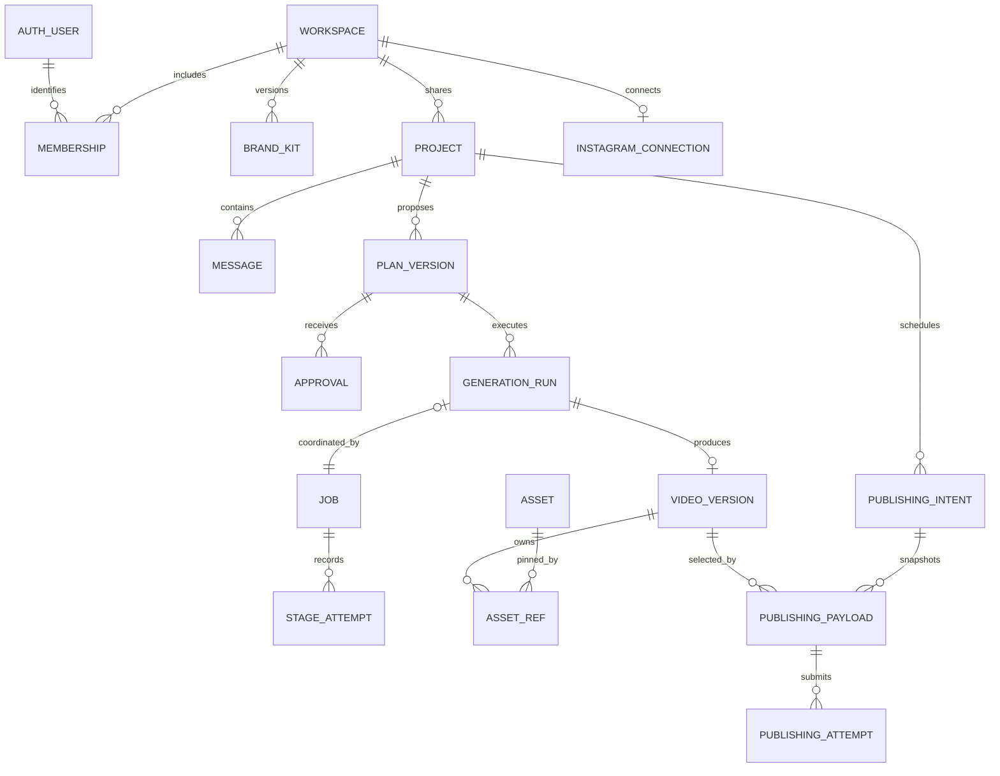

# VideoCraft — V1 Database Design

## F13a deployed slice — migration 014 (22 October 2026)

`014_workspace_settings` preserves manifests 001–013. It widens only workspaces.defaults.preferredAccentId to nullable, extends the latest activity_events validator for workspace_settings_changed (nullable projectId, workspaceId-only resourceRefs), and adds strict workspace_settings_commands. Existing workspace/event rows remain valid. Command rows have UUID _id/workspaceId, member userId, SHA256 keyHash/requestHash, safe SettingsView snapshot and createdAt. Unique workspace_settings_replay_v1(workspaceId,userId,keyHash); no TTL. Shared revision remains BSON Long settingsRevision, independent of brandRevision and member preferencesRevision. No new membership schema is needed; writes use the existing internal generationGuardRevision membership fence.

Active-member/workspace reads are snapshot transactions. Mutation replay checks current access, returns the original snapshot and makes no duplicate event. A new command validates expected revision, effective changes, safe counter capacity and supplied voice availability, fences the active member, CAS-updates workspace settingsRevision and nextActivitySequence, then inserts one receipt and one workspace event. Concurrent writes conflict on the same workspace and retry into either replay or stale refusal. Event/receipt failure rolls back the entire settings operation. No provider call or media I/O occurs inside transactions. A timezone-only patch does not rewrite defaults; a GET normalizes the legacy unresolved accent only in its projection.

No project/plan/run/approval/video/schedule document is updated. Project creation keeps its existing explicit immutable request snapshot and idempotency identity; composer inheritance is captured before sending. Legacy pending create commands without voice fields retain their original null selections. Recovered drafts never silently acquire new workspace preferences. Null voice/accent remain valid while providers are unavailable; a supplied nonnull pair uses existing free-only catalog safeguards. Brand kit/logo storage, asset references are covered by F13b and personal preference mutations by F13c below.

## F12c deployed slice — migration 013 (22 October 2026)

`013_verified_speech_reuse` adds only generation_speech_reuses; migrations 001–012/checksums remain unchanged. Strict rows contain UUID _id/workspaceId/projectId/runId/sourceRunId/sourceAttemptId/sourceApprovalId/owner, segment_scene_[1–8] ID, SHA256 sourceInputHash/inputHash/identityHash/providerConfigHash/audioHash, bounded integer byteLength 4,844–4,320,044, sampleRate:24000, Long leaseEpoch>=1 and createdAt. Unique generation_reuse_once_v1(runId,segmentId); nonunique generation_reuse_source_pin_v1(sourceAttemptId). No TTL or auto cleanup. Receipts are immutable provenance/source retention pins; they are not provider submissions. Existing attempt schema and generation counters are unchanged.

Only original settled attempts from successful same-project/workspace rendered_local runs can be candidates; approved canonical input/hash, source artifact, target speech identity and provider configuration must match. Limit to the newest 20 source runs using generation_project_history_v1. Actual file I/O stays outside transactions. Before receipt insertion, transaction rechecks exact source run/approval/attempt/artifact and touches the target's owner/epoch lease and live-project guard through the existing owned() fence. Operator disablement, config drift, uncertain usage or cancellation refuse reuse. Unique target role prevents duplicate provenance. A stale owner cannot commit a receipt or reach render. The in-memory verified audio is used for this execution; changing/deleting the file afterward cannot alter those bytes.

No local speech cleanup/deletion service exists. Retain original run/approval/settled-attempt/WAV records while these receipts reference them. Any future cleanup, sharing or project-duplication feature must first add a shared source lifecycle/reference-revision guard and honor these pins transactionally; a read-only receipt count is not sufficient for concurrent deletion. Missing/corrupt local WAV before retrieval is a cache miss, never a fabricated reuse; a newly approved run may synthesize normally. Retain failed/cancelled-run receipts conservatively until a future safe cleanup exists. No cross-project/cross-workspace reuse or recursive reuse chains.

Conservative full-plan speech reservation remains required. Reused segments do not create attempts or increment submissionCount. Fully reused runs have zero new submissions and refund only their own unused hold. Mixed runs keep their full settled hold; no refund is inferred for reused phrases alongside consumed speech. Existing uncertainty/recovery semantics and executor-stop requirement remain unchanged; expired rendering/validating leases remain blocked until termination can be verified.

## F12b deployed slice — revision comparison (22 October 2026)

No schema, index or migration change. One read-only snapshot transaction checks active membership and current live-project/plan/source/settings/fingerprint, refuses active pointers, and joins latestReadyVideoId to a same-project/workspace ready video and its exact approval/plan/input hash. Validate approved canonical render input before comparing saved narration/headings/diagrams/settings and source-brief revision. No ready output yields an explicit null baseline. Invalid/foreign baseline fails closed; no fallback to another version. Existing primary/unique indexes serve bounded UUID lookups; comparison arrays are bounded by the existing plan contract. Comparison never touches project counters, activity, speech attempts/reservations, approval snapshots, assets or media. This adds no reusable-audio record, cleanup exception or synthesis permission; exact completed-clip identity/lifecycle verification remains F12c.

## F12a deployed slice — completed-video history (22 October 2026)

No new collection, migration or index. Read-only snapshot transactions check active membership/live project and query ready_videos by workspaceId/projectId with versionNumber descending and optional `$lt` cursor boundary, using migration 012's unique ready_video_version_v1 index in reverse. The bounded page fetch is limit+1, maximum 51. latestReadyVideoId determines isLatest independently of completion/version numbering, preserving older late-completion semantics. Failed/new drafts and incomplete generation runs are excluded because only committed ready_videos are listed. Browsing/selecting/downloading never rewrites originals, counters, guards, activity or the latest pointer. Available pins and remote integrity remain authoritative at actual media delivery. There is no cleanup/reuse metadata change in this slice.

## F11c deployed slice — download reads (21 October 2026)

No schema/index/migration change. Downloads reuse migration 012's immutable ready video and owned MP4/SRT asset pins plus the stored bundle's checksum descriptors. The chosen role must match its exact scoped key, destination and available reference; membership/project and referenceRevision are reread after verified remote retrieval. SRT unavailability does not substitute the MP4 or another subtitle asset. No download counters, leases, reservations, mutation, publication rights or automatic regeneration are introduced.

## F11b deployed slice — migration 012 (21 October 2026)

`012_ready_video_playback` adds ready_videos and video_assets; 001–011 manifests remain unchanged. Ready videos have immutable UUID workspace/project/run/approval/plan/bundle IDs, input/manifest/MP4/build/config hashes, bucket, Long versionNumber, sourceRunCreatedAt/readyAt, matching language/captionLanguage, evaluation narrator/policy, five role->asset UUIDs, validated media and bounded matching transcript. Unique ready_video_run_v1(runId), ready_video_bundle_v1(bundleId), ready_video_version_v1(workspaceId,projectId,versionNumber). Assets hold scoped UUID video/bundle ownership, immutable destination/object descriptor, lifecycleState available|unavailable|deleting|deleted, Long referenceRevision, refCount:1 and createdAt. Unique video_asset_role_v1(videoId,object.kind) and video_asset_object_v1(object.key,configHash). Each asset is owned by one video; sharing/cleanup requires later work honoring these references/lifecycle guards. Validators enforce shapes/counters/indexes; service enforces relationships/hash/language/role invariants.

After all remote objects verify, storage's same fenced transaction verifies completed-manifest/MP4 provenance, approved input, exact captions/timings and evaluation flags; sets stored; inserts ready version/five owned pins; advances project revision/guard/nextVideoVersionNumber; records deduplicated ready/storage activity. Failure rolls everything back. Deterministic IDs and unique run identity prevent duplicate versions/pins/events under retries. latestReadyVideoId advances by source run creation order (run ID tie-break), so older late completions stay historical. Draft edits do not supersede approved completed work; failed newer work preserves prior output. Earlier stored bundles can be reconciled by worker or `web:storage -- promote <run-id>` from verified R2 bytes alone, without local files/inference/rendering. Source/bundle/artifact/approval and live project guard are rechecked at commit; promotion is idempotent. Checksumless legacy manifests are refused. Reconciliation failures are skipped per process (bounded 1000) until explicit correction/promote/restart.

Playback requires active member, live scoped project, stored matching bundle, current destination config and available MP4 ownership pin matching exact key/descriptor/checksum. Full bytes verify before a second access/lifecycle check; no signed URL or object key is exposed. Missing bytes return unavailable without rewriting immutable versions. The generic migration uniqueness audit now groups compound fields under synthetic aggregation keys so dotted index paths are valid; prior migration definitions and drift refusal are unchanged. No media/ready rows are seeded and no cleanup service is introduced.

## F11a deployed slice — private bundles, migration 011 (21 October 2026)

Completed-MP4 provenance refinement: successful renderer manifests now include `mp4Sha256`, computed after rendering, checked unchanged through validation/stills, then saved before completion returns. The renderer returns the exact completed manifest hash; the live bridge checks persisted manifest bytes against it before inserting the existing generation_local_artifacts.manifestHash. That DB pin therefore transitively pins the completed MP4; no schema/migration is changed. Storage reader and prepare/upload service boundaries require SHA256(actual upload bytes) to equal the checksum in that exact DB-pinned manifest. Same-profile/duration/audio replacement files are rejected even if media inspection passes. Missing/malformed legacy checksums return STORAGE_VIDEO_CHECKSUM_REQUIRED; never backfill them from current files or rewrite the committed artifact. Existing stored legacy bundles gain no new trust/ready/publication capability; future delivery must enforce the same provenance requirement. Recover by a separately reviewed new generation, not automatic speech/rendering or an in-place manifest rewrite.

`011_private_media_storage` adds only `generation_storage_bundles`; manifests 001–010 remain unchanged. One immutable bundle per rendered-local run/artifact stores UUID workspace/project/run/approval/artifact IDs, input/build/manifest SHA256 pins, destination bucket/config hash and exactly five bounded descriptors `{kind,key,sha256,size,mime}` for MP4, same-language SRT, approved input, timing/layout and validation manifest. No credentials, URLs or arbitrary local paths. Config hash binds endpoint/bucket/access-key identity. Mutable fields: state `pending|uploading|failed|stored`, Long revision/epoch, nullable owner/leaseUntil/error/storedAt and timestamps. Strict BSON validators enforce bounds and state/lease metadata; service enforces role uniqueness, exact derived keys and relationships. Named indexes: unique storage_one_bundle_per_run_v1, unique storage_one_bundle_per_artifact_v1, storage_dispatch_v1 `(state,leaseUntil,createdAt)` and storage_project_history_v1 `(workspaceId,projectId,createdAt desc)`. No TTL/seeding or existing-schema modification.

Preparation verifies a live same-workspace project, rendered_local run, committed local artifact and immutable approval. Bounded real-path/symlink-safe file reads, canonical input/manifest hashes, voice/diagnostic flags, exact matching subtitles/timing and media profile/signal are checked outside transactions. Preparation/finalization recheck provenance and write the project guard transactionally. Keys are fixed `workspaces/<workspace>/projects/<project>/runs/<run>/bundles/<artifact>/<fixed-file-name>`; retries retain exact keys, hashes and sizes. Per-file caps: MP4 128 MiB, SRT/manifest 256 KiB each, input 512 KiB, timing 2 MiB; whole bundle <=132 MiB. These bounds are not aggregate account-quota enforcement.

Claim atomically takes pending or expired uploading state for the same configuration, incrementing owner epoch/revision; its lease is 180 seconds, fenced/extended before each bounded external operation. R2 calls never execute in a DB transaction. SDK automatic retries are disabled. Every PUT uses create-only If-None-Match:* and matching bytes; success requires bounded GET verification of actual bytes, size, MIME and SHA256, not ETag/metadata alone. Unknown PUTs/negative reads are not proof of completion. Identical keys/bytes make storage replay safe even if an old request finishes late; this never relaxes the render executor-stop requirement.

After all five verifications, one fenced transaction sets stored/storedAt, clears the lease, writes the live project guard and records a deduplicated generation_changed activity event. Deletion winning the guard prevents completion; an already-authorized PUT may finish as a private orphan. No R2 deletion occurs here. Failure retains descriptors/partial objects with a safe code; explicit operator retry requeues failed storage only after source/config checks. Old-owner callbacks cannot finalize or overwrite the new owner's DB result. Stored bundles are terminal, not automatically reuploaded. Speech reservations and generation state are unchanged; no rerender/refund/regeneration.

Discovery scopes to live workspace/project output without a bundle. Unreadable local sources are skipped for that process (bounded at 1000) so other work can proceed; correct files then explicitly store, or restart discovery. Failure before preparation creates no fabricated record. Local files remain required until stored. Ready videos, public DTOs, signed playback/downloads, asset pins/cleanup and deletion integration remain F11b/c or later. This is a private storage checkpoint, not publication permission.

## F09b/F10b deployed slice — migration 010 (21 October 2026)

`010_generation_worker` extends generation_runs, adds strict generation_speech_attempts and generation_local_artifacts, and preserves manifests/indexes 001–009. Run states: queued -> running -> rendered_local|failed, with queued -> cancelled and running -> cancellation_requested -> cancelled. Execution fields: nullable owner/leaseUntil/startedAt/artifactId/error, Long leaseEpoch>=0, stage enum and submissionCount 0–8. Legacy 009 queued/cancelled shapes remain valid; new active states require owner, positive epoch, lease/start timestamps and execution fields; failed/local-result states require terminal timestamps and metadata. A second named partial unique index `(workspaceId,projectId)` covers queued/running/cancellation_requested; the original queued-only index is retained. `(state,leaseUntil)` supports recovery. State/hash/relationship transitions remain service-enforced.

The singleton generation_workers row grants a 45-second process slot, heartbeated every 10 seconds while busy (idle poll two seconds); admission requires a heartbeat less than 30 seconds old. Explicit disabled state is never overwritten by startup/expiry/heartbeat. Run leases extend 90 seconds and carry owner+epoch. Every submission, response settlement and finalization writes the live slot/run fence. A replacement process cannot dispatch another run until existing active leases are recovered; recovery never steals an unexpired run. An expired pre-submission run fails safely and releases unused capacity. An expired submitted attempt becomes uncertain, pauses provider usage and cannot be automatically resent. Old-owner responses/files cannot commit state or resurrect a result.

**Render-lease recovery exception:** expired `rendering` or `validating` runs stay active, including `cancellation_requested`. Recovery does not finalize them, clear their project pointer, close their reservation or release the sole physical render slot. The replacement's registry heartbeat is not executor-stop evidence; `claim()` continues to refuse work while that active run exists. Abort signals, settled speech, elapsed time and late output files do not prove Chrome/FFmpeg termination. This slice has no durable process-tree termination verifier or supported automatic/manual unlock command, so these runs remain operationally paused. A future recovery command must verify executor termination bound to the exact run/owner/epoch before permitting terminalization; never unlock by changing only lease timestamps. Normal owned completion/cancellation handling remains unchanged.

generation_speech_attempts: UUID _id/runId/workspaceId/owner; segment_scene_1..8; inputHash/textHash/providerConfigHash; Long leaseEpoch; submitted|settled|refused|uncertain; nullable audioHash/byteLength/sampleRate=24000; created/finished timestamps. Unique `(runId,segmentId)` enforces one submission identity per phrase, plus `(state,runId)` recovery lookup. The submitted marker and run submissionCount/stage commit BEFORE a request may leave the process. The complete approved text is not duplicated into attempts. A received clip is persisted to a unique local attempt WAV and its bytes/hash checked before settlement; crashes between those steps retain uncertainty instead of discovering/reusing unacknowledged files automatically.

The original conservative whole-plan provider reservation is retained through execution. Fresh free metadata must cover all outstanding holds, discounting only this run's already-settled phrase reservation estimates for its own next-send gate. The public net balance still subtracts the entire original hold (floored at zero), so delayed provider accounting cannot make consumed credits available to a different job. Known completion/refusal marks the hold settled; partial consumed work is not refunded. Any submitted unknown state marks it uncertain, preserving operator disablement and blocking future speech. Only a run with zero durable submissions can release its unused hold using the config/period safeguards from 009. Fresh observations occur outside transactions; configuration, period, reservation, policy, source/project and ownership gates are reread/fenced transactionally before each attempt.

generation_local_artifacts: UUID _id/runId/workspaceId/approvalId, inputHash/rendererBuildHash/manifestHash, strict validated media (1080×1920 H.264/AAC48k, <=90.2s container tolerance, bounded decoded signal), createdAt; unique runId. Artifact ID identifies an operator-local folder beneath output/dashboard-renders/<runId>/<artifactId>; no arbitrary DB/client filesystem path is used. Root driver validates media and supplies hashes from the actual files. Finalization inserts the local artifact and terminal run, closes reservation, clears only that run's project pointer, advances project revision/guard and appends user-initiated generation activity atomically. Cancellation, deletion or lost ownership prevents a successful artifact commit; uncommitted local bytes remain ignored orphans for later cleanup. This is not an R2 asset/ready video and grants no URL/publication rights. Job state is authoritative; directory existence alone never constitutes success. Ready-video/R2 persistence and explicit artifact recovery/reuse remain later migrations/features.

## F09a deployed slice — migration 009 (21 October 2026)

Migration `009_generation_queue` adds strict `approvals`, `generation_runs`, `generation_commands` and `generation_workers` collections; prior 001–008 manifests are unchanged. Memberships gain optional BSON Long `generationGuardRevision` (>=0) for transaction fencing of access removal. Activity permits `generation_changed`. Existing membership/content rows are preserved.

`approvals` stores UUID identifiers/workspace/project/plan, schemaVersion:1, inputHash/settingsSnapshotHash SHA256, sourceBriefRevision/approvedProjectRevision BSON Long >=1, approvedAt/approvedBy and **inputCanonical**. This is bounded canonical JSON (<=512 KiB), containing the entire resolved render object, not a reference to mutable settings. The service validates the strict educational-diagrams-v1 contract and computes SHA256 before insertion; Mongo validates bounded string/outer shape, not nested JSON semantics/hash equality. A future worker must parse, strictly validate and verify hashes/font bytes/build compatibility before any external action, and must never rebuild an approval from the current project. Approvals are insert-only through the domain service. Unique `(workspaceId,planVersionId,inputHash)` prevents another approval for the same logical input.

`generation_runs` is both the durable queue record and authoritative generation job in this slice, separate from planning-only `jobs`. It stores UUID run/job/approval/project/plan/reservation identities, workspace, content/settings/provider-config/build hashes, sourceBriefRevision, reservationPeriodId nullable, state queued|cancelled, BSON Long statusRevision, actor and timestamps. Provider config/reservation details are server-only operational pins and excluded from content hash/public DTO. Unique indexes: `(workspaceId,planVersionId,inputHash)`, jobId, approvalId, and partial `(workspaceId,projectId)` where state=queued. Queue `(state,createdAt,_id)` and project-history `(workspaceId,projectId,createdAt desc,_id desc)` indexes support dispatch/status. This intentionally avoids putting generation rows into the planning worker's collection. Running/retry/stage state and worker claiming require a later explicit schema migration.

`generation_commands` has UUID _id/workspaceId/projectId/runId, userId, bounded action/resource scope, keyHash/requestHash, bounded safe response snapshotCanonical and createdAt. Unique `(workspaceId,userId,scope,keyHash)`, no TTL. Replay reauthorizes live scoped access, compares input hash and returns the committed response before checking stale revision/assets/providers/workers. New keys for identical version/hash acknowledge the existing run, preserve its first actor/input, and reserve nothing. These are acknowledgements, not new rendering requests.

`generation_workers` has singleton `generation:local`, UUID owner, Long revision, healthy|draining|disabled state, contract/compiler/build/font pins, bounded capabilities, heartbeatAt/expiresAt. Admission requires heartbeat within 30 seconds (at most 5 seconds future clock tolerance), unexpired healthy state and exact speech/render/timing/font compatibility, then fences the row revision. No worker is fabricated or registered by API/migration; the collection remains empty until a real worker exists. Its future process must coordinate drain/heartbeat via this row and verify admitted build/input before claiming work.

One snapshot/majority acceptance transaction rechecks member/live project/current version/source brief/request/settings/fingerprint and expected revision/hash, validates the input, reserves net free speech capacity with provider revision/policy/config/expiry checks, fences worker/member/project, inserts approval/run/receipt/activity, and sets project.latestRunId with revision+guard increments. The conservative reservation is twice narration UTF-16 length plus 100 per phrase; no provider calls occur. Concurrent requests cannot overreserve; failures roll everything back. Brief revision stays unchanged. Existing provider disablement/uncertainty cannot be cleared by approval.

Only queued -> cancelled is implemented. Exact statusRevision, active membership and live project are required. Cancellation updates state/status/timestamps, clears latestRunId only when it identifies that run, increments project revision/guard, records receipt/activity and removes a matching unused reserved hold atomically. It credits the observed balance only for the same provider config and allowance period with safe arithmetic. Changed config/period receives no credit; uncertain/settled holds remain untouched. Approval content remains immutable, and unique input identity prevents a cancelled run being restarted by repeat approval. Validators enforce shapes/index uniqueness; service transactions enforce relationships/hash/state-time consistency. No application storage, actual media, worker leases or in-flight stage claims are represented as implemented.

## F08d deployed slice — read-only resolved input (21 October 2026)

No migration or document mutation is needed. plan_versions continues to retain the immutable staged proposal, unresolved settings and original saved-input hash. A snapshot/majority read transaction checks membership, scoped plan/live project, current pointer/request/source-brief/settings, source fingerprint and active-work exclusion, and reads current speech metadata. The pure compiler resolves trusted templates, stable narration/caption/event coverage and fixed settings; installed font bytes supply SHA256 pins. Compilation and font I/O occur outside the DB transaction. A check does not insert approval/jobs/receipts, change revisions, reserve capacity, refresh providers or rewrite historical rows.

The resolved selected-language object is tagged schemaVersion:2 AND contract:educational-diagrams-v1. Canonical SHA256 covers its content, voice/brand/font/output/template/compiler/timing/policy pins; credentials and mutable availability are excluded. This is separate from the existing original saved-input fingerprint and edit contentHash. F09 must persist the entire validated object/hash as immutable approval/run input, guarded by expected current plan, project revision and hash in the acceptance transaction. It must never reconstruct an already-approved run from later mutable settings/assets. Until F09, currentPlanInputHash remains null in project details and no generation capability is granted. Existing migrations 001–008/checksums remain unchanged.

Preflight supports sequence/cycle/comparison diagrams, matching captions, Alice/source-voice evaluation delivery, default Midnight Frame colors/local font pins and 1080×1920/30fps H.264/yuv420p/AAC48k output. Actual timing/final frames, font-metric layout fitting, renderer implementation, approval/queue/reservations and output media validation remain owning F09/F10 features. Future brands/media/template families require explicit supported pins, not arbitrary JSON or network references. Provider state/usage checks remain advisory here; expired/operator-disabled/unresolved usage cannot be cleared by compiling a plan.

## F08c deployed slice — migration 008 (21 October 2026)

Migration `008_plan_history` extends plan_versions with optional nullable UUID restoredFromPlanVersionId. Existing rows remain untouched; manifests 001–007 are unchanged. Restore records source:direct_edit, parentPlanVersionId=previous current version and restoredFromPlanVersionId=selected historical version. A subsequent ordinary edit clears restore provenance on its own new row while retaining its parent link. Old versions remain insert-only in the domain service.

New strict `plan_restore_commands` mirrors plan_edit_commands: UUID _id/workspaceId/basePlanVersionId/projectId/planVersionId, 24-hex userId, SHA256 keyHash/requestHash, BSON Long committed projectRevision >=1 and createdAt Date. basePlanVersionId denotes the selected restore source. Unique named index `plan_restore_replay_v1` on (workspaceId,userId,basePlanVersionId,keyHash). Separate action collections prevent edit/restore key collisions. No TTL; uncertain commands retain their result identity for replay.

One snapshot/majority transaction checks active membership, source/project/current relationships, expected revision/current pointer, current brief/request identity, source brief/settings equality, active planning/render exclusion and safe counters. It inserts a new version, advances project current pointer/request identity/version counter/revision/guard, and writes activity/receipt atomically. Brief revision stays unchanged; no AI job or approval is created. IDs/time/hash are fixed outside transaction retries; provider I/O never runs inside transactions. Concurrent edit/restore has one winner; replay precedes stale guards and still requires live-project access. Validators enforce shapes; services enforce relationships/transitions/no-op refusal.

History reverse-scans the existing unique (workspaceId,projectId,versionNumber) index with strict less-than boundary, bounded limit+1 and project/workspace predicates. No additional list index or cleanup is required. Existing checksum/metadata drift refusal and read-only healthy reruns remain in force. Video history/full render contracts remain future work.

F08b (21 October 2026) needs no schema migration: existing plan scene validators already allow ordered 2–5 bounded labels and the three trusted layout values. The same insert-only direct-edit service now replaces diagram props on existing scene IDs, then atomically writes a new version, content hash, parent/current pointers, project revision, event and replay receipt. Diagram-only edits preserve spoken text/captions/settings and brief revision. Manifests 001–007 and stored originals are unchanged. Domain validation enforces selected language and existing-scene relationships beyond storage shape checks.

F08a schema increment (21 October 2026): migration `007_plan_text_edits` widens `plan_versions` with optional `source:ai|direct_edit`, nullable UUID `parentPlanVersionId` and SHA-256 `contentHash`, preserving legacy AI rows and all 001–006 manifests. Existing version-number and request-identity uniqueness remain enforced. Human-edited versions use their new version UUID as `sourcePlanningRequestId`, retain original saved-input hash/settings/model and point to their immutable parent; no synthetic AI job is created. New strict `plan_edit_commands` stores actor/workspace/base/project, key/request hashes, result version ID, committed BSON Long projectRevision and timestamp; unique `(workspaceId,userId,basePlanVersionId,keyHash)`, no TTL yet. Command replay remains valid after newer changes but rechecks project access. Current-plan/source-brief/request/revision checks, active-job exclusion, version insert, current pointer/new request identity, project revision/guard/counter increment, actor/time, workspace activity and receipt are transactional. Brief revision does not change for plan text edits. No existing proposal is updated in place; settings/diagrams/caption IDs are preserved, caption text is derived anew. API/service permissions enforce immutability and relationships beyond storage shape checks.

## F07 deployed slice — migration 006

Migration `006_ai_planning` adds strict bounded validators and named indexes for `jobs`, `plan_versions`, `planning_commands`, `planning_budget`, `worker_slots`, and `stage_attempts`; widens project replay snapshots for nullable UUID plan/active-job pointers and activity type `planning_changed`. Manifests 001–005 remain immutable. These collections currently implement only the planning slice below; later execution/publishing fields in this document require explicit later migrations.

| Collection | Implemented authority and constraints |
|---|---|
| jobs | UUID, workspace/project/actor, kind brainstorm/plan, key/request/input hashes, immutable saved input/source revision/request ID; BSON Long status revision; queued/running/ready/failed/paused/cancelled/cancellation_requested/superseded; bounded attempt 0–3; submission none/submitted/settled/uncertain; owner UUID/lease; result/safe error/timestamps. Unique workspace/user/project/kind/keyHash, queue state/createdAt, workspace/project chronological indexes |
| plan_versions | Insert-only in domain service; UUID/workspace/project, unique project version Long and unique source planning request; saved-input hash, source revision, unresolved settings snapshot, bounded proposal format, exact model/prompt contract and creator/time. No generation approval or final timing |
| planning_commands | Unique workspace/user/action-resource scope/key hash; request hash and original small AcceptedJob snapshot. No TTL yet. Checked before provider/revision state, with current access recheck |
| planning_budget | `_id:gemini`, configuration hash, Long revision, operator observation/expiry, integer remaining 0–500, nextRequestAt, paused/uncertain. Short-lived manual observation; reservation decrement is atomic with submitted attempt/job. No refund of submitted requests and no uncertainty-clearing re-attestation |
| worker_slots | `_id:planning:global` exception to UUIDs; owner UUID, expiry and heartbeat. One planning executor; 90-second lease, 10-second in-call heartbeats. Worker CLI renews when idle; reads require heartbeat newer than 30 seconds |
| stage_attempts | UUID, unique job/attempt, owner, submitted/settled/uncertain and timestamps. Prepared/claim/submitted are committed together before network; there is no separately reclaimable prepared attempt in this slice |

Job acceptance writes the project request/active pointer, job, command receipt and workspace activity sequence/event in one transaction. Cancellation/retry changes and receipt are atomic. Submission conditionally decrements the free budget, checks the independent operator provider gate with a write, persists the attempt and job lease before the external call. No provider call runs inside a transaction. The worker uses a single global lease; each unique per-process owner UUID acts as fencing identity. Submission/finalization write the owned nonexpired slot, and finalization requires matching job owner/attempt/live lease. Heartbeats do not advance visible status revision. Expired submitted work becomes unknown, pauses the budget and is never resent blindly. A replacement executor cannot adopt an expired request for inference.

Finalization commits immutable proposal + project version counter/current pointer + job result + activity together, guarded by live project, active membership, source brief revision and current planning request/active job. Edits increment brief/project/guard revisions and clear request/active pointers; old proposal stays readable and late work becomes superseded. Active pointer is cleared only if still pointing at that job. This slice has a separate planning worker; render/publishing executors are not implemented. Strict validators protect shapes, domain services enforce relationships/transitions; deployment roles must eventually restrict arbitrary writes to insert-only collections.

## Document control

| Field | Value |
|---|---|
| Version/date | 1.0 — 20 October 2026 |
| Status | Proposed implementation schema and consistency contract; no database migrated by this document |
| Baselines | [PRD.md](PRD.md) v1.2 and [SYSTEM_DESIGN.md](SYSTEM_DESIGN.md) v1.0 |
| API companion | [API_DESIGN.md](API_DESIGN.md) v1.0; endpoint identifiers API-01–API-45 |
| Database/storage | MongoDB Atlas metadata and durable work; private Cloudflare R2 media bytes |
| Initial scale | One internal team/workspace, one shared brand/Instagram connection, one authorized render at a time |

This document defines collections, fields, validation ownership, indexes, relationships, state transitions, transaction recipes, query patterns, migration and recovery rules. MongoDB is not assumed to provide SQL foreign keys, previous-state transition enforcement, cross-service transactions, or provider exactly-once delivery.

Product scope remains Plan → Generate → Publish, English/English or Telugu/Telugu, separate compatible accents/voices, no customer billing/quotas, no dedicated backup/scaling work. The current filesystem prototype is not this schema. Application/schema refinements needed to support the API are explicit in section 17.

## Contents

Implementation note — F05: migration `003_project_editing` widens only `idempotency_records` and `activity_events`; migrations 001/002 remain immutable. Receipts support project-specific PATCH route scopes, HTTP 200/201 and the `edit` action in safe snapshots while retaining older create snapshots. Activity adds `project_updated`. Existing unique replay/activity/TTL indexes are reused. Brief/settings edits use scoped expected-revision CAS with transaction-bound membership/actor reads; project, revisions, event counter, event and receipt commit together. A canonical no-op has a receipt but no revision/activity increment. Future active plan/run pointers currently cause edit refusal; job cancellation/invalidation awaits its feature. Runtime remains read-only for schema setup; stop application writes before the explicit migration command.

1. [Invariants and ownership](#1-invariants-and-ownership)
2. [Types and validation conventions](#2-types-and-validation-conventions)
3. [Collections and relationships](#3-collections-and-relationships)
4. [Identity, workspace, projects, and messages](#4-identity-workspace-projects-and-messages)
5. [Plans, approvals, runs, and ready versions](#5-plans-approvals-runs-and-ready-versions)
6. [Jobs, stage attempts, and worker ownership](#6-jobs-stage-attempts-and-worker-ownership)
7. [Assets, uploads, and pins](#7-assets-uploads-and-pins)
8. [State-transition specification](#8-state-transition-specification)
9. [Instagram and publishing schemas](#9-instagram-and-publishing-schemas)
10. [Index catalog](#10-index-catalog)
11. [Transactions and race prevention](#11-transactions-and-race-prevention)
12. [Queries, pagination, and projections](#12-queries-pagination-and-projections)
13. [Deletion, cleanup, and recovery](#13-deletion-cleanup-and-recovery)
14. [Schema migrations and prototype import](#14-schema-migrations-and-prototype-import)
15. [Database security and operations](#15-database-security-and-operations)
16. [Verification and integrity audits](#16-verification-and-integrity-audits)
17. [API mapping and schema refinements](#17-api-mapping-and-schema-refinements)
18. [References and handoff](#18-references-and-handoff)

## 1. Invariants and ownership

| ID | Invariant | Enforcement |
|---|---|---|
| INV-01 | Only current approved members can access workspace content or request new media URLs | Session/membership/allowlist guard + scoped domain queries; never client workspace ID |
| INV-02 | One language controls narration/captions; no independent caption setting | Strict API/plan schemas, derived fields and equality checks |
| INV-03 | Generation uses exact saved approved plan/settings | Immutable plan/approval/input hash, current brief/proposal CAS |
| INV-04 | Double generation approval does not synthesize twice | Unique logical run and job dedupe + transaction |
| INV-05 | Old ready videos and scheduled snapshots survive new drafts/default changes | Separate immutable versions/payloads and mutable pointers |
| INV-06 | A Ready video has validated durable pinned bytes | Upload/validation evidence then guarded ready transaction |
| INV-07 | A stale/deleted/cancelled worker cannot commit Ready | Live project/epoch/cancellation guards and shared document writes |
| INV-08 | At most one unresolved intent per project/account | Partial unique active-slot index |
| INV-09 | A delayed retry cannot create a new post after HTTP idempotency expires | Permanent intent `creationCommandId` uniqueness |
| INV-10 | Cancellation before send gate prevents new submission; after gate outcome is checked | Intent/project/connection gate transaction + no blind remote retry |
| INV-11 | A new connection/account never retargets old schedules | Immutable external account identity, connection generation, reviewed same-account resume |
| INV-12 | Referenced media cannot be garbage-collected | Asset refs plus shared asset guard writes, not a read-only reference check |
| INV-13 | Timezone/default changes do not move approved schedule instants | UTC instant + original wall-time/zone/offset in immutable payload |
| INV-14 | Source data and restricted media do not become commercial-use permitted merely because an account upgrades | Immutable usage provenance + current policy preflight |
| INV-15 | No database/worker action implicitly buys capacity or introduces customer billing | Shared operator provider controls, bounded concurrency/reservations, no customer-credit model |

Authorization, semantic/factual correctness, external account eligibility, and usage rights are application/integration checks. Database validators validate resulting documents; they cannot compare against the old document to enforce every legal transition. State transitions use guarded domain commands and transactions, supported by indexes. [MongoDB schema validation](https://www.mongodb.com/docs/manual/core/schema-validation/)

## 2. Types and validation conventions

### 2.1 Common types

| Shorthand | Storage/constraint |
|---|---|
| `Id` | Lowercase canonical UUID string for application resources; server-generated |
| `UserId` | Stable public Auth.js user ID string; map through the pinned adapter, not assumed UUID |
| `ExternalId` | Nonempty bounded opaque string, e.g. Meta account/media ID; never a floating-point number |
| `D` | BSON Date, UTC; API renders ISO 8601 string |
| `L` | BSON Long, nonnegative unless explicitly stated; checked safe JSON integer on output |
| `Hash` | 64 lowercase hexadecimal SHA-256 characters |
| `LocalId` | Plan/reference-local stable string, regex `^[a-z][a-z0-9_-]{0,63}$` |
| `Actor` | `{kind:"user",userId:UserId}` or `{kind:"system",service:string}`; no fake user for worker events |
| `UsagePolicy` | `evaluation_only`, `publication_permitted`, `review_required`; unknown use is review_required |
| `SafeError` | `{code,message,retryable,action,requestId,classification}` with bounded allowlisted detail; no secret/provider body |

Normal application documents include `_id`, `schemaVersion:1`, and `createdAt`. Workspace content includes `workspaceId`; user-authored records include actor. Mutable lifecycle records have appropriate `updatedAt` and revision fields. Per-collection exceptions such as system-global worker slots are explicit.

Required nullable values are stored as null consistently; optional absent fields are identified. Optional unique external IDs are **absent until known**, not empty strings. Partial indexes select strings where appropriate; do not let a unique null block all unconfirmed records.

### 2.2 Counters and hashes

- `projects.revision`: editable project/proposal presentation revision, API CAS.
- `projects.briefRevision`: generation-relevant brief/settings revision; title-only renames do not increment it.

F14a implementation (23 October 2026): title-only PATCH uses existing validators/indexes and 24-hour idempotency_records; migration manifests remain unchanged. Expected project revision precedes a scoped CAS. An actual rename updates displayTitle/searchTitle and actor/time, increments only project revision, then commits workspace activity sequence, one project_updated event and the safe response receipt in one transaction. No-op titles commit only a receipt. Brief/settings, briefRevision/guardRevision, plan/planning/run/ready-video pointers and immutable artifacts remain unchanged. Replay checks membership and live project before returning its original snapshot; stale/mismatched commands refuse. Combined title/input changes retain existing input-edit restrictions and counters atomically. Rename conflicts with a concurrently prepared approval through project revision, without rewriting captured media. Existing literal title search and project_library_v1 ordering apply; no new collection/index is needed.
- `guardRevision`, `referenceRevision`, lease epochs: internal safety counters, not editor revisions.
- `jobs.statusRevision`: visible job control/stage revision. Heartbeat/renderer progress timestamps do not invalidate user cancellation preconditions alone.
- Intent/connection `revision`: control revision; machine transition may advance it, so stale reschedule/cancel requests must resolve the new state.
- Message/activity/version numbers are monotonic counters allocated transactionally; no `countDocuments()+1` allocation.

Canonical generation hashing follows system design section 7: sorted object keys, preserved arrays, UTF-8, normalized line endings and NFC text, explicit defaults, exact selected-language narration/captions/scenes, resolved voice/model settings, brand assets/fonts, output/compiler/template versions. Do not normalize again after approval in a way that changes spoken text. Cache keys include context/normalization/usage scope, not just text.

### 2.3 Validation layers

1. Strict request/domain schema: bounds, known fields, semantic references, actor/workspace derivation.
2. MongoDB `$jsonSchema` validators with `validationLevel:"strict"`, `validationAction:"error"` for owned collections: required fields, BSON types, enums, bounded arrays/objects, allowed properties. Include all common fields before setting `additionalProperties:false`.
3. Unique/partial indexes and CAS predicates: uniqueness, resource control, terminal-state protection.
4. Short multi-document transactions: cross-collection references, pins, jobs, approvals and side-effect gates.
5. Provider/media checks: actual bytes, timing, factual/language/permission review; these cannot be proved by a field type.

API grapheme limits and encoded-byte limits are checked in application code; Mongo string length alone is not a Telugu grapheme counter. Application-owned plan JSON is capped at 512 KiB; command JSON at 128 KiB. Histories/attempts/assets are separate collections, not unbounded arrays in one project.

## 3. Collections and relationships

### 3.1 Inventory

| Group | Collections |
|---|---|
| Library-managed authentication | Auth.js user/account/session collections and adapter-required auxiliaries |
| Shared application | `workspaces`, `memberships`, `brand_kits`, `projects`, `messages` |
| Immutable input/output | `plan_versions`, `approvals`, `video_versions` |
| Execution | `generation_runs`, `jobs`, `stage_attempts`, `worker_slots`, `worker_heartbeats` |
| Media | `assets`, `asset_refs`, `uploads` |
| Instagram | `instagram_connections`, `oauth_transactions` |
| Publishing | `publishing_intents`, `publishing_payloads`, `publishing_attempts` |
| Operations | `activity_events`, `provider_controls`, `idempotency_records`, `schema_migrations` |

`uploads` and `schema_migrations` make implied lifecycle/maintenance records explicit. These are logical collections in one application database, not separate services or microservices. A few dozen small collections are acceptable; do not introduce Redis/Kafka/vector databases for this team MVP.

### 3.2 Entity view



References are enforced by scoped transactional writes/application validation, not MongoDB foreign keys. `asset_refs.ownerType/ownerId` is a bounded polymorphic relationship validated against the allowed owner collection. Do not accept arbitrary owner types from clients.

## 4. Identity, workspace, projects, and messages

### 4.1 Auth.js data

Keep the installed adapter's user/account/session formats, ID conversion, collection names and library-required indexes compatible. Public user ID strings map to adapter storage (which may use ObjectId); never assume a cross-collection string/ObjectId join works without conversion. Verify it in auth integration tests. [Auth.js MongoDB adapter](https://authjs.dev/getting-started/adapters/mongodb)

Required logical guarantees: unique provider+subject account link, unique session token, correct user link, session expiry checked on reads, Google verified email. Limit scopes to identity; avoid persisting unused Google service tokens. No passwords are stored by this app. Do not add an incompatible strict custom validator to adapter-owned documents without pinning/testing its full release schema.

Session token expiry/revocation and membership authorization are separate. If the adapter stores a session bearer token, restrict that collection and prevent serialization/logging; do not claim it is hashed unless a verified custom adapter implements that contract. TTL cleanup does not replace runtime session validity checks.

### 4.2 `workspaces`

| Fields | Type/rule |
|---|---|
| `_id`, `schemaVersion`, `createdAt` | Common; exactly the configured single workspace is bootstrapped |
| `name` | String 1–120 graphemes |
| `timezone` | Valid IANA string, default Asia/Kolkata |
| `defaults` | `{language,targetSeconds,preferredAccentId,preferredVoiceCatalogId:null\|string,themeId,captionStyleId}` |
| `settingsRevision` | L; shared editable settings CAS |
| `brandKitRevisionId` | Id or null; current brand pointer |
| `brandRevision` | L, initially 0 |
| `nextActivitySequence` | L; allocated atomically |
| `updatedAt`, `updatedBy` | D and Actor for actual settings changes |

Member preferences override defaults when starting new work only. Brand is off until configured. Unresolved default voice is allowed as a preference but not as approved generation input. Internal counter increments must not change settingsRevision or make every settings page stale.

### 4.3 `memberships`

Fields: `_id:Id`, workspaceId, userId:UserId, normalizedEmail:string, status:`active|disabled`, joinedAt:D, disabledAt:D|null, disabledBy:Actor|null, preferences:`{language:null|en|te,voiceCatalogId:null|string,accentId?:null|string,timezone:null|string}`, preferencesRevision:L, activityReadThroughSequence:L, createdAt/updatedAt.

F13c migration 018 clones the latest membership validator, adding optional nullable curated accentId inside preferences; legacy three-field rows remain valid and read as null accent. New saves replace the complete four-field object. Manifests 001–017 remain unchanged. Strict member_preferences_commands stores UUID _id, workspaceId/userId, SHA256 keyHash/requestHash, safe original {revision,preferences} snapshot and createdAt. Unique member_preferences_replay_v1(workspaceId,userId,keyHash); no TTL. Snapshot preference fields are all required. No shared activity event or new external media operation. A transaction rechecks active member/workspace, returns same-member replay before stale/provider checks, validates merged input, CAS-updates the same active membership + Long preferencesRevision and inserts its private receipt. Concurrent disablement conflicts with that same membership write; any receipt failure rolls back the update. Other members/shared defaults/read counters and all saved work remain untouched. Future account deletion/retention must preserve command identity as required for safe replay.

Unique workspace/user pair. Exact current allowlist + active status is required on API access. Disabled membership is not automatically restored on Google login. Preference edits use CAS; activity read position uses monotonic `$max` and does not change preferencesRevision. Removing a member preserves shared content, actor references and approved schedules.

### 4.4 `brand_kits`

**Implemented F13b1 (migration 015, 22 October 2026):** insert-only service revisions have schemaVersion 1, BSON Long `revision` >=1, unique `{workspaceId,revision}` (`brand_workspace_revision_v1`), complete uppercase palette colors, fixed Inter/Noto Telugu/theme IDs, null logo and immutable same-workspace parent chain. `workspace_brand_commands` stores unique `{workspaceId,userId,keyHash}` (`workspace_brand_replay_v1`), normalized requestHash, original safe API snapshot and createdAt without TTL. One transaction authorizes active membership, checks replay, verifies current pointer/revision, rejects no-op, writes the membership guard, CAS-updates workspace brand pointer/revision + activity sequence, inserts kit/receipt and `workspace_brand_changed` workspace event. Any failure rolls all writes back. Settings revision is independent; both settings and brand writes serialize through the shared workspace row without overwriting each other's fields. No index/DDL work in request handlers. Historical migration manifests remain unchanged.

Current brand GET fails closed for a missing/mismatched pointer instead of falling back to different colors. F13b2 accepts optional captured project brand references after same-workspace immutable-row validation. Plans retain this revision in settingsSnapshot; preparation and approval resolve that exact revision, and canonical approvals contain complete resolved colors/font pins. Workspace pointer changes never rewrite projects/plans/approvals/videos. Current schemas already permit nullable UUID brand references, so no new migration is required. Brand revisions are retained indefinitely; future deletion/cleanup must preserve references from projects, planning jobs/versions, approvals and ready media. F13b3–4 implement prepared logos and immutable brand/run logo pins as described in section 7.3.

Insert-only brand revision: `_id`, workspaceId, revision:L, logoAssetId:Id|null, primary/secondary/background colors matching `^#[0-9A-Fa-f]{6}$`, englishFontId, teluguFontId, themeId, createdAt, createdBy, parentBrandKitRevisionId:null|Id.

Fonts/themes are curated catalog IDs. Logo must be a validated available asset with an owner pin. New kit creation and workspace brand pointer/revision update are one transaction. Completed plans snapshot exact settings/assets; changing defaults does not rewrite old brand revisions. A logo path/URL/SVG string is invalid.

### 4.5 `projects`

| Fields | Type/rule |
|---|---|
| `_id`, workspaceId, schemaVersion | Common scope |
| `displayTitle`, `searchTitle` | String 1–120; server-derived normalized literal-search form |
| `brief` | `{idea:1..2000,audience:1..200,references:[{referenceId,text,suppliedUrl:null\|string}]}`; ≤10 refs/20,000 graphemes total |
| `settings` | Complete SettingsInput from API section 4, compatible catalog references |
| `revision`, `briefRevision`, `guardRevision` | L; distinct counters described in section 2 |
| `currentPlanVersionId`, `latestReadyVideoId`, `latestRunId` | Id or null, scoped relations |
| `activePlanningJobId`, `planningRequestId` | Id or null; request identity guards late results |
| `nextPlanVersionNumber`, `nextVideoVersionNumber`, `nextMessageSequence` | L; transactional allocation, gaps permitted after controlled import |
| `createdBy`, `updatedBy`, `createdAt`, `updatedAt` | Actor/D; library update time reflects relevant user-visible changes |
| `deletedAt`, `deletedBy` | D or null, Actor or null; tombstone blocks normal access |
| `cleanupJobId`, `deletionReceipt` | Id or null, bounded coarse status; no source text in receipt |
| `sourceProjectId` | Id or null, duplication provenance only |

F14b (migration 019): project_duplicate_commands permanently records UUID _id, workspaceId/userId/sourceProjectId, Long sourceRevision, keyHash/requestHash, copied projectId, original bounded ProjectDetail snapshot and createdAt. Unique project_duplicate_replay_v1 on {workspaceId,userId,sourceProjectId,keyHash}; no TTL. plan_versions clones the latest validator, widening source to ai|direct_edit|duplicate and adding optional duplicatedFromPlanVersionId; old rows/manifests remain unchanged. The copied project has fresh identity/revisions/counters, copied brief/settings and sourceProjectId. An eligible matching current proposal is copied to a new project-owned plan version 1 with a fresh unique sourcePlanningRequestId equal to its own plan ID, sourceBriefRevision 1 and recalculated input/content hashes. Historical source IDs occur only in provenance, never as its current/parent planning identity. Outdated proposals are not promoted into a new approval-eligible plan.

Within one transaction duplication checks source expected revision, locally resolves retained brand/logo ownership, fences source guardRevision and the active membership's generationGuardRevision, inserts the independent project/optional plan, allocates one workspace activity sequence, inserts a sanitized project_created event and permanent receipt. It does not change source editor/brief revisions, timestamps or active work. Replay precedes expected-revision checks but rechecks active membership and live same-workspace source/target. Copy/plan/pointer/activity/receipt and internal guard writes roll back together. No media ownership is shared by duplication; copied immutable brand revisions retain their existing brand/logo pins and must remain retained by future cleanup. New projects do not inherit approvals, runs, ready videos, conversation or publishing state.

F04 draft refinement: `settings.accentId` and `settings.voiceCatalogId` can be null until explicit compatible catalog selection. Migration 002 broadens those two storage fields without rewriting any existing project. This permits persistence only; unresolved settings cannot be approved for generation.

No single `project.status` overwrites planning/rendering/publishing state. DraftState is derived using current brief/proposal/approval; latest run and active publishing intents are separate. A new request/settings change marks old proposals ineligible by source revision/current pointer, without updating the immutable plan.

Internal counter allocation/guards do not advance editor revision. Proposal selection/saved edits advance revision; generation-relevant brief/settings changes also advance briefRevision. Actor history records system versus human changes accurately. When a new plan result is current, CAS uses both active planning request ID and source brief revision.

### 4.6 `messages`

Fields: `_id`, workspaceId, projectId, sequence:L, role:`user|assistant`, text:string, actor:Actor|null, relatedJobId:Id|null, createdAt, schemaVersion. User text ≤2,000 graphemes; assistant presentation text is bounded (proposed ≤8,000 graphemes/32 KiB). Store structured plans/results separately rather than dumping large provider bodies into messages.

Sequence is allocated using project counter and message insert in a transaction; unique `(projectId,sequence)`. Request-cutoff messages are fixed for that planning job. Clients cannot insert system-role instructions or assistant messages. Posting a message alone does not approve/generate/publish.

## 5. Plans, approvals, runs, and ready versions

### 5.1 `plan_versions`

Insert-only fields: `_id`, workspaceId, projectId, versionNumber:L, sourceBriefRevision:L, sourcePlanningRequestId:Id|null, parentPlanVersionId:Id|null, baseVideoVersionId:Id|null, source:`ai|direct_edit|duplicate|prototype_import`, planSchemaVersion:2, plan, settingsSnapshot, inputHash:Hash, changeSummary:string|null, promptContractVersion:string, plannerModelId:string|null, createdAt/createdBy.

`isCurrent`, `canGenerate`, allowedActions and approval state are API projections; do not mutate these into the immutable row. Plan data dictionary:

| `plan` field | Type/check |
|---|---|
| `schemaVersion` | Exactly 2; independent of collection schemaVersion |
| `title`, `learningObjective`, `audience` | Selected-language bounded strings and template-readable title |
| `language`, `targetSeconds` | en/te and 30/60/90 |
| `narration[]` | 1–60 entries `{segmentId:LocalId,text,pronunciation?:string}`; segment text ≤2,000 graphemes, total constrained by duration review |
| `captions[]` | 1–240 bounded entries `{captionId:LocalId,sourceSegmentId:LocalId,text}`; same language/meaning/number preservation |
| `scenes[]` | 3–10 entries `{sceneId,templateId,templateVersion,segmentIds[],props,events[]}`; trusted discriminated schemas |
| `events[]` | Bounded ≤20/scene; unique eventId, segmentId, phrase or verified word occurrence anchor, designed offsetMs, allowlisted action |
| `suppliedReferences[]` | Pasted provenance from saved input, no implied crawling/research |
| `reviewNotes[]` | ≤50 entries `{id,severity:warning\|blocker,message}`; unresolved blockers prevent generation |

All plan-local IDs are unique within their respective schema scopes; narration/caption/scene/event refs resolve unambiguously. Every spoken segment has caption/visual coverage; reuse of a segment reference in multiple visuals does not synthesize/append that audio twice. Repeated words need an occurrence identifier. Final timing derives from audio, not model-estimated seconds.

Template props have bounded nesting/arrays and explicit schema per template family (hook, diagram, process, comparison, sequence, numeric example, recap). Arbitrary JSON/HTML/JS/SVG/URLs are not accepted. Numeric visuals include units/source or illustrative label. Unsupported shapes require a reviewed supported simplification.

### 5.2 Resolved settings and approval hash

`settingsSnapshot` contains language/derived captionLanguage equality, target duration, accent/catalog IDs, exact speech provider/model/voice IDs and settings, pronunciation/normalization adapter version, brand revision/asset IDs/hashes/colors, local font IDs/hashes, theme/caption style, output profile, template/compiler/timing/renderer contract versions, usagePolicy and policy configuration version.

Output profile: 1080×1920, 30 fps, H.264/yuv420p MP4, AAC/48 kHz narration. Template/compiler versions cannot silently change an approved meaning. Safe resolved names/IDs can be exposed; secrets never enter the plan/hash/manifest. Display title and post caption are outside generationInputHash; on-video title is inside it.

### 5.3 `approvals`

Insert-only fields: `_id`, workspaceId, projectId, scope:`generation|publication`, snapshotId:Id, snapshotRevision:L|null, inputHash:Hash, actor:Actor (user required for new user approvals), approvedAt:D, commandId:Id, schemaVersion. Scope determines whether snapshotId references plan_versions or publishing_payloads; validate explicitly.

Generation approval and get-or-create run/job are atomic. Different members can generate the same plan once: preserve actual first approval and any additional actor acknowledgement event without inventing a second logical run. Imported samples carry import provenance, not fabricated user approval.

### 5.4 `generation_runs`

| Fields | Type/rule |
|---|---|
| `_id`, workspaceId, projectId, planVersionId, approvalId | Scoped IDs; immutable inputs |
| `inputHash`, `settingsSnapshotHash` | Hashes fixed at creation |
| `jobId` | Id; one logical generation job, retries create attempts, not changed input |
| `status`, `statusRevision`, `stage` | Execution state/visible revision |
| `checkpointRefs` | Bounded stage→artifact IDs and dependency hashes; no unbounded attempt history |
| `videoVersionId` | Id or null, populated only by ready commit |
| `error`, `cancellationRequestedAt` | SafeError or null, D or null |
| `createdAt`, `startedAt`, `updatedAt`, `finishedAt` | D/null as applicable |

Unique `(workspaceId,planVersionId,inputHash)`. Changing settings needs another plan. `needs_plan_revision` cannot resume with rewritten text; only a new reviewed plan can generate corrected narration. A retryable failed run keeps identical input and valid checkpoints.

### 5.5 `video_versions`

Insert-only fields: `_id`, workspaceId, projectId, versionNumber:L, source:`generated|prototype_import`, generationRunId, planVersionId, approvalId, generationInputHash, settingsSnapshotHash, assets:`{mp4,poster,srt,transcript,manifest,timing,timeline}` IDs, language, captionLanguage equal to language, narrator snapshot, usagePolicy/provenance, media metrics, rendererBuildHash, template/compiler versions, validationReportAssetId, readyAt, createdAt/createdBy.

For generated output, generationRunId/approvalId are required real IDs. Explicit prototype import is a discriminated variant with those fields absent (public projection null), a real imported planVersionId and `importProvenance:{sourceManifestHash,importedBy,importedAt,originalProvider,originalUsagePolicy}`. Do not invent a generation job or user approval for an imported file. The generationRunId unique index therefore applies only to actual string IDs.

Media metrics include actual duration, dimensions, fps, codecs, sample rate, byte size and signal/clipping validation. Availability and user capabilities are computed from asset/current policy state, not mutable video content. Transcript/timings can be R2 JSON artifacts; return a bounded approved transcript in API with no provider raw data.

One video per generationRunId, ready version number allocated at completion. A late historical run may create a historical version but cannot become latestReady unless it still matches the intended current proposal/run. Ready commit always writes the live-project guard, even when not advancing the latest pointer.

### 5.6 Example stored plan metadata

The following is a **metadata projection** of a stored document; `plan`/`settingsSnapshot` use the complete schemas above. Extended JSON date/Long wrappers illustrate BSON storage, not API response serialization.

```json
{
  "_id":"30000000-0000-4000-8000-000000000001",
  "schemaVersion":1,
  "workspaceId":"10000000-0000-4000-8000-000000000001",
  "projectId":"20000000-0000-4000-8000-000000000001",
  "versionNumber":{"$numberLong":"1"},
  "sourceBriefRevision":{"$numberLong":"1"},
  "sourcePlanningRequestId":"41000000-0000-4000-8000-000000000001",
  "parentPlanVersionId":null,"baseVideoVersionId":null,"source":"ai",
  "planSchemaVersion":2,
  "inputHash":"aaaaaaaaaaaaaaaaaaaaaaaaaaaaaaaaaaaaaaaaaaaaaaaaaaaaaaaaaaaaaaaa",
  "changeSummary":null,"promptContractVersion":"educational-plan-v2","plannerModelId":"configured-reviewed-model",
  "createdAt":{"$date":"2026-10-20T08:34:00.000Z"},
  "createdBy":{"kind":"user","userId":"user_example_1"}
}
```

The model label is an illustrative configured value, not a claim of live Gemini generation or an actual replacement model ID.

## 6. Jobs, stage attempts, and worker ownership

### 6.1 `jobs`

| Fields | Type/rule |
|---|---|
| `_id`, workspaceId, projectId | Id; projectId nullable only for workspace tasks such as brand upload validation |
| `kind` | `brainstorm`, `plan`, `revision`, `generation`, `caption_suggestion`, `upload_validation`, `publishing_dispatch`, `reconciliation`, `cleanup`, `token_refresh` |
| `targetId`, `targetRevision` | Typed target ID/revision appropriate to kind; resolved under workspace scope |
| `dedupeKey` | Bounded string including workspace/kind/target/input revision, unique globally |
| `input` | Discriminated immutable input refs; planning also has bounded saved brief/settings/conversation-cutoff snapshot so later edits cannot change in-flight input |
| `contractVersion`, `requiredCapabilities` | Worker compatibility/version constraints |
| `state`, `stage`, `statusRevision` | Enums from section 8 and API job contract |
| `nextRunAt`, `priority` | D; bounded integer, initial deterministic ordering |
| `attemptCount`, `maxAttempts` | L; bounded policy, not unbounded automatic loops |
| `leaseOwner`, `leaseEpoch`, `leaseExpiresAt`, `lastHeartbeatAt` | Worker ID or null, L, D or null, D or null; epoch never resets |
| `progress` | Null or `{source:"renderer",stage:"render",percent:0..100}`; no fabricated pipeline estimate |
| `cancellationRequestedAt`, `cancellationRequestedBy` | D or null, Actor or null |
| `result`, `error` | Typed bounded result or null, SafeError or null; external raw data excluded |
| `createdAt`, `startedAt`, `updatedAt`, `finishedAt` | D/null as applicable |

Results are bounded to 32 KiB and point to full plan/video/artifacts rather than embedding them. Brainstorm result contains exactly three bounded angles; caption result ≤2,000 graphemes. Work discovery is by persisted state/nextRunAt; no in-memory queue is authoritative.

One generation run has one generation job through retries. A dispatch job binds an intent payload revision; old revisions become superseded no-ops. Reconciliation jobs are read/evidence tasks and can never call `media_publish`. Job state ready means its typed task is complete, not that every kind produced a video/post.

### 6.2 `stage_attempts`

Fields: `_id`, workspaceId, projectId:null|Id, jobId, generationRunId:null|Id, stage, attemptNumber:L, leaseEpoch:L, state:`prepared|submitted|succeeded|failed|uncertain|cancelled`, inputFingerprint:Hash, provider/model/voice snapshot nullable, providerRequestId:ExternalId|null, executorRef:null|bounded object, artifactIds:bounded Id array, validation summary, safe error nullable, preparedAt/submittedAt/finishedAt/checkpointedAt dates, schemaVersion.

Prepare a request/attempt before calling an external service; submitted is a may-have-been-sent marker, not guaranteed acceptance. On lost response, preserve uncertainty and provider identifiers. Do not infer no consumption from a missing artifact. Each retry appends a new attempt; provider/model/voice cannot silently change under the same approved input.

### 6.3 `worker_slots` and `worker_heartbeats`

`worker_slots`: system-global `_id:"render:global"`, jobId:null|Id, ownerWorkerId:null|string, slotEpoch:L, jobLeaseEpoch:L|null, expiresAt:D|null, lastHeartbeatAt:D|null, executorRef:null|bounded object, stopVerification:`not_required|pending|confirmed`, schemaVersion. This is the explicit exception to UUID IDs/workspace ownership.

Acquire slot and job in one transaction. Initial coordinator claims at most one generation/render task, while separate asynchronous planning/publisher loops remain responsive. Proposed lease 90 seconds, heartbeat 15 seconds. Release only with matching epochs. Expiry grants no right to assume an old renderer stopped: confirm child/Sandbox termination or hold replacement execution for review.

`worker_heartbeats`: `_id:workerId` (bounded operator ID), release/contract versions, capabilities, executor mode, lastSeenAt:D, startedAt:D, state:`healthy|draining|unavailable`, activeJobIds (bounded by configured capacity), safe host label. No credentials/private file paths in API projection. Heartbeat expiry is a runtime comparison; do not TTL-delete lease evidence needed for recovery.

### 6.4 `provider_controls`

Disablement refinement (migration `005_provider_operator_policy`): `operatorDisabled` is an independent boolean on new/refreshed rows; it is optional in storage solely for legacy 004 compatibility. Existing `state:disabled` is also a kill switch until explicitly cleared. Metadata refresh preserves/promotes that policy and cannot change it, even when access/allowance checks succeed or credentials change. Refresh CAS matches observed revision, state and flag (including absence) to preserve concurrent legacy operator writes. Catalog/selection/probe/reservation checks enforce the effective disabled policy independently of observed availability. Only the operator CLI's expected-revision enable command clears policy, changes legacy disabled state to paused and expires observations; fresh account/allowance checks are then required. It never clears uncertain consumption/reservations. Migration 004 remains immutable; no data backfill or automatic re-enablement occurs.

F06 concrete subset: migration `004_provider_catalog` introduces global provider IDs `elevenlabs|gemini` with immutable schema version, key/config fingerprint (never the key), BSON Long revision, reviewed model, state/reason, bounded language evidence, checked/expiry dates, nullable observed remaining units/reset period, at most two successful language tests and at most 100 reservations. No additional indexes beyond `_id`, TTL deletion or seeded enabled states. Refresh uses expected-revision replacement so an in-flight metadata read cannot overwrite a newly committed reservation. Reservations conditionally decrement fresh remaining capacity and append a UUID record atomically. Speech probes additionally exclude active/uncertain reservations and existing same-language evidence in that write. Failed/uncertain requests retain their reservation and pause the path across metadata refresh; no automatic refund, retry, upgrade or fallback. Even settled probe reservations are conservatively deducted during refresh until explicit operational reconciliation is introduced; this deliberately understates capacity. Job/attempt binding, settlement reconciliation and reservation cleanup are extended with actual F07/F09/F10 dispatch, not falsely represented as a working job system here. Existing migration 001–003 definitions remain unchanged.

Operator/system-owned provider records: `_id` stable provider/config ID, schemaVersion, provider/model, enabled flag, state:`enabled|paused|disabled`, safe reason, policyVersion, allowed usage, capabilityCheckedAt, allowance snapshot `{unit,periodId,observedRemaining,checkedAt,expiresAt}`, reservation guard/revision, bounded `activeReservations[]`, updatedAt/updatedBy.

Reservation: `{reservationId,jobId,attemptId,estimatedUnits,consumedUnits,state:reserved|settled|uncertain,createdAt}`. Units are provider credits/characters/requests, nonnegative integers; this is shared technical accounting, not per-user billing. Initial low concurrency bounds active rows (proposed max 100, pause on overflow). Reserve in a conditional transaction before submission, using current conservative remaining capacity and other reservations; never release an unknown consumed request merely because a lease expired. Refresh the external allowance snapshot before relying on uncertain capacity. Exhaustion/payment/access failure pauses that path; no paid fallback/top-up.

### 6.5 `activity_events`

Insert-only fields: `_id`, workspaceId, projectId:null|Id, sequence:L, dedupeKey:string, type:string from event catalog, actor:Actor, resource refs, safe message, actionNeeded:boolean, safeActionRoute:null|string, createdAt, schemaVersion. Sequence uses workspace counter in the same transaction as the event. Critical status/activity is committed with its domain result; duplicate workers cannot emit duplicate Published events.

Read position belongs to memberships. Deleted-project events expose only minimal outcome/recovery information to current members. Raw provider logs/references/tokens/signed URLs never belong in these messages. Detailed sanitized operational timing is in attempts/logs; no extra analytics platform is required.

### 6.6 `idempotency_records`

Fields: `_id`, workspaceId, userId, routeScope (method + resource/action), keyHash:Hash, requestHash:Hash, committedHttpStatus, safeResultRef, optional bounded safe response snapshot, createdAt, expiresAt:D, schemaVersion. No persistent pending status is considered a committed result.

Domain change/result record insertion is one transaction; duplicate-key contention reads the committed winner. Same key with changed payload is a conflict. A lost DB commit acknowledgement is resolved by reading this identity/domain unique key before repeating a side effect. Expired records are ignored logically even if TTL has not deleted them.

Store enough safe response data to replay the original project command rather than pretending a later mutable row is its historical result. Never store signed URLs/provider secrets as generic response snapshots. Media signing reauthorizes and remints; upload replay uses the same original reservation and expiry; OAuth replay uses the same encrypted-state transaction. Permanent intent creationCommandId survives this collection's 24-hour default expiry.

F04 concrete fields: project-create receipts use `safeResultRef:{kind:"project",id}` and bounded `safeResponseSnapshot:ProjectDetail`. Migration 002 currently limits this collection to the implemented project-create command and limits activity to `project_created` events with `resourceRefs:{projectId}`. Extend the typed unions in new migrations when other commands/events are implemented; do not edit migration 001/002 manifests after application.

## 7. Assets, uploads, and pins

### 7.1 `assets`

| Fields | Type/rule |
|---|---|
| `_id`, workspaceId, projectId | projectId nullable/source provenance; not the only authorization relationship |
| `kind` | `mp4`, `poster`, `speech`, `timing`, `timeline`, `srt`, `transcript`, `manifest`, `validation_report`, `brand_logo`, `voice_sample` |
| `objectKey`, `bucketConfigId` | Server-resolved bounded immutable key/config reference; no public/signed URL |
| `sha256`, `sizeBytes`, `mimeType` | Actual Hash/L/type after write; staged metadata can be incomplete until validated |
| `media` | Typed dimensions/duration/fps/audio metrics for relevant kinds; no arbitrary unbounded provider metadata |
| `dependencies` | Bounded asset IDs/fingerprints; each scope/availability validated |
| `usagePolicy`, `usageProvenance` | Immutable generation/creation rights snapshot and provider/config policy version |
| `lifecycleState` | `staged`, `available`, `unavailable`, `deleting`, `deleted` |
| `lifecycleRevision`, `referenceRevision`, `refCount` | L; guard and denormalized count maintained with refs |
| `uploadAttemptId`, `generationRunId`, `createdBy`, timestamps | Provenance; null where not applicable |

Bytes/checksum/identity/creation usage provenance become immutable when available; lifecycle can change independently. No ready object key is overwritten with another version. A missing object transitions availability to unavailable via an audited command, not silently to a different render.

An asset copied by reference into a duplicate project remains workspace-owned and authorized via that live version/brand pin. Deleting its original project cannot remove it while another owner pins it. Never recursively delete an entire project R2 prefix without checking surviving references.

### 7.2 `asset_refs`

Fields: `_id`, workspaceId, assetId, ownerType:`plan_version|generation_run|video_version|brand_kit|publishing_payload|upload|voice_catalog`, ownerId, purpose, createdAt, schemaVersion. All references resolve to same-workspace allowed owners; voice catalog samples use an operator-controlled catalog identity, not a browser-supplied owner.

Unique `(assetId,ownerType,ownerId,purpose)`. Pin creation/removal **writes the shared asset referenceRevision/refCount in the same transaction** as the reference row. Pin requires available asset except a narrowly typed active-upload/run ownership pin for staged output. Cleanup checks all refs, refCount and lifecycle and writes that same asset guard before deletion; an index alone cannot stop a reference/cleanup write skew.

Ready video pins remain until project deletion. Active run pins prevent cleaning inputs. An unresolved scheduled/reconciling payload retains its media even if a project is tombstoned until the external outcome is resolved. Older resolved payload pins can be released when ready video/history pins provide the required retention or explicit deletion allows cleanup.

### 7.3 `uploads`

**F13b3 deployed subset:** migration 016 introduces isolated `logo_uploads` and `logo_assets` for synchronous server-mediated preparation; generic uploads/assets/asset_refs/job flows below remain planned. No older manifests or collections change. `logo_uploads` has UUID _id (command identity), workspace/user, strict file metadata, requestHash, preassigned assetId, validating/ready/rejected/expired state, owner UUID, Long epoch, leaseUntil, pinned canonical object descriptor nullable, safe error, and creation/update/original 15-minute expiry. Permanent owner index `{workspaceId,userId,createdAt:-1}`; no TTL. Same ID with changed content/name/type/length fails; terminal replay rechecks access and creates no new asset/write. Lease takeover increments epoch; every descriptor and terminal write fences ownership, live expiry and active member guard. R2 is always outside transactions.

`logo_assets` has unique uploadId (`logo_asset_upload_v1`), unique object key/configHash (`logo_asset_object_v1`), same workspace/creator, canonical descriptor (private key/config/bucket, SHA256, length, PNG dimensions <=1024), available/unavailable lifecycle, referenceRevision Long.ONE, refCount=1 and createdAt. It is permanently pinned by the matching ready upload; ready upload + asset creation commit atomically. F13b3 originally provided only upload ownership; F13b4 adds brand/run pins below. No deletion/cleanup or usage-rights grant is implemented. All rows/canonical objects remain retained, including orphan writes after revocation/failure, until a future reference-aware cleanup feature exists. No prefix deletion or automatic expiry of ready evidence. Preview verifies actual bytes and requires available asset + ready upload before/after fetch. **F13b4 (migration 017):** cloned validators widen brand_kits.logoAssetId and the permanent brand receipt snapshot to UUID|null, and logo_assets.refCount to bounded positive numeric counters; manifests 001–016 remain byte-identical. New strict logo_asset_refs stores UUID identity, schemaVersion 1, workspaceId/assetId, ownerType brand_kit|generation_run, ownerId, purpose brand_logo and createdAt. Unique {assetId,ownerType,ownerId,purpose} prevents duplicate pins; {workspaceId,ownerType,ownerId} supports owner lookup. logo_library_v1 indexes {workspaceId,lifecycleState,createdAt DESC,_id DESC}. refCount equals 1 retained upload owner + count of logo_asset_refs. There is no TTL, unpin, cleanup or logo deletion service.

Brand save validates available asset + same-workspace ready upload + identical canonical object descriptor and derived private key, then CAS-increments the asset's referenceRevision/refCount and inserts its brand pin atomically with kit/pointer/receipt/event. Removal/replacement creates a new kit without releasing any historical pin. Receipt replay performs no new pin and works even after the asset becomes unavailable. Every new generation approval independently resolves the captured brand pin and adds a run pin with the same asset guard in its approval/reservation transaction. Workers require both scoped pins, compare approved content identity, fetch/hash/size/PNG-dimension-check actual bytes, and recheck owner/lifecycle/descriptor after read. Each speech/reuse acceptance and render-stage transition writes the asset reference guard in the same transaction as its executor fence; failed preflight sends no speech and releases an unused hold. These guards do not prove executor termination; the existing render-lease recovery block remains intact. Future lifecycle/cleanup writers must use this same asset guard and honor all retained owners. Storage reads stay outside transactions; no storage addresses enter public DTOs/approval JSON. Ready videos retain the immutable run/approval chain and brand/run pins indefinitely. Generic asset_refs remains planned; this isolated collection does not claim a general deletion/refcount service.

Fields: `_id`, workspaceId, createdBy, purpose:`brand_logo`, filename, declaredContentType, declaredSizeBytes:L, declaredSha256:Hash, stagingObjectKey, writeExpiresAt:D, receiptExpiresAt:D, state:`reserved|validating|ready|rejected|expired`, validationJobId:Id|null, assetId:Id|null, rawActualSha256:Hash|null, safeError:null|SafeError, createdAt/updatedAt, cleanupAfter:D optional.

The API upload ID is not an available media asset ID. PUT permission is confined to its quarantine key and original expiry. Validation reads a bounded single byte snapshot, checks raw size/hash/signature/decoder/pixels, strips unnecessary metadata, then uploads validated canonical bytes to a **distinct immutable asset key**. Store canonical SHA-256 on that asset; it may differ from raw input checksum after processing. A still-valid PUT to quarantine cannot replace an approved logo.

Finalize is idempotent and creates one validation job. Check actual object presence; metadata/MIME/filename are not proof of decoded content. Expired/rejected staging content gets scoped cleanup after all active validation work is resolved. `cleanupAfter` TTL is set only for safely disposable terminal receipts, not as a timer that deletes a running job's only evidence.

## 8. State-transition specification

All transitions below require the current expected state/revision (and lease epoch when worker-owned), live scope, and the transaction recipes in section 11. Missing transitions are forbidden by domain services. A validator's enum alone does not enforce the graph. Append attempts/activity where required; do not rewrite an immutable historical input.

### 8.1 Draft/proposal state

DraftState is derived, not a mutable property on plan_versions:

| Event | Derived result | Guard/side effect |
|---|---|---|
| Create/save generation-relevant brief | draft / changes_requested | Increment briefRevision; old proposal ineligible; keep ready videos/schedules |
| Start current planning request | planning | Persist request ID/source revision/job atomically |
| Valid current result | plan_ready | Insert immutable version, CAS current pointer; advance presentation revision |
| Late valid result | Current state unchanged | Optional historical version + superseded job, never overwrite pointer |
| Approve exact current snapshot | approved | Insert approval/get-or-create run/job and pins |
| Edit approved snapshot/settings | plan_ready or changes_requested for new proposal | New immutable version; previous approval remains historical |

### 8.2 Generic jobs

| From | To | Necessary condition |
|---|---|---|
| queued, waiting_retry | running | Due, supported contract/capability, atomic claim/lease; render slot if generation |
| running | validating | Computation/output available, ownership valid |
| running, validating | ready | Typed task result durably committed; generation also commits video/assets |
| running, validating | waiting_retry | Known safe transient outcome, bounded retry policy and nextRunAt |
| queued, running, validating, waiting_retry | paused | Provider/host/config path unavailable; preserve input/checkpoints |
| paused | queued | Explicit safe resume or configured safe recovery, no uncertain external send |
| running, validating, waiting_retry, paused | failed | Definite nonrecoverable/exhausted attempt or needs-plan-revision classification |
| queued, waiting_retry, paused | cancelled | Unclaimed/no unsafe external work; record actual cancellation |
| running, validating | cancellation_requested | Best-effort abort; suppress late output |
| cancellation_requested | cancelled | Old effect cannot commit output; preserve uncertain consumption evidence |
| failed | queued | Explicit retry allowed for same immutable input after rechecks |
| queued, running, waiting_retry, paused | superseded | Planning/stale dispatch input no longer current; not silent cancellation of a valid older approved generation |
| ready, cancelled, superseded | none | Terminal; new logical work requires its own command/version |

Race with a state/stage transition can make cancellation's statusRevision stale; client reloads. Heartbeats/progress alone do not invalidate it. A failed job cannot retry with changed text, another voice, a deleted project or unverified publishing outcome.

### 8.3 Generation runs and attempts

Run states: queued, running, waiting_retry, paused, validating, ready, failed, cancellation_requested, cancelled, needs_plan_revision. Transitions mirror applicable generation-job rows; no automatic supersession of an already approved older generation merely because a new draft exists. `running/validating → needs_plan_revision` records duration/readability correction needed; associated job fails with that code. Only a new reviewed plan can leave that content problem, not mutation/retry of the old run.

Stage attempts: `prepared → submitted → succeeded|failed|uncertain`; prepared may become cancelled before sending. Uncertain can become succeeded/failed only with recorded evidence, or cancelled only as local no-output handling while preserving unknown consumption. It does not erase whether a provider may have accepted the request. Retrying creates another attempt after safe policy resolution; no succeeded→submitted transition.

### 8.4 Asset and upload lifecycle

| Domain | Transition | Check |
|---|---|---|
| Asset | staged → available | Actual bytes/hash/media validated and durable upload confirmed |
| Asset | staged → deleting → deleted | Failed/cancelled unpinned output cleanup, no unresolved owner |
| Asset | available → unavailable | Proven missing/corrupt object; audit and disable access |
| Asset | unavailable → available | Exact same bytes/checksum restored and validated, not a silent replacement version |
| Asset | available/unavailable → deleting | No live pins, shared guard acquired |
| Asset | deleting → deleted | Scoped R2 delete confirmed/already absent, finalize metadata |
| Asset | deleting → deleting | Idempotent bounded cleanup retry; no new pin allowed |
| Upload | reserved → validating | Object present, one validation job, unexpired reservation or already-started valid workflow |
| Upload | reserved → expired | Write window/receipt rules ended with no accepted validation; cleanup queued |
| Upload | validating → ready | Canonical validated asset available |
| Upload | validating → rejected | Definite content failure; safe error persisted |
| Upload | ready/rejected/expired terminal receipt | Retry invalid content by a new reservation, not overwriting final asset |

Never infer new accepted content from a once-valid MIME header. Upload validation accepted before write expiry may complete afterward; this does not grant a new PUT permission. Terminal receipt TTL only follows safe cleanup conditions.

### 8.5 Connection lifecycle

| Transition | Check |
|---|---|
| disconnected / needs_reconnection → connecting | Authorized new OAuth transaction with expected connection revision |
| connecting → connected | Consumed valid state, verified same/explicitly replaced eligible account, scopes and encrypted credentials saved |
| connecting → disconnected / needs_reconnection | Denial/expiry/error; no fabricated successful connection |
| connected → refreshing → connected | Supported token refresh; credentialRevision changes, account/generation unchanged |
| connected / refreshing → needs_reconnection | Revocation/expiry/missing scopes; pause unstarted affected intents |
| connected / connecting / refreshing / needs_reconnection → disconnected | Explicit disconnect; increment generation/control guard; prevent new send gates |

Refresh success must CAS against current generation so it cannot reactivate a disconnected/replaced account. Token/heartbeat maintenance does not rewrite approved payload identity. Same-account resume after disconnect/reconnect is explicit and records a new approval/binding when required.

### 8.6 Publishing intents

| From | To | Guard/effect |
|---|---|---|
| New | scheduled or preparing | New immutable approved payload; ready permitted media; active slot/pins/job committed; now mode prepares |
| scheduled | preparing | Due/current revision/account/rights/host valid; claim |
| preparing | uploading | Approved container creation started/ID checkpointed |
| uploading | publishing | Container ready **and submission gate committed** with all shared guards |
| publishing | published | Confirmed exact media ID/outcome evidence; never a container-ready assumption |
| publishing | reconciling | Lost response/crash/unknown send outcome |
| scheduled, preparing, uploading | delayed | Definite safe pre-publish transient failure within grace |
| delayed | preparing | Safe bounded retry within 15-minute grace and current revision |
| scheduled, preparing, uploading, delayed | needs_reconnection | No ambiguous publish; same-account access unavailable |
| needs_reconnection | scheduled / preparing | Explicit reviewed same-account resume, future/in-grace time, new binding/approval as needed |
| scheduled, preparing, uploading, delayed, needs_reconnection | cancelled | No publish can still occur; cancellation wins before gate, or proven no submission |
| scheduled, preparing, uploading, delayed, needs_reconnection | missed | Beyond grace and definitely unsubmitted, no unresolved send |
| preparing, uploading, delayed | failed | Definite permanent failure and no possible accepted publish |
| reconciling | published | Verified attributable provider evidence |
| reconciling | needs_review | Outcome remains unknown; retain active slot/pins |
| needs_review | reconciling | New known IDs/evidence/read-only review request, not resending publish |
| reconciling, needs_review | cancelled / missed / failed / delayed / needs_reconnection | Only after definitive nonpublication evidence and old sender stopped; apply normal time/retry rules |
| publishing | failed / delayed | Only explicit provider rejection proving nonpublication and old sender unable to send again; ambiguous errors reconcile instead |
| published, cancelled, missed, failed | none | Terminal outcome; permalink retrieval/metadata enrichment is not a new publication |

`activeSlot:true` for every unresolved state; false only for definite terminal published/cancelled/missed/failed. Needs review/reconnection remain active. Terminal intents do not restart through stale tasks. Explicit late posting/reposting uses a new reviewed intent or a permitted pre-gate revision while still unresolved and definitely unsubmitted.

Reschedule/caption/cover/video replacement before the gate is a **payload revision**, not arbitrary mutation of historical content. It updates intent revision/current payload and invalidates prior dispatch revision atomically. Uncertain or gated work cannot be replaced by claiming it was missed. Disconnect/delete/cancel after the gate records desire and reconciliation, not guaranteed cancellation.

### 8.7 Publishing attempt phases

Attempt `phase` is `container_create|container_status|publish|reconcile|permalink`; state is `prepared|submitted|succeeded|definite_failure|uncertain`. Only publish-phase attempts may own a send gate; that persisted marker is never cleared. Read attempts cannot submit a post. New attempt numbers append history rather than rewriting failed fingerprints. ProviderMediaId is attached to the authoritative successful publish attempt; repeated reconciliation updates evidence against that attempt, not a conflicting second confirmed-post identity.

## 9. Instagram and publishing schemas

### 9.1 `instagram_connections`

| Fields | Type/rule |
|---|---|
| `_id`, workspaceId, schemaVersion | One connection slot per workspace, lazy-create or bootstrap consistently |
| `status`, `revision`, `generation`, `guardRevision` | Lifecycle/control counters; generation invalidates disconnected/replaced identity |
| `account` | Null or `{id:ExternalId,handle:string,type:business\|creator}`; external ID is authority, handle display may change |
| `encryptedCredentials` | Null or `{keyId,nonce,ciphertext,authTag}` authenticated encryption envelope; binary/encoded format standardized in codec |
| `credentialRevision` | L; safe token refresh CAS distinct from editor/identity generation |
| `expiresAt`, `healthCheckedAt`, `refreshAfter` | D or null using verified returned provider metadata |
| `grantedScopes` | Bounded allowlisted strings; actual granted permissions checked |
| `authorizedBy`, `authorizedAt`, `disconnectedBy`, `disconnectedAt` | Actor/D nullable; audit shared impact |
| `reconciliationCredentialState` | `none\|required\|retired`; retained credentials usable only for recorded in-flight evidence checks |
| `safeError`, createdAt, updatedAt | Safe operational status, no token serialization |

Ciphertext uses authenticated encryption with key version/nonce/tag and associated workspace/account/generation/purpose. Keys are injected separately, never stored beside ciphertext. Token refresh must check generation/account/credentialRevision so late refresh cannot resurrect a disconnected account. Credential rotation alone does not change account generation or mutate approved payloads.

Disconnect increments generation and control guard, pauses unstarted intents, prevents new gates, and retires general credential access. Keep only narrowly justified reconciliation access where still permitted; removal of already revoked credentials cannot guarantee a known publish outcome. Same-account reconnect/resume is explicit. A new account never overwrites old payload account IDs.

### 9.2 `oauth_transactions`

Fields: `_id`, workspaceId, userId, sessionBindingHash:Hash, provider:`instagram`, stateHash:Hash, encryptedState envelope (for identical unexpired OAuth URL replay), mode:`connect|reconnect|replace`, expectedConnectionRevision:L, safeReturnPath, active:boolean, consumedAt:D|null, state:`pending|processing|succeeded|failed|expired`, expiresAt:D (incoming callback validity), processingDeadline:D|null, cleanupAfter:D optional, createdAt, safe outcome code nullable, schemaVersion.

Generate cryptographically random state; hash for lookup, encrypt only the short-lived value needed for replay. Consume with a conditional update matching active/unconsumed/unexpired/current session/user/workspace. TTL cleanup is secondary. Before creating a replacement flow, deactivate the old active flow atomically with the connection revision update; concurrent callbacks cannot both connect.

TTL uses cleanupAfter, set only after the flow is terminal or safely abandoned. Do not TTL-delete a consumed record merely because its original callback acceptance deadline passes while the bounded token exchange is still processing. A sweeper expires pending/abandoned flows; processingDeadline plus connection-generation guards prevent late exchange results from reviving a replaced flow.

Network exchange is outside the transaction. On crash after state/code consumption, keep a truthful failed/connecting recovery and restart OAuth; do not bypass state validation or pretend token exchange succeeded. Expired/session-unbound callbacks cannot attach an account to the team. Return only a validated relative route and safe outcome code.

### 9.3 `publishing_intents`

| Fields | Type/rule |
|---|---|
| `_id`, workspaceId, projectId | Scope; project tombstone can retain restricted reconciliation record |
| `creationCommandId`, `creationRequestHash` | Permanent external-command identity and original canonical request hash, never replaced by later payload revisions |
| `accountId`, `connectionId` | External account identity and internal connection slot |
| `revision`, `payloadRevision`, `currentPayloadId`, `guardRevision` | Control/CAS and immutable payload pointer |
| `state`, `activeSlot` | State graph section 8; unresolved=true, definite terminal=false |
| `scheduledAtUtc`, `nextActionAt` | D; effective now instant or schedule instant, queryable denormalization from payload |
| `dispatchJobId`, `nextAttemptNumber` | Id or null, L; allocate global intent attempt numbers atomically |
| `currentPublishAttemptId`, `submissionStartedAt` | Id or null, D or null; send boundary persists across retries/reconciliation |
| `providerContainerId`, `providerMediaId`, `permalink` | Optional nonempty ExternalId/string only when known; never null-index collisions |
| `cancellationRequestedAt`, `cancellationRequestedBy` | D or null, Actor or null; desire not false confirmation |
| `error`, `resolutionEvidence` | Safe error and bounded typed proof/actor refs; no full remote body |
| createdAt, updatedAt, publishedAt, resolvedAt | D/null as applicable |

One activeSlot per project/account; one original command identity forever while record/tombstone is retained. Replay compares creationRequestHash, not a newer caption/time, and returns the same intent. Provider media identity is also unique at the authoritative intent level to prevent different intents from claiming one confirmed external post.

### 9.4 `publishing_payloads`

Insert-only fields: `_id`, workspaceId, projectId, intentId, revision:L, previousPayloadId:Id|null, videoVersionId, mp4AssetId, mp4Sha256:Hash, caption, cover:`{mode,offsetMs,fallbackAccepted}`, shareToFeed:boolean, accountSnapshot:`{id,handle}`, connectionId, connectionGeneration:L, dispatch:`{mode,scheduledAtUtc,localDateTime,timezone,utcOffsetMinutes}`, payloadHash:Hash, usagePolicyDecision:`{policyVersion,allowed,reason,checkedAt}`, approvedBy:Actor, approvedAt:D, approvalId, createdAt, schemaVersion.

For now dispatch store server acceptance UTC plus a display timezone/original local representation; for schedule store validated local wall time/offset/zone and resolved UTC. Server rejects past/nonexistent/ambiguous/inconsistent times before insertion. Approved timezone changes do not retroactively move old payload instants.

Payload does not store a signed URL expected to survive thirty days, mutable workspace settings, or a replacement video pointer. New ready videos/defaults do not change it. Reschedule/caption/cover/replacement and reviewed same-account reconnect binding create a new payload/approval revision before a new dispatch; old queued revisions become no-ops. Active/uncertain payload assets remain pinned.

### 9.5 `publishing_attempts`

Fields: `_id`, workspaceId, projectId, intentId, payloadId, payloadRevision:L, attemptNumber:L, phase enum, state enum, jobId, leaseEpoch:L, requestFingerprint:Hash, preparedAt/submittedAt/finishedAt:D|null, sendGateId:Id optional, containerId/mediaId optional ExternalId, providerRequestId optional, retryClassification, safeError, nextCheckAt:D|null, evidence:`{classification,source,checkedAt,reviewActor?,proofRefs[]}`, createdAt, schemaVersion.

The immutable request fingerprint includes approved payload/account/container identity and selected API contract version. Do not store bearer fetch URLs/tokens in it or logs; store object/checksum/expiry metadata only. `sendGateId` exists only for a publish attempt and is unique. A new send attempt requires definite prior nonpublication evidence and stopped old sender; request timeout alone is insufficient.

The authoritative confirmed publish attempt additionally stores canonical `accountId` and `providerMediaId` derived from the payload/result. Other read/container attempts omit these canonical fields; their local `mediaId` remains evidence. Unique confirmation indexes therefore do not block repeated read-only reconciliation of the same original attempt.

Evidence classification: `confirmed_published`, `definitely_not_published`, `unknown`. Sources distinguish provider response/known-ID query from a teammate's proposed match. A user-supplied media ID is only a hint until scope and attributable evidence are verified. Human absence claims cannot automatically clear activeSlot. A confirmed media ID without a permalink still means published.

### 9.6 Example scheduled intent metadata

Projection of stored record; payload/approval/pins/jobs are separate, committed atomically:

```json
{
  "_id":"80000000-0000-4000-8000-000000000001","schemaVersion":1,
  "workspaceId":"10000000-0000-4000-8000-000000000001",
  "projectId":"20000000-0000-4000-8000-000000000001",
  "creationCommandId":"81000000-0000-4000-8000-000000000001",
  "creationRequestHash":"cccccccccccccccccccccccccccccccccccccccccccccccccccccccccccccccc",
  "accountId":"17840000000000001","connectionId":"90000000-0000-4000-8000-000000000001",
  "revision":{"$numberLong":"1"},"payloadRevision":{"$numberLong":"1"},
  "currentPayloadId":"82000000-0000-4000-8000-000000000001","guardRevision":{"$numberLong":"0"},
  "state":"scheduled","activeSlot":true,
  "scheduledAtUtc":{"$date":"2026-10-21T04:30:00.000Z"},
  "nextActionAt":{"$date":"2026-10-21T04:30:00.000Z"},
  "dispatchJobId":"40000000-0000-4000-8000-000000000003",
  "nextAttemptNumber":{"$numberLong":"0"},
  "currentPublishAttemptId":null,"submissionStartedAt":null,
  "cancellationRequestedAt":null,"cancellationRequestedBy":null,"error":null,"resolutionEvidence":null,
  "createdAt":{"$date":"2026-10-20T08:45:00.000Z"},"updatedAt":{"$date":"2026-10-20T08:45:00.000Z"},
  "publishedAt":null,"resolvedAt":null
}
```

## 10. Index catalog

### 10.1 Notation and required indexes

All collections have `_id` uniqueness. `U` means unique, `P` partial, `T` TTL. Fields use exact storage names. Deploy with named, versioned migrations; do not call createIndex on every request. Verify the chosen MongoDB/Atlas tier supports the validators, transactions and index options used.

| Collection | Index keys / options | Purpose |
|---|---|---|
| memberships | U `{workspaceId:1,userId:1}` | One member record |
| memberships | `{workspaceId:1,status:1}` | Team access audit |
| brand_kits | U `{workspaceId:1,revision:1}` | Immutable brand sequence |
| projects | `{workspaceId:1,deletedAt:1,updatedAt:-1,_id:-1}` | Recent live library keyset |
| messages | U `{projectId:1,sequence:1}` | Ordered conversation; project scope checked |
| plan_versions | U `{workspaceId:1,projectId:1,versionNumber:-1}` | Unique plan sequence/list |
| approvals | U `{workspaceId:1,scope:1,commandId:1}` | Duplicate command audit protection |
| generation_runs | U `{workspaceId:1,planVersionId:1,inputHash:1}` | One logical run/input |
| generation_runs | `{workspaceId:1,projectId:1,createdAt:-1,_id:-1}` | Version execution history |
| jobs | U `{dedupeKey:1}` | Persistent task dedupe |
| jobs | `{kind:1,state:1,nextRunAt:1,priority:-1,_id:1}` | Due task scan; scan single kind/state then merge bounded candidates |
| jobs | `{state:1,leaseExpiresAt:1}` | Expired-owner recovery |
| jobs | `{workspaceId:1,projectId:1,createdAt:-1}` | Project task lookup |
| stage_attempts | U `{jobId:1,stage:1,attemptNumber:1}` | Stage attempt allocation |
| stage_attempts | `{generationRunId:1,createdAt:1}` | Checkpoint/diagnostic history |
| worker_slots | `_id` only initially | Fixed render slot |
| worker_heartbeats | `{lastSeenAt:1}` | Stale host audit; no ownership TTL |
| assets | U `{objectKey:1}` | Create-once object identity within configured bucket namespace |
| assets | `{workspaceId:1,projectId:1,lifecycleState:1}` | Scoped asset maintenance |
| asset_refs | U `{assetId:1,ownerType:1,ownerId:1,purpose:1}` | No duplicate pins |
| asset_refs | `{workspaceId:1,ownerType:1,ownerId:1}` | Owner teardown/signing |
| uploads | U `{stagingObjectKey:1}` | One quarantine reservation/key |
| uploads | `{workspaceId:1,state:1,writeExpiresAt:1}` | Receipt/expiration sweep |
| uploads | T `{cleanupAfter:1}`, `expireAfterSeconds:0` | Only safely terminal disposable receipts get field |
| video_versions | U/P `{generationRunId:1}`, filter `{generationRunId:{$type:"string"}}` | One generated output/run; explicit imports have no fabricated run |
| video_versions | U `{workspaceId:1,projectId:1,versionNumber:-1}` | Version list |
| instagram_connections | U `{workspaceId:1}` | Single shared connection slot |
| oauth_transactions | U `{stateHash:1}` | One-time state lookup |
| oauth_transactions | U/P `{workspaceId:1,provider:1}`, filter `{active:true}` | Only one active OAuth flow for this integration |
| oauth_transactions | T `{cleanupAfter:1}`, `expireAfterSeconds:0` | Terminal/abandoned flow cleanup; logic checks expiresAt separately |
| publishing_intents | U `{workspaceId:1,creationCommandId:1}` | Permanent original command identity |
| publishing_intents | U/P `{workspaceId:1,projectId:1,accountId:1}`, filter `{activeSlot:true}` | One unresolved destination intent |
| publishing_intents | U/P `{accountId:1,providerMediaId:1}`, filter `{providerMediaId:{$type:"string"}}` | One authoritative association per confirmed post |
| publishing_intents | `{workspaceId:1,scheduledAtUtc:1,_id:1}` | Calendar keyset |
| publishing_intents | `{state:1,nextActionAt:1,_id:1}` | Due health/reconciliation discovery |
| publishing_payloads | U `{intentId:1,revision:1}` | Immutable payload sequence |
| publishing_attempts | U `{intentId:1,payloadRevision:1,attemptNumber:1}` | Attempt identity |
| publishing_attempts | U/P `{sendGateId:1}`, filter `{sendGateId:{$type:"string"}}` | Single persisted gate identity |
| publishing_attempts | U/P `{accountId:1,providerMediaId:1}`, filter `{providerMediaId:{$type:"string"}}` | Only original confirmed publish attempt owns these canonical IDs |
| publishing_attempts | `{intentId:1,createdAt:1,_id:1}` | Outcome history |
| activity_events | U `{dedupeKey:1}` | One notice per domain event |
| activity_events | U `{workspaceId:1,sequence:-1}` | Ordered/readable activity |
| activity_events | `{workspaceId:1,projectId:1,sequence:-1}` | Project activity keyset |
| provider_controls | `_id` only initially | Low-volume global provider configuration/reservations |
| idempotency_records | U `{workspaceId:1,userId:1,routeScope:1,keyHash:1}` | Command result replay |
| idempotency_records | T `{expiresAt:1}`, `expireAfterSeconds:0` | Temporary HTTP replay cleanup |
| schema_migrations | `_id` uniqueness; U/P `{lockName:1}`, filter `{state:"running"}` | One migration ID and active migration runner |

For the publishing_attempts optional unique external-ID index, use fields named `accountId`/`providerMediaId` as a deliberate canonical denormalization of payload account and successful media ID; other attempts omit both. These values are derived server-side in the same confirmation transaction. The normalized general fields `containerId/mediaId` can remain attempt evidence, not competing post identities.

No default TTL on projects, plans, approvals, jobs, ready assets, or unresolved publishing records. TTL is asynchronous and is not a scheduler/lease expiry guarantee. [MongoDB TTL](https://www.mongodb.com/docs/manual/core/index-ttl/)

### 10.2 Critical index examples

Illustrative migration code; not executed by this document:

```javascript
db.publishing_intents.createIndex(
  {workspaceId: 1, projectId: 1, accountId: 1},
  {name: "one_unresolved_destination_v1", unique: true,
   partialFilterExpression: {activeSlot: true}}
);
db.publishing_intents.createIndex(
  {workspaceId: 1, creationCommandId: 1},
  {name: "permanent_creation_command_v1", unique: true}
);
db.idempotency_records.createIndex(
  {expiresAt: 1}, {name: "http_replay_expiry_v1", expireAfterSeconds: 0}
);
```

Partial indexes apply only to matching documents, and queries need compatible predicates to rely on them. Use explicit equality for activeSlot; do not scatter status-name exclusion lists through uniqueness logic. Preflight existing data for duplicates before building unique indexes. [MongoDB partial indexes](https://www.mongodb.com/docs/manual/core/index-partial/)

### 10.3 Representative validator

This is a complete example validator for the pin record, not a promise that every collection has already been migrated. Apply equivalent complete schemas from each field dictionary, including lifecycle-specific nullable/absent rules and supported enums.

```javascript
db.createCollection("asset_refs", {
  validator: {$jsonSchema: {
    bsonType: "object",
    required: ["_id", "schemaVersion", "workspaceId", "assetId", "ownerType", "ownerId", "purpose", "createdAt"],
    additionalProperties: false,
    properties: {
      _id: {bsonType: "string", minLength: 36, maxLength: 36},
      schemaVersion: {bsonType: "int", enum: [1]},
      workspaceId: {bsonType: "string", minLength: 36, maxLength: 36},
      assetId: {bsonType: "string", minLength: 36, maxLength: 36},
      ownerType: {enum: ["plan_version", "generation_run", "video_version", "brand_kit", "publishing_payload", "upload", "voice_catalog"]},
      ownerId: {bsonType: "string", minLength: 1, maxLength: 120},
      purpose: {bsonType: "string", minLength: 1, maxLength: 80},
      createdAt: {bsonType: "date"}
    }
  }},
  validationLevel: "strict",
  validationAction: "error"
});
```

Application UUID syntax validation is stricter than this example's length constraint. MongoDB uses its BSON-aware supported JSON-schema subset; do not paste an OpenAPI/modern JSON Schema dialect into `$jsonSchema` unchanged. [MongoDB JSON Schema operator](https://www.mongodb.com/docs/manual/reference/operator/query/jsonschema/)

## 11. Transactions and race prevention

### 11.1 Transaction policy

Use tested Atlas/replica-set transactions, primary reads, snapshot read concern inside transactions where supported, majority write acknowledgement, and bounded transaction deadlines. MongoDB transaction support must be verified on the actual deployment. Prepare IDs and pure computations outside retryable callbacks; external provider/R2 calls never run inside a transaction callback, because it can execute again. [MongoDB transactions](https://www.mongodb.com/docs/manual/core/transactions/)

| Command | Required atomic write set |
|---|---|
| Create/update project | Project insert or expected-revision CAS + idempotency result + activity as applicable |
| Start planning | Touch live project guard, snapshot brief/request/cutoff, insert job, set active request, command result |
| Complete planning | Insert immutable plan; conditionally update current pointer on exact request/sourceBriefRevision; supersede late result, actor/activity |
| Approve generation | CAS live project/current proposal/source brief/hash; insert approval, unique logical run, job/input pins and command result |
| Claim generation | Claim due job with next leaseEpoch and acquire render:global slot using matching owner epochs |
| Checkpoint | Update owned job/run under epoch/state; append attempt/artifact refs; renew slot as applicable |
| Ready | Touch live project guard, verify ownership/no cancellation/input hash; finalize available asset refs/video; complete run/job; update intended latestReady; release slot; activity |
| Brand revision | Validated logo pin/guard, insert kit, workspace brand pointer/revision CAS, result |
| Finalize upload | One reservation/job ownership transition; on result canonical available asset + receipt pointer + pins |
| Create intent | Touch live project/connection guards, verify ready bytes/use/account; insert payload/approval, active slot/intent/dispatch job, media pins, permanent command hash and temporary result |
| Revise/resume intent | CAS pre-gate state/revision, immutable new payload/approval, update pins/time/account generation binding, supersede old dispatch, insert/requeue correct job |
| Submission gate | Touch live project + current connection guards, CAS intent/payload/lease/no cancel, insert unique publish attempt/gate, set publishing |
| Confirm outcome | Check attempt identity, attach exact media evidence, unique external ID, terminal intent/activeSlot, job state, activity, safe pin release |
| Cancel/delete/disconnect | Update same intent/project/connection guard documents as gate; stop future revisions/work, retain in-flight reconciliation and pins |
| Cleanup | No references + conditional asset guard/lifecycle write → deleting; external delete afterward; finish record separately |

### 11.2 Approval and ready write skew

Reading the project's deletedAt/current proposal and only inserting a job does not exclude a concurrent delete/edit. Approval must write a live project guard under expected revision/current pointer/sourceBriefRevision. Deletion writes the same document, so one transaction conflicts/retries and rechecks current state. Ready completion has the same requirement even if it keeps the result as historical instead of advancing latestReady.

Updating only internal guardRevision does not advance editor revision; it still creates a MongoDB document-write conflict with actual edits/deletion. After retry, re-run all authorization/state predicates. A duplicate logical-run insert failure rolls back its incomplete write set, reads the winning run/job, and records any additional actor acknowledgement appropriately.

### 11.3 Asset pin versus cleanup

Pin transaction reads available asset, conditionally increments referenceRevision/refCount and inserts a unique ref. Unpin deletes the owned ref and decrements counters atomically, never below zero. Cleanup reads no remaining refs/refCount zero and conditionally writes the **same asset document** to deleting with a guard increment. Concurrent new pin must conflict and re-evaluate. A count query in one collection plus an unrelated write is insufficient.

Delete R2 outside DB transaction, with a scoped server-resolved key. Never reuse a deleted object key for new content. If DB finalization fails, repeat safe cleanup; if R2 deletion fails, asset stays deleting and no new owner can attach it. If duplicates shared an asset, source-project deletion releases only that project's pins.

### 11.4 Publication send gate

Before calling publish, transaction checks exact payload revision, known ready container, ownership epoch, live project, same connected account/generation, no cancel, ready pinned bytes and current usage policy. It writes project and connection guard fields, intent control fields, and a unique publish attempt with irreversible `submissionStartedAt`/sendGateId. If cancel/delete/disconnect wins first, those shared writes prevent the gate.

If gate wins first, cancellation is uncertain/in-flight and the worker is authorized for that one request. A crash between gate commit and network send is indistinguishable from a lost response without external evidence; replacement does **not** resend. Reconcile known IDs, and retain Needs review if evidence cannot prove outcome. Database fencing cannot revoke a provider call already accepted or make a remote non-idempotent API exactly once.

### 11.5 Lease recovery

Owned writes filter job ID, state, leaseOwner/epoch, target revision, and cancellation. Heartbeats update lastHeartbeatAt/lease expiry under the same epoch. On ownership loss, stop new effects and cancel child execution best effort. Sweeper does not automatically turn every expired running job into queued: inspect stage attempt and executor stop evidence first.

Safe deterministic stages can resume. Unknown TTS may have consumed allowance; investigate or request bounded explicit retry. A publish-gated job is reconciliation-only until outcome proof. Do not release the sole render slot and start another physical render while the old child might still run; unknown ownership is an operational pause, not proof of termination.

### 11.6 Durable queue and commit ambiguity

Jobs and corresponding domain state live in MongoDB and commit together. Worker poll discovers accepted work even if API response/wake-up is lost; no external queue dual-write/outbox service is needed initially. For unknown DB commit acknowledgement, retry the same client key/read permanent unique identity before any side effect. Never fix a unique-index conflict by deleting a prior intent or using a new external command ID automatically.

## 12. Queries, pagination, and projections

### 12.1 Authorization-first queries

Every application lookup includes current server workspace and resource scope, not just a globally unique ID. Resolve job/video/asset relationships against a live authorized project/brand/catalog owner before projection/signing. The narrow deletion-receipt query permits only coarse cleanup state after tombstone. Auth adapter collections/token envelopes and internal-only tasks are never generic serialized DTOs.

Membership checks use the adapter user ID + configured workspace; never trust a requested workspace ID. A valid signed cursor/resource UUID does not grant authorization. Verify parent/child same-workspace relationships when inserting and reading, and ensure referenced video belongs to the publishing project unless duplication created an explicit valid local version/reference.

### 12.2 Project library

Start with `{workspaceId, deletedAt:null}` and stable sort `{updatedAt:-1,_id:-1}`. For a descending cursor, add typed keyset predicate:

```javascript
const after = {
  $or: [
    {updatedAt: {$lt: lastUpdatedAt}},
    {updatedAt: lastUpdatedAt, _id: {$lt: lastId}}
  ]
};
```

`lastUpdatedAt` is validated BSON Date and lastId canonical UUID from a verified cursor, not arbitrary JSON. Apply literal escaped title search and state/ready filters before pagination. `latestRunId` and latest ready pointer select intended summaries; publishing remains a separate relation. For low team volume, scoped indexed lookups/aggregation before the final limit are acceptable. Do not filter only a fetched page or pretend an unanchored literal regex has a scalable full-text index.

Mutable updatedAt traversal is not a snapshot across concurrent edits. UI deduplicates IDs and refreshes the first page for current data. If later performance warrants a materialized summary, add it with transactional maintenance/audits; do not introduce an independently authoritative single project status now.

### 12.3 Other keysets

- Plans/videos: kind selected first, `(versionNumber desc,_id desc)` within project; unique version number is allocated transactionally.
- Messages: sequence ascending, one project; use `sequence > lastSequence` under the verified cursor.
- Activity: workspace sequence descending; read position monotonic and bounded to current high-water. Deletion filters remove source details but preserve permitted minimal outcome notices.
- Calendar: UTC range + `(scheduledAtUtc asc,_id asc)` keyset and intent state filter; original zone stays in payload. Publish-now has a persisted effective dispatch instant.
- Worker due queues: single kind/state indexed scans by nextRunAt/priority/ID, merge bounded candidates as needed. Do not use skip/offset for growing histories.

Cursor envelope contains version, endpoint/workspace, normalized filter fingerprint, order, last typed tuple, expiry, and integrity signature. It is not a serialized MongoDB query. No mandatory total count; fetch one extra row for hasMore. Explain-plan/index validation uses actual chosen MongoDB version and representative data, not assumptions about every aggregate being index-covered.

### 12.4 Read projections

Map storage `_id`/Date/Long to public ID/ISO/safe integer explicitly. Plan eligibility and allowed actions are computed; editor revisions exclude machine counters/progress. Asset URLs are obtained only via access commands and never persisted into project DTOs. Own email can appear in `/me`; team actor summaries use names/IDs, not full identity/session rows.

## 13. Deletion, cleanup, and recovery

### 13.1 Project deletion phases

F14c1 migration 020 implements phase 1 for idle/resolved projects only. It clones the current project validator with a bounded nullable deletionReceipt (projectId, accessRemoved:true, cleanupState:retained, cleanupJobId:null, externalPublicationState:none_pending, bounded message), extends activity with project_deleted, and adds strict project_delete_commands with permanent unique project_delete_replay_v1(workspaceId,userId,projectId,keyHash), hashed request, minimal snapshot and createdAt. No TTL, asset unpin, file delete, source-content purge or cleanup worker is introduced. Prior manifests remain immutable. Files, records and all historical brand/run/media/reuse pins remain retained unchanged.

One transaction authorizes, reads replay, verifies expected revision/live scope, refuses unresolved job/run/storage/publishing evidence, writes the same source project editor/guard and active membership generation guard, then commits one event/sequence and command receipt. Receipt failure rolls everything back. New approval/worker/storage/duplicate writers contend on the same project document, so they retry and re-evaluate the tombstone rather than commit through it. Expired render leases and unknown speech remain blockers, never termination evidence. Deletion refuses even terminal local renders without a same-workspace/project stored bundle, preventing a discovery gap. Known publication rows fail closed until cancellation/reconciliation is integrated. A current member can read the minimal tombstone receipt; ordinary source content and replayed source snapshots remain inaccessible. Future phases below remain required before claiming physical cleanup or active-work cancellation.

1. **Tombstone:** write project deletedAt/actor/guard; remove ordinary access immediately. Return a minimal idempotent cleanup receipt. Revoke access to replayed source-content response snapshots for this project.
2. **Stop future work:** supersede/cancel unclaimed planning/dispatch, flag active generation cancellation, block new send/ready gates. Work already sent externally is recorded truthfully.
3. **Resolve external uncertainty:** retain narrow attempt/identity/credential/media pins for in-flight publish. Continue reconciliation beyond schedule grace; never release the active slot just to complete local cleanup.
4. **Release safe ownership:** remove only this project's/version's refs once no longer needed; preserve duplicate/shared brand/other owner pins.
5. **Delete objects:** asset guard/no-pin check, mark deleting, delete exact R2 keys, retry failures. Late uploads under reserved run keys are rediscovered and cleaned safely.
6. **Remove content records:** best-effort delete source messages/plans/reference text/full payload content once in-flight requirements are resolved. Retain minimal tombstone/outcome/command/actor identifiers needed to stop stale work and explain known external results, without retaining unnecessary private content.

No local deletion removes an Instagram post. Revoked membership or logout does not delete team projects. Already issued direct bearer media URLs may work until expiry; object deletion/access changes do not retroactively cancel fetched bytes.

### 13.2 Temporary and orphan cleanup

Use a configurable initial 24-hour grace for definitely unreferenced temporary/staged work after active ownership is resolved. This is maintenance tolerance, not a retention promise. Do not put automatic expiry on a scheduled MP4, ready history, active job, unresolved publication or valid approval record. Query pins/state and write the shared guard before any delete.

Upload receipts expire logically by their timestamps; cleanupAfter TTL is used only after safe terminal cleanup. In-flight PUTs can finish after a negative HEAD/read or local cancellation; reserve IDs/keys so late objects can be found rather than assuming they never existed. Never delete a broad filesystem/R2 prefix containing still-pinned assets.

### 13.3 Recovery boundaries

Atomic DB writes and immutable artifact/checkpoint refs support ordinary restart/retry. A provider response lost before checkpointing may consume allowance; a deleted/lost R2 object may be unrecoverable. No dedicated backups, cross-region recovery, RPO/RTO, or guarantee of every intermediate is required. New regeneration is an explicitly reviewed new version; it cannot silently replace published/scheduled historical bytes.

### 13.4 Connection and provider pauses

Disconnect sets connection generation/state and pauses definitely unstarted intents under shared guards. Token refresh/health errors expose affected schedules and preserve export. Same-account reconnect does not auto-post missed work. New account replacement leaves old account IDs/payloads unchanged.

Provider control transitions `enabled → paused/disabled` stop new requests; they cannot revoke already accepted calls. `paused → enabled` requires verified access/allowance/policy or an explicit eligible configuration decision, never a paid automatic fallback. Reservations remain uncertain until consumption can be accounted for; stale heartbeat alone does not restore free capacity.

## 14. Schema migrations and prototype import

### 14.1 `schema_migrations`

Fields: `_id` descriptive migration version string (explicit system-ID exception), checksum:Hash, description, state:`prepared|running|applied|failed`, lockName:`schema`, owner, leaseEpoch:L, startedAt/finishedAt:D|null, safeError:null|SafeError. Only a running row holds the partial unique migration lock. Keep migration history; no TTL on authoritative migration state.

Schema versions are collection/document contract versions; plan schema v2 is separate. Pin DB driver/adapter release, generate validators from the same owned domain schemas where practical, and test BSON types explicitly. Runtime APIs do not create indexes or alter schema lazily.

### 14.2 Deployment migration order

F03 implementation checkpoint (20 October 2026): explicit migration `001_database_foundation` implements the strict owned validators for workspaces/memberships/projects, compatible Auth.js indexes, the project-library index and checksummed migration history/ownership lock. Runtime authentication only checks migration readiness; it no longer creates indexes. Later feature collections and transitions are introduced by subsequent immutable migrations with their domain services. `projects.deletionReceipt` is restricted to null until the deletion feature defines its bounded receipt. The full schema inventory above remains the target contract, not a claim that all future collections exist. See [DATABASE_SETUP.md](DATABASE_SETUP.md) for commands/recovery and [PROJECT_STATUS.md](PROJECT_STATUS.md) for verification evidence.

1. Verify the account supports chosen transactions, validators/indexes, TLS/network access and connection limits.
2. Create new collections/base validators and named indexes in a controlled migration process. DDL/index operations are not assumed to share a transaction with application data.
3. Audit existing rows for missing fields, wrong types, duplicate unique keys, invalid activeSlot and foreign references; repair with documented provenance before tightening validators.
4. Apply additive fields/backfill in bounded batches; keep old/new application/worker compatibility explicit.
5. Tighten validator action to strict/error only after rows conform. Mark migration applied with checksum; failed/stale runner requires controlled ownership recovery, not an unattended destructive rerun.
6. Deploy compatible worker/contracts and application. Workers claim only supported task contract versions. Do not rewrite immutable approved meaning to fit a new renderer silently.

Rollback code only while stored schema remains compatible. Pause unsupported jobs or deploy a repair rather than dropping data/indexes to hide an error. A database/code rollback cannot retract an external post. No destructive migration is authorized by this documentation.

### 14.3 Prototype-to-application mapping

| Existing prototype | Application destination/change |
|---|---|
| `output/projects/.../project.json` | Scoped projects/messages/immutable plan/run records; no implicit migration of local ownership |
| Bilingual `schemaVersion:1` fixture | Explicit selected `en` or `te` planSchemaVersion 2; retain original provenance, reject cross-language output |
| Global `.cache/pipeline.lock`/active variable | Persisted job/slot epochs and per-attempt executor directories |
| Speech WAV cache | Workspace/voice/model/context/usage-aware asset metadata/hash and safe reuse refs |
| Local ready manifest | Validated uploaded assets + immutable video record; manifest becomes a referenced provenance artifact |
| Local plan approval flag | Real actor-bound immutable approval only when actually given; import never invents it |
| Existing Alice test | `prototype_import`, real evaluation-only usage provenance, actual voice/accent evidence and media checks |
| Local sample paths and secrets | No arbitrary file upload/scan; never import `.env.local` or keys |

Import is explicit operator work after app identity/DB/R2 exist. Select files, validate media/checksum/language and upload canonical bytes, insert import provenance under a team workspace, create correct pins. The old manifest's generic Indian accent label is not evidence that Alice is an Indian-accent voice. Retain the working local prototype for reference; do not overwrite source examples during document design.

## 15. Database security and operations

- Authenticated application reads/writes use least-privilege server/worker identities. Migration/index administration is separate; credentials never reach browser/renderer content.
- Keep Auth.js account/session data and Meta encrypted credentials inaccessible to generic DTO/query serializers. Encryption key ring lives outside MongoDB; preserve old key versions until credential re-encryption completes.
- Application immutable rows are insert/read-only through domain services. MongoDB validators do not inherently stop updates to an otherwise valid old plan; restrict collection permissions where practical and audit any administrative repair/deletion path.
- Enforce workspace/parent constraints in every mutation and read/signing service. Do not expose arbitrary collection/query/aggregation endpoints, Mongo operators, object paths, raw provider data or user-selected workspace IDs.
- Use TLS, actual Atlas network-access rules for web/worker egress, bounded connection pools and query/transaction timeouts. No assumed free static-egress service or silent paid network upgrade.
- Normalize literal title search; never execute a user regex program. Bound conversation/plan/results and prevent unbounded embedded histories.
- Redact keys, cookies, OAuth codes/state URLs, signed URL query strings, token envelopes and reference text from routine logs. Correlation IDs/attempt evidence remain useful without storing credentials.
- Record regions/data flows accurately; Indian audience targeting does not assert India-only storage/processing. Initial experiments remain permitted free/sample usage.
- No customer credit/subscription/payment collection exists. Operational allowance reservations are service safety, not member monetization.
- Basic audits/logs/heartbeats are enough for internal use; dedicated backups/disaster recovery/scaling services remain deferred.

## 16. Verification and integrity audits

### 16.1 Constraint tests

| Test | Required result |
|---|---|
| Invalid BSON type/unknown field/state or missing required ref | Validator rejects owned-collection write |
| Same membership/version/run/command identity twice | Named unique index rejects duplicate; domain returns winner where idempotent |
| Two unresolved intents same project/account | Partial unique constraint permits one only |
| Multiple null/unconfirmed provider IDs | No false uniqueness collision; canonical known IDs unique |
| Expired OAuth/replay row still physically present | Application checks expiresAt; cannot use TTL delay as validity |
| String versus ObjectId Auth.js mapping | Correct stable user membership joins; no accidental unrestricted access |
| Large Telugu text/caption/source | Application grapheme/byte/layout bounds; no corrupt truncation |
| Derived captionLanguage differs from narration | Domain validation rejects; no independent API field |

### 16.2 Transaction/fault tests

| Race/failure | Required result |
|---|---|
| Two members approve same saved plan | One run/job; no duplicate synthesis; actor acknowledgement correct |
| Brief changes during planning | Old response cannot become current |
| Title rename/heartbeat versus approval | Rename is a valid edit conflict if expected revision stale; heartbeat does not change brief or editor revision |
| Old renderer after cancel/delete/lease loss | No ready commit or resurrection; orphan bytes safely discoverable |
| R2 upload success, DB commit response lost | Read command/run identity, retry finalization, no repeated speech |
| Pin transaction versus cleanup | Shared asset write conflict prevents delete of newly referenced media |
| Still-live upload PUT after finalize | Only quarantine can change; canonical validated logo remains exact bytes |
| Duplicate command after HTTP TTL | Generation uniqueness/permanent publishing ID still prevent external duplicate |
| Reschedule versus stale queued dispatch | Current payload revision wins; stale job no-op |
| Cancel/disconnect/delete versus send gate | Winner determines safe cancellation versus reconciliation; no false cancelled result |
| Crash after gate before/after network send | Unknown effect stays reconciling/needs_review, no blind resend |
| New account/token refresh versus old schedule | Account generation respected; refresh cannot resurrect disconnect or retarget old account |
| Worker sleeps beyond schedule grace | Definitely unsubmitted becomes missed, uncertain attempts continue evidence checks |
| Deleted source project with shared duplicate pin | Shared asset remains for its surviving owner |

### 16.3 Integrity audits

Periodically or manually check: same-workspace parent refs; current pointers resolve; immutable hashes match canonical content; activeSlot matches state; known media identity unique; refCount equals actual refs; ready videos have available pinned bytes/checksums; jobs/leases/slots agree; unresolved gated attempts remain discoverable; worker/task contracts compatible; brand/default changes did not rewrite historical snapshots.

Audits report and pause affected work rather than inventing evidence, deleting an active intent, or automatically rerendering/reposting to repair history. Verify query plans using the actual database and representative team data. These tests are implementation acceptance; mocks cannot prove actual transaction/index/Meta/R2 behavior.

## 17. API mapping and schema refinements

### 17.1 API-to-data ownership

| API group | Main collections and guards |
|---|---|
| API-01–03 Identity/preferences/voices | Auth adapter + memberships/workspaces; server catalog/provider_controls, safe sample refs |
| API-04–11 Projects/messages | projects/messages + CAS/sequence counters, idempotency/activity; deletion guards |
| API-12–17 Plans/revisions | jobs/input snapshots, plan_versions, project request/brief revisions, messages/cutoffs |
| API-18–22 Generation/video | approvals, generation_runs, jobs/stage_attempts/slots, video_versions, assets/refs |
| API-23 Media access | Scoped version/brand/catalog owner pins + asset lifecycle; no persisted signed URL |
| API-24–26 Uploads | uploads/quarantine, validation job, canonical assets/refs |
| API-27–30 Defaults/brand | workspaces settings/brand counters, immutable brand_kits and validated logo pins |
| API-31–34 Instagram | connection guards, encrypted credentials, one-time OAuth flow, affected intent state |
| API-35 Caption suggestion | job snapshot/result, approved video explanation; no publication approval |
| API-36–41 Publishing | permanent command identity, immutable payload/approval, active-slot intent, attempts/gates, media refs/jobs |
| API-42 Calendar | Intent UTC range/index + payload zone/time/account snapshot |
| API-43–44 Activity | Append-only workspace sequences + per-membership monotonic read position |
| API-45 Operations | Sanitized queue/heartbeat/provider state; no credentials/member credits |

### 17.2 Refinements from SYSTEM_DESIGN v1.0

| Change | Rationale |
|---|---|
| Explicit `uploads` collection/status API | Reserved upload and decoded asset are distinct, reload-safe entities |
| Quarantine key distinct from canonical asset | Outstanding PUT permission cannot overwrite an approved logo |
| Project editor/brief/guard revisions; separate preferences/read markers and credential counters | Distinguish user content, generation identity, and internal race fencing |
| Permanent intent creationRequestHash/creationCommandId and canonical media uniqueness | Protect late replays and external-post association beyond HTTP TTL |
| Short-lived encrypted OAuth state alongside lookup hash | Allows safe same-flow idempotent replay without storing a plaintext authorization URL |
| Asset guard/refCount and context-bound authorization | Prevent snapshot write skew and support safe cross-project reference reuse |
| Generic superseded state for stale planning/dispatch | Truthful terminal no-op, while valid approved older generation remains independent |
| Bounded job result/input union | Brainstorm/caption/upload work has a durable typed result without unbounded project/provider blobs |
| `schema_migrations` record/lock | Controlled validation/index upgrades and auditable baseline |

No product-language, billing, team, hosting or UI scope was expanded. Potential provider/account/hosting access remains a gate from system design section 23, not a field that an API user can flip to bypass policy. These documents are reviewable contracts before Stitch; update both if UI reconciliation changes an interaction.

## 18. References and handoff

- [PRD.md](PRD.md): product rules, FR-01–FR-12, AC-01–AC-26, EC-01–EC-55.
- [SYSTEM_DESIGN.md](SYSTEM_DESIGN.md): system boundaries, provider evidence, deployment gates and overall correctness model.
- [API_DESIGN.md](API_DESIGN.md): HTTP/DTO/command and UI-state contracts.
- [MongoDB schema validation](https://www.mongodb.com/docs/manual/core/schema-validation/), [JSON Schema subset](https://www.mongodb.com/docs/manual/reference/operator/query/jsonschema/), [transactions](https://www.mongodb.com/docs/manual/core/transactions/), [partial indexes](https://www.mongodb.com/docs/manual/core/index-partial/), [TTL](https://www.mongodb.com/docs/manual/core/index-ttl/): storage primitives, not replacements for application guards.
- [Auth.js MongoDB adapter](https://authjs.dev/getting-started/adapters/mongodb): preserve the installed adapter contract and verify actual ID/index behavior.

Primary references were reviewed on 20 October 2026. Field names, bounds, state policy and transaction recipes are proposed application design. No schema/index migration, purchase, deployment or external publication was performed while creating these documents. Next: use the API states/operations and these invariants to reconcile Google Stitch screens, then implement after UI approval.
