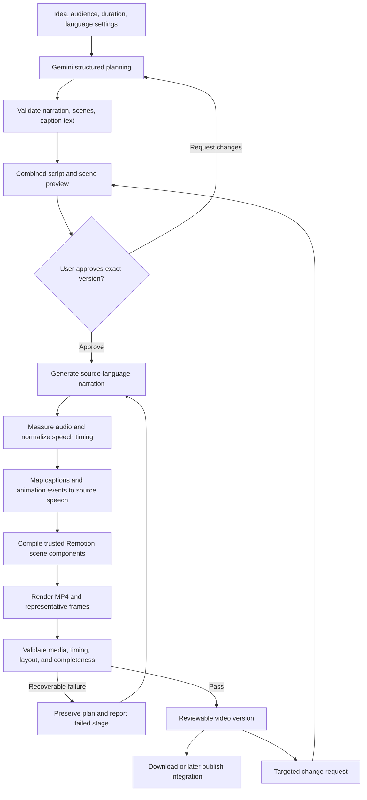

# VideoCraft: Pipeline Technical Design & Prototype Plan

| Field | Value |
|---|---|
| Version | 1.1 |
| Date | 19 October 2026 |
| Status | Approved for local prototype implementation by the user on 19 October 2026; live AI evaluation remains pending credentials |
| Product reference | [Approved V1 PRD](PRD.md) |
| Intended use | Internal team MVP for Indian audiences |
| Experiment budget | Free allowances and local compute only; no paid activation |

This document specifies how to design and evaluate VideoCraft's video-production pipeline. The user has approved proceeding with the local prototype. It does not replace the PRD or describe the full application's final system architecture. See README.md for runnable prototype instructions and current limitations.

Earlier experimental code and offline sample outputs are separate draft work. They do not establish that Gemini planning, neural narration, Indian-accent delivery, or Telugu translation quality have passed a live end-to-end evaluation.

## Contents

1. [Purpose and boundaries](#1-purpose-and-boundaries)
2. [Pipeline architecture](#2-pipeline-architecture)
3. [Inputs, outputs, and contracts](#3-inputs-outputs-and-contracts)
4. [Planning and approval](#4-planning-and-approval)
5. [Voiceover generation and synchronization](#5-voiceover-generation-and-synchronization)
6. [Captions and translation](#6-captions-and-translation)
7. [Motion graphics and rendering](#7-motion-graphics-and-rendering)
8. [Revisions, versions, and artifact reuse](#8-revisions-versions-and-artifact-reuse)
9. [Execution, errors, and recovery](#9-execution-errors-and-recovery)
10. [Application integration boundaries](#10-application-integration-boundaries)
11. [Data and storage plan](#11-data-and-storage-plan)
12. [Prototype implementation sequence](#12-prototype-implementation-sequence)
13. [Dependencies and setup checklist](#13-dependencies-and-setup-checklist)
14. [Prototype completion criteria](#14-prototype-completion-criteria)

## 1. Purpose and boundaries

### Questions the prototype should answer

- Can one reviewed idea become a clear educational explainer through an automated pipeline?
- Can Indian-English and Telugu narration sound natural enough for the team's intended audience?
- Can diagrams, labels, and motion events follow the actual spoken explanation?
- Can subtitles in the selected video language remain accurate, readable, and correctly timed?
- Can a targeted correction preserve approved work and avoid rebuilding unrelated assets?
- Can the selected free/local tools support this experiment without activating paid services?

### Agreed product boundaries

- User experience remains **Plan → Generate → Publish**. Internal stages are not additional dashboard pages.
- AI proposes narration and visual scenes together; the user approves the combined plan.
- Spoken languages are English and Telugu. English uses a curated Indian-accent voice; accent and language are independent settings.
- One language choice controls narration and subtitles together: English with English subtitles, or Telugu with Telugu subtitles. No separate subtitle-language setting or cross-language output.
- Visuals use accurate illustrations, diagrams, arrows, charts, and purposeful motion. No arbitrary conversations, avatars, or photorealistic footage generation.
- V1 uses individual sign-ins with one shared team workspace.
- Initial experiments are free only. Public launch validation, scaling, subscriptions, dedicated backups, and disaster recovery are deferred.

### Scope of this document

Define production contracts, synchronization, rendering, revision behavior, failure handling, and a staged prototype plan. Describe where Next.js, MongoDB, R2, and Meta will connect, while leaving detailed application endpoints, deployment topology, and database indexing to the subsequent system architecture document.

## 2. Pipeline architecture



Recovery resumes the appropriate failed stage; it does not always restart speech as the simplified diagram might suggest. Publishing and scheduling consume a ready approved video and are a separate subsystem.

### Proposed components

| Component | Responsibility |
|---|---|
| Planner | Produce structured narration, scene intent, captions, and review notes |
| Plan validator | Enforce supported schema, templates, IDs, language, and content bounds |
| Speech adapter | Generate the approved narration using an explicitly selected provider/voice |
| Timing normalizer | Convert provider timing or validated phrase timing into a common source-audio map |
| Caption mapper | Attach matching or translated text to source phrase windows |
| Scene compiler | Resolve approved animation events into a deterministic frame timeline |
| Renderer | Produce the real video, poster, and QA frames using trusted components |
| Output validator | Check media integrity and record required human review |
| Job coordinator | Persist stage, attempt, version, artifacts, and actionable errors |

## 3. Inputs, outputs, and contracts

### Input brief

| Field | Meaning |
|---|---|
| Idea | Topic or selected brainstorm angle |
| Learning objective | One concept the viewer should understand |
| Audience | Defaults to beginners; can be changed |
| Target duration | Product supports 30, 60, and 90 seconds; begin the experiment at 30 seconds |
| Spoken language | `en` or `te` |
| Accent preference | Separate delivery setting, mapped only to compatible curated voices |
| Voice | Actual provider/model/voice combination selected after listening tests |
| Caption mode | Match narration, English, or Telugu |
| Reference text | Optional supplied knowledge; no implied live research |
| Visual settings | Shared brand colors/logo and the approved educational style |

### Approved plan contract

```text
PlanVersion
  schemaVersion, planVersionId, workspaceId
  title, learningObjective, audience, targetDuration
  spokenLanguage, accentPreference, voiceSelection
  captionLanguage = spokenLanguage // derived output metadata, not an input control
  narrationSegments[]
    segmentId, exactText
  scenes[]
    sceneId, templateId, narrationSegmentIds[]
    labels[], visualElements[], animationEvents[]
  captionSegments[]
    captionId, sourceSegmentIds[], language, exactText
  suppliedReferences[], reviewNotes[]
  settingsSnapshot, templateVersions
```

An animation event references a source segment, an unambiguous word/phrase occurrence, and an optional intentional offset. Model-estimated seconds are planning hints, not final audio timing.

### Timing and render contracts

```text
SourceTiming
  sourceAudioId, sampleRate, actualDuration
  segments[]: segmentId, start, end, timingMethod, qualityFlags
  optionalWords[]: segmentId, occurrenceId, text, start, end

RenderManifest
  approvedPlanVersionId, approvalId, sourceAudioId
  sourceTimingId, captionVersionId, sceneTimelineId
  exactProviderModelVoice, rendererAndTemplateVersions
  resolution, fps, codecs, actualDuration
  outputArtifacts[], validationResults[], reviewStatus
```

Stable IDs connect the script, audio, captions, animation, and revisions. Output is a versioned artifact, not merely a URL overwritten whenever the project changes.

### Expected artifacts

Reviewed plan, source narration audio, normalized timing, matching-language subtitle text, render manifest, MP4, poster/representative frames, and optional SRT for inspection. A completed provider request alone is not a completed video.

## 4. Planning and approval

1. Accept the idea and saved defaults. Brainstorming is optional.
2. Ask Gemini for a structured explanation and supported visual plan.
3. Validate schema, stable IDs, scene order, narration coverage, language, text length, and supported visual components.
4. Prepare subtitles from approved narration in the selected language, preserving source segment links.
5. Present narration, scene summaries, and caption language/text together.
6. Save an approval record against the exact plan/settings version before generation.

The planner should prefer a clear hook, concise explanation, practical example where useful, and recap. Scene count follows clarity and duration rather than a mandatory number of cards.

Factual claims must be consistent with supplied references. Flag uncertain or contradictory material; never invent statistics, sources, or research claims. Model-generated text cannot override application instructions or become executable code.

### Model direction

Start with `gemini-3.8-flash` for structured planning and translation, subject to live free-tier account access. Store model IDs in configuration so changing a model does not change the plan contract. Schema-valid output still requires semantic and language review.

## 5. Voiceover generation and synchronization

### Voice selection

Initial ElevenLabs candidate: `eleven_v3`, supporting English and Telugu. Evaluate actual voices for Indian-English delivery, Telugu pronunciation, pace, names, and technical terms. The earlier Multilingual v2 suggestion is not the Telugu default because its documented language list excludes Telugu.

The interface must not treat an Indian accent as a language. Selecting Telugu changes the narration text; selecting an accent changes compatible delivery/voice choices. Do not expose unsupported accent combinations.

### Speech production

Generate only approved narration. Prefer natural sentence groups; avoid resetting vocal delivery for every word. Normalize sample rates and account for pauses or edits introduced during assembly.

Prefer native provider timing when available. Normalize original versus spoken text where numbers, abbreviations, or punctuation are expanded. An unresolved mapping blocks dependent cue generation or requires repair.

### Synchronization order

1. Produce narration and measure actual audio duration.
2. Establish source segment/word timing using a validated method.
3. Resolve each animation event against its source anchor.
4. Apply designed lead/lag offsets explicitly.
5. Map captions to source windows.
6. Render deterministically from the compiled frame timeline.

At 30 fps, time-to-frame rounding is approximately 16.7 ms at most; the larger uncertainty is usually the quality of the underlying speech alignment. Phrase timing must be labeled phrase-level and must not be presented as validated word alignment.

### Duration handling

Use actual audio, not word count, to set the timeline. Preserve natural delivery and readable visuals. If a script materially overruns its target, propose a concise revision for approval; never clip narration. Distribute short visual-reading pauses deliberately instead of adding a long empty ending.

### Free-only alternative

An explicitly selected eligible Gemini TTS free-tier path (`gemini-3.8-flash-tts`) may be used for permitted experiments. Validate Telugu and Indian delivery with actual samples. Missing access must pause the path; never silently change provider/voice or activate paid fallback.

Offline robotic speech may help diagnose rendering when credentials are absent. It cannot pass the neural narration or Indian-accent quality gates. No API credentials are needed to review this design document.

## 6. Captions and translation

| Selected video language | Subtitles | Required behavior |
|---|---|---|
| English | English automatically | English text follows English speech |
| Telugu | Telugu automatically | Telugu-script text follows Telugu speech |

Generate subtitle cues from the approved narration in the selected language, preserving IDs, names, numbers, units, and negation. Review the text before rendering. Cross-language subtitles and a separate subtitle selector are outside V1.

Use measured source phrase windows. Split a cue within its phrase window or propose a shorter approved narration revision when needed; do not silently shorten the spoken content.

Captions use at most two readable lines and safe positioning. Telugu uses Telugu script and a bundled shaping-capable font. Test conjuncts, vowel marks, long words, and line breaks in actual rendered frames. Romanized Telugu and simultaneous dual-language subtitles are deferred.

Diagram labels follow the selected video language. Changing that language invalidates approval before regeneration and does not alter the Instagram post caption.

## 7. Motion graphics and rendering

### Visual direction

Use one coherent educational system: recognizable illustrated objects, accurate diagrams, arrows, process sequences, comparisons, charts, and short labels. Brand settings change presentation without changing the explanation's meaning.

The planner selects trusted components and fills validated properties. The renderer must not execute arbitrary code generated by AI. Supported templates should have explicit layout bounds and compatible animation events.

### Suggested first example

Water cycle: overview → sun heats water → vapour rises → droplets/clouds form → rain falls → water collects. Each visual event should follow its specific narrated phrase. For example, falling rain should begin at the precipitation explanation, not simply because a new scene started.

This is an initial evaluation topic, not a product restriction to water-cycle videos. A second topic should test a different visual structure before generalizing the scene system.

### Render profile and execution

- Target vertical 1080×1920, 30 fps, H.264 MP4 with AAC audio.
- Use final source timing and approved captions in the exported file.
- First validate the renderer locally; this separates media correctness from cloud-hosting setup.
- Then benchmark Remotion on Vercel Sandbox if permitted free access is available.
- Persist outputs to Cloudflare R2 before a sandbox is torn down; temporary render storage is not final storage.
- Keep Vercel application routes short-lived; rendering is a separately tracked task.

Remotion documents Vercel Sandbox rendering. Availability and budget must still be checked in the actual account. If no allowed free hosted path is available, report that limitation and retain local evaluation; do not purchase infrastructure.

### Validation

Check actual codecs, dimensions, audio presence, duration, complete scene coverage, captions, and representative frames. Human review checks intelligibility, educational meaning, and semantic animation timing. Metadata checks cannot prove pronunciation, translation accuracy, or visual correctness.

## 8. Revisions, versions, and artifact reuse

| Requested change | Invalidate | Potential reuse |
|---|---|---|
| Narration wording/meaning | Affected speech, timing, captions, cues, final render | Unchanged scene assets and unrelated speech where stitching remains natural |
| Spoken language or voice | Source speech, timing, affected caption mappings/cues, render | Approved visual structure if still appropriate |
| Caption language/text | Caption version and final render | Source narration/audio and compatible scene timing |
| Colors/logo | Visual settings and final render | Narration, source timing, caption text |
| Visual event/example | Affected scene plan/timeline and render | Unchanged source audio if narration remains valid |
| Project title/post caption | Relevant metadata only | Existing video |

Fingerprint artifacts using their real dependencies: approved text, provider/model/voice, audio normalization, template version, timing version, and settings. A cached file's existence is insufficient without matching dependencies and integrity checks.

Changes create a proposed version and a concise summary for approval. Keep the previous ready version available. Recalculate downstream offsets whenever an earlier audio segment changes length.

Existing scheduled posts retain their exact version/caption/account/time snapshot. A newer draft never silently replaces scheduled or published content.

## 9. Execution, errors, and recovery

### Proposed job states

`plan ready → approved → queued → speech → timing → captions/scenes → rendering → validating → ready`

Record `failed`, `paused`, or `cancelled` separately, along with the failed stage and actionable reason. Source plan/settings remain available.

### Essential recovery rules

| Condition | Response |
|---|---|
| Malformed AI plan | Validate; bounded repair or request a new proposal; no render |
| Missing key / free access unavailable | Pause integration; no paid fallback |
| Rate limit | Respect retry guidance; preserve work; avoid blind repeated requests |
| Empty, clipped, or wrong-language audio | Fail speech validation and retry only after identifying the cause |
| Unresolved speech/caption anchor | Repair timing/mapping before output is marked ready |
| Missing font or overlapping labels | Correct layout/font and re-render affected output |
| Renderer interruption | Keep saved plan and valid artifacts; allow retry/regeneration |
| Final storage failure | Keep job incomplete; retry upload before announcing readiness |
| Duplicate submit / queue redelivery | Reuse the matching intent or atomically claim one job |
| Concurrent teammate edit | Reject stale approval/version; preserve both members' work |
| Cancel during an external request | Best effort; do not promise that submitted provider work can be undone |

Persist job/version identifiers and basic errors. A simple single-render queue is enough for the initial team MVP. Dedicated backups, disaster recovery, public-scale infrastructure, and comprehensive intermediate recovery are not prototype gates.

## 10. Application integration boundaries

| Application component | Pipeline boundary |
|---|---|
| Next.js / Node.js | Validate requests, save approval, submit job, return progress/artifacts |
| Auth.js Google sign-in | Identify each member; enforce approved team membership |
| Shared workspace | Shared projects/brand/connection, individual actor history, stale-edit protection |
| MongoDB Atlas | Store briefs, plan versions, approvals, timing/artifact metadata, job state |
| Cloudflare R2 | Store video, narration, poster, and other media objects privately |
| Vercel | Host app; evaluate separate render and scheduler execution within actual free access |
| Instagram | Consume an exact ready version and explicit publishing approval |

Use the PRD's three-stage experience. Do not turn the internal speech/alignment/rendering sequence into separate mandatory pages.

The later full system architecture should specify API endpoints, MongoDB indexes/atomic operations, membership enforcement, secret handling, render dispatch, scheduling, and deployment. Base those decisions on measured prototype behavior rather than assumed throughput or cost guarantees.

## 11. Data and storage plan

Prototype-local storage can hold a reviewed plan, source audio, timing, render manifest, and generated media. Keep credentials in a Git-ignored local environment file, never inside plans or render inputs.

The application later stores documents in MongoDB with a shared `workspaceId`, plus creator/editor/approver IDs. Video binaries belong in R2, with storage keys and checksums in metadata. A member's sign-out/removal must not delete shared team content.

Private artifacts receive scoped temporary download URLs. The Meta fetch path must remain valid for its actual processing window. Deleting a local project does not retract an already published Instagram post.

Versioned final artifacts stay associated with their approved inputs. Basic temporary-file cleanup is sufficient initially; detailed retention schedules and backup promises remain deferred.

## 12. Prototype implementation sequence

These are proposed future steps. Review this design before authorizing the next implementation milestone.

| Stage | Planned work | Evidence to review |
|---|---|---|
| P0 — Design review | Confirm contracts, voices/languages, free-only constraints, and prototype gates | This document |
| P1 — Local renderer | One curated script, accurate animated scenes, local fonts, deterministic timing | Real local video and scene frames; diagnostic audio clearly labeled if used |
| P2 — Live AI loop | Gemini plan → review/approval → permitted neural narration → real timing → Remotion output | One complete AI-produced explainer with source artifacts |
| P3 — Language selection | Exercise both narration languages with matching subtitles | Two outputs: English/English and Telugu/Telugu |
| P4 — Revisions/recovery | Change one phrase/visual, preserve unaffected artifacts, interrupt/retry a render | Version lineage, reuse record, recoverable failure |
| P5 — Cloud experiment | Benchmark permitted Vercel Sandbox path; persist final output to R2 | Measured time, verified stored output, documented free-access limits |
| P6 — Architecture refinement | Write the full application architecture using findings | Concrete application/data/job/deployment design |

Only after these results should the full dashboard, shared account flows, and publishing UI be built around the established contracts. Instagram setup can proceed separately when authorized and should not block local video-quality work.

## 13. Dependencies and setup checklist

### Design stage: no API credentials required

The user currently has no Gemini key. Do not make this document's completion depend on obtaining credentials, installing packages, or producing videos.

### Before live generation

- Confirm an eligible free-tier Gemini project and supported model access; keep billing disabled for experiments.
- Configure secrets locally/server-side, never through chat or committed files.
- Confirm actual ElevenLabs model/voice access and permitted use. Its free plan excludes commercial output; internal business use is not automatically noncommercial.
- If ElevenLabs access/rights require payment, use a permitted explicitly chosen free experiment path or pause it. No subscription or paid fallback is authorized.
- The user confirmed the organization has three or fewer people for Remotion free-license evaluation; recheck eligibility if the organization changes.
- Validate English/Indian delivery, Telugu pronunciation, font shaping, translation meaning, and timing before locking voice IDs.

### Before hosted rendering/storage

Verify Vercel/Remotion execution support, applicable plan terms, MongoDB/R2 access, available free allowances, output persistence, and scheduler cadence. Free allowances are not a guarantee of unlimited hosting or always-on execution.

### Parallel Meta setup checklist for a later integration step

1. Create/configure the team's Meta developer app.
2. Set the appropriate redirect URI and minimal required permissions.
3. Register/authorize eligible professional Instagram team/test accounts as required by the selected app mode.
4. Keep app secrets server-side; expose a **Connect Instagram** authorization button to members.
5. Verify actual authorization, media fetch, publishing status, and unknown-outcome reconciliation for the intended team account.

This checklist is preparation, not an implemented integration. Broad public-customer access is deferred. A manual key is not a replacement for the member-facing authorization flow.

### Primary references

- [Gemini structured outputs](https://ai.google.dev/gemini-api/docs/structured-output), [models](https://ai.google.dev/gemini-api/docs/models), [speech](https://ai.google.dev/gemini-api/docs/speech-generation), and [free-tier pricing](https://ai.google.dev/gemini-api/docs/pricing).
- [ElevenLabs model languages](https://elevenlabs.io/docs/overview/models), [timed narration](https://elevenlabs.io/docs/api-reference/text-to-dialogue/convert-with-timestamps), and [commercial-use guidance](https://help.elevenlabs.io/hc/en-us/articles/13313564601361-Can-I-publish-the-content-I-generate-on-the-platform).
- [Remotion on Vercel](https://www.remotion.dev/docs/vercel), [licensing](https://www.remotion.dev/docs/license/pricing), and [Vercel Sandbox quotas](https://vercel.com/docs/sandbox/pricing).
- [Auth.js Google](https://authjs.dev/getting-started/providers/google), [MongoDB adapter](https://authjs.dev/getting-started/adapters/mongodb), [Cloudflare R2](https://developers.cloudflare.com/r2/pricing/), and [Meta-maintained Instagram API documentation](https://www.postman.com/meta/instagram/documentation/6yqw8pt/instagram-api).

## 14. Prototype completion criteria

These are evaluation gates for a future prototype, not claims that the earlier draft implementation passed them.

- A real reviewed AI plan produces a complete explainable video, not merely successful API responses.
- Both language choices work: English narration with English subtitles, and Telugu narration with Telugu subtitles. There is no separate subtitle-language input.
- Start with a 30-second topic. Then verify representative 60- and 90-second cases using the PRD's duration windows and hard cap; never truncate speech to pass.
- The team accepts the selected Indian-English voice, Telugu voice, and Telugu-script rendering after listening/visual review.
- At least one second topic exercises a different diagram/comparison structure; the design is not accidentally limited to one hardcoded landscape.
- Subtitle/animation cues follow actual narration. Apply the PRD's timing targets against correct phrase/word anchors in the selected video language.
- All scenes are present; captions fit; no missing glyphs, unintended blank sections, clipped speech, or silent exports.
- At least one targeted revision demonstrates correct invalidation and reuse of unaffected artifacts.
- One controlled render failure can be retried without losing the saved plan or approved prior output.
- Record media properties, actual duration, latency, provider/voice choice, method of synchronization, free-access limitations, and human review notes.
- Cloud-render/R2 readiness is demonstrated separately if that stage is reached; local output does not prove hosted persistence or scheduling.
- No paid service, subscription, automatic top-up, or unapproved fallback is activated.
- Findings explicitly distinguish verified behavior, simulation/diagnostic behavior, and unresolved dependencies.

After design review, the next authorized milestone should be specified explicitly before more code is added.
