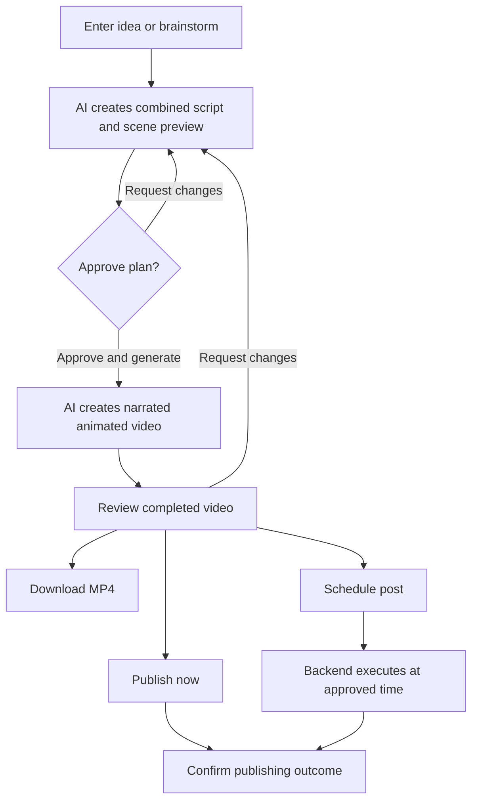
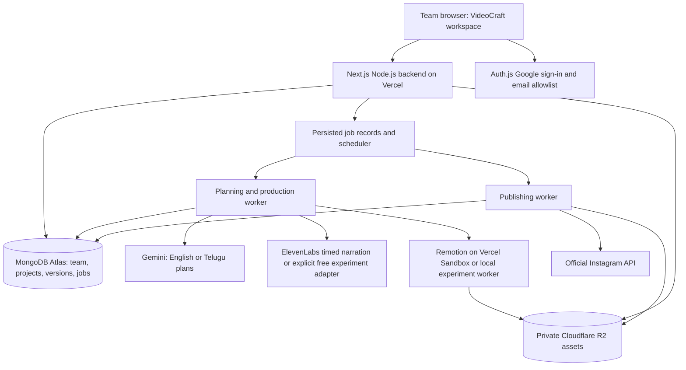

# Product Requirements Document

## VideoCraft — Internal MVP / V1

| Document field | Value |
|---|---|
| Version | 1.2 |
| Date | 19 October 2026 |
| Product name | VideoCraft |
| Status | Revised implementation baseline incorporating the agreed internal-team scope |
| Initial audience | The user's team creating educational content for Indian audiences |
| Experiment budget | Zero spend: free allowances or local experiments only; stop before paid usage |
| Business model | No customer billing in V1; subscriptions and usage plans deferred to V2 |

This document defines the product to build. It does not indicate that the application, provider accounts, or integrations are already implemented. Product scope reflects the user's decisions. Numeric operational defaults and performance targets are proposed engineering defaults to validate during prototyping, not measured results or provider guarantees.

## Contents

1. [Product definition](#1-product-definition)
2. [Audience and outcomes](#2-audience-and-outcomes)
3. [Scope](#3-scope)
4. [Experience and navigation](#4-experience-and-navigation)
5. [Detailed user flows](#5-detailed-user-flows)
6. [Functional requirements](#6-functional-requirements)
7. [AI and animation pipeline](#7-ai-and-animation-pipeline)
8. [Media and quality](#8-media-and-quality)
9. [Publishing and scheduling](#9-publishing-and-scheduling)
10. [States and data](#10-states-and-data)
11. [Edge cases and recovery](#11-edge-cases-and-recovery)
12. [Architecture and integrations](#12-architecture-and-integrations)
13. [Nonfunctional requirements](#13-nonfunctional-requirements)
14. [Measurement and acceptance](#14-measurement-and-acceptance)
15. [Delivery and launch gates](#15-delivery-and-launch-gates)
16. [Dependencies and V2](#16-dependencies-and-v2)
17. [Provider references](#17-provider-references)

## 1. Product definition

### Product promise

Turn an idea into a branded, 30–90-second educational explainer with AI narration, synchronized motion graphics, and captions. Let the user download it or publish it to Instagram immediately or at a scheduled time.

The user directs and approves. AI and the production system handle scripting, scene planning, narration, timing, animation assembly, captions, and rendering.

### Agreed decisions

- Focus V1 on educational explainers for creators, educators, and brands.
- Deploy first for the user's internal team. Public launch, customer validation, growth analytics, and scaling are not MVP gates.
- Make motion graphics central: diagrams, arrows, labels, comparisons, and sequences help explain the narration.
- Keep three stages: **Plan → Generate → Publish**.
- AI creates the script and storyboard. Show them together in one preview; no separate editor screens or manual storyboard construction are required.
- Approve the plan before generating; explicitly choose download, publish, or schedule after reviewing the video.
- Support 30-, 60-, and 90-second targets and vertical video.
- Support English narration with Indian accents and Telugu narration. Language and accent are separate controls, with compatible curated voices.
- One video-language selection controls narration and subtitles together: English with English subtitles, or Telugu with Telugu subtitles. No separate subtitle-language control or cross-language subtitles in V1.
- Use accurate illustrations, diagrams, charts, short text, and purposeful motion in one coherent educational style. Photographic/cinematic generation and random dialogue are outside V1.
- Use individual Google sign-ins with one shared team workspace, shared project library, and one shared brand kit.
- Include saved projects, basic branding, simple revisions, captions, and Instagram scheduling.
- V1 has no checkout, subscription tiers, customer credits, usage meters, paid feature gates, or customer generation allowances. Those belong to V2.
- Use Next.js/TypeScript with Node.js backend routes, Auth.js Google sign-in, MongoDB Atlas for data, Cloudflare R2 for video assets, and Vercel for application hosting.
- Use `gemini-3.8-flash` for English/Telugu planning. Initial ElevenLabs narration candidate: `eleven_v3`, which supports Telugu and English; validate actual voice quality and free-account access before enabling it. Multilingual v2 is unsuitable as the Telugu default because Telugu is absent from its documented language list.
- Use native provider timing where available and Remotion for rendering. Evaluate Vercel Sandbox rendering within free allowances; use local rendering during experiments if cloud access would cost money. Dedicated WhisperX infrastructure is not required for the initial path.
- Defer dedicated backups, disaster recovery, formal retention guarantees, and public-scale infrastructure. Keep ordinary saves, job status, basic error logs, retry, and deletion controls.

### Meaning of automation and free access

Automation covers production and an explicitly approved publishing action. V1 does not continuously invent topics or publish unreviewed content on its own.

Free access does not imply unlimited provider capacity. During initial experiments, use only free allowances and permitted free/local paths. If a provider would require payment or an allowance is exhausted, pause that integration and explain why; do not enable paid fallback or automatic top-ups. API limits and rendering capacity can produce a queue, not a customer usage plan.

Provider free-tier permission matters as well as price. Internal business use is not automatically noncommercial use. The ElevenLabs free plan excludes commercial use, so its free output is limited to permitted evaluations. Use the explicitly selected Gemini free-TTS/local prototype path for team material when ElevenLabs rights or access do not fit; do not silently substitute voices or bypass terms. See section 12.

## 2. Audience and outcomes

| User | Need | Example |
|---|---|---|
| Educational creator/coach | Explain knowledge regularly without learning animation software | A 60-second lesson on active recall |
| Educator/subject expert | Make concepts understandable through narration and visuals | A 90-second explanation of the water cycle |
| Brand owner/marketer | Publish consistent educational content related to a category | A 30-second explanation of how sunscreen works |

The first release is an internal tool for the user's team. Each member signs in individually to one shared workspace. Members can see and work on shared projects; record the actor behind approvals, edits, and publishing. Separate client workspaces, complex roles, comments, presence, and real-time collaborative editing are outside scope.

### Jobs to be done

- Turn a known topic into a concise explanation and a finished video.
- Turn a vague idea into a useful angle and learning objective.
- Show a relevant visual at the moment its concept is narrated.
- Correct content through a plain-language request without operating a timeline.
- Download or publish without moving files between multiple tools.
- Preserve the exact video, caption, destination, and time approved for a scheduled post.

### Outcomes

A team member finishes the happy path without dedicated script, storyboard, or animation editors. Output explains one coherent topic in English or Telugu, needs little correction, and is usable on Instagram. Team members can reopen shared work. Basic timing/error telemetry helps improve the pipeline; public adoption validation is not required.

## 3. Scope

### Required V1 capabilities

| ID | Capability | Boundary |
|---|---|---|
| FR-01 | Account/workspace | Individual Google sign-in, approved team membership, one shared workspace |
| FR-02 | Projects | Create, rename, reopen, duplicate, delete, and inspect state |
| FR-03 | Idea planning | Topic input, optional brainstorming, audience, duration, pasted references |
| FR-04 | AI plan | Combined narration and scene preview, optional edits, approval |
| FR-05 | Branding/styles | One shared brand kit, curated English/Telugu voices, separate language/accent controls |
| FR-06 | Production | Speech, timing, motion graphics, subtitles matching narration, rendering, validation |
| FR-07 | Preview/revisions | Playback, text-based changes, regeneration, previous versions |
| FR-08 | Download | MP4 export of a completed version |
| FR-09 | Instagram connection | One eligible account, health, reconnect, disconnect |
| FR-10 | Publishing/calendar | Publish now, schedule, reschedule, cancel, inspect results |
| FR-11 | Persistence/recovery | Autosave, durable background jobs, progress, retry |
| FR-12 | Internal operations | Free-only provider configuration, basic error logs, job status, safe retry |

All capabilities are required for complete V1. Instagram must work for the intended internal team's eligible account; public-customer access approval is not an MVP gate. Export remains useful while team-account integration is being configured, but does not replace the publishing requirement.

### Outside V1

- Billing, payments, customer quotas, subscriptions, usage-based pricing, credits.
- Languages beyond English and Telugu, voice cloning, avatars, cinematic generated footage, and photographic-media sourcing.
- Full timelines, arbitrary scene code editing, advanced video editing controls.
- Long-form output, landscape/square exports, multiple variants per render.
- PDF/deck imports, webpage scraping, stock search, paid image-generation dependency.
- Background music and sound effects; narration is the required audio track.
- Complex team roles, real-time collaboration, client workspaces, multi-brand management, multiple Instagram connections.
- Other social platforms, importing social media, editing/deleting external posts, social analytics, comments.
- Recurring unattended idea-to-post automation.
- Public sign-up, market-validation studies, growth experiments, scaling work, dedicated backups, and disaster recovery.

## 4. Experience and navigation

| Surface | Purpose |
|---|---|
| Projects | Signed-in landing page; prominent idea/new-project input and existing projects |
| Project workspace | Idea conversation, combined plan, progress, preview, revisions, publishing |
| Calendar | Scheduled posts and recent publishing activity |
| Settings | Account, shared defaults, branding, language/voice preferences, timezone, Instagram connection |

The workspace is the primary production surface. Desktop is the primary creation layout. Mobile supports entering ideas, review, approval, scheduling, and status checks.

### Progressive disclosure

- Main prompt: **What would you like to explain?**
- Duration and video language are visible. Accent and voice are separate compatible controls with saved defaults. Subtitles automatically use the selected video language; there is no independent subtitle-language choice.
- Audience, branding, and visual theme have defaults. Selecting Telugu never just applies an Indian accent to English text; it generates Telugu narration.
- Brainstorming is optional. A clear idea goes directly to **Create plan**.
- Narration and scene summaries appear in one combined preview. Scene details can expand inline.
- Edits use a single change-request field or optional direct narration editing.
- Publishing controls open within the workspace. Provider authorization may redirect and then return to the same project.
- No required brand wizard or Instagram connection before creating a video.
- Show only actions valid for the current state; avoid unnecessary confirmations for routine changes.

| Stage | Primary action | Other actions |
|---|---|---|
| Idea | Create plan | Brainstorm, adjust defaults, add references |
| Plan ready | Approve & generate video | Request changes, edit narration |
| Rendering | View progress | Leave safely, request cancellation |
| Video ready | Publish / schedule | Play, download, request changes |
| Scheduled | View scheduled post | Reschedule, cancel, inspect snapshot |

## 5. Detailed user flows

The branches are optional actions inside the three-stage experience, not separate mandatory dashboard pages.

### 5.1 First-time account to first video

1. Sign in with Google. Check the approved-email allowlist before granting team access; no public registration wizard.
2. Land in the shared team's Projects with an idea input. Branding and Instagram setup are optional.
3. Enter a topic; choose English or Telugu once for narration and subtitles, with separate compatible accent/voice controls. Defaults: English with Indian accent, English subtitles, general/beginner audience, and 60 seconds.
4. Click **Create plan**. Save a project and show a truthful planning state.
5. AI returns the learning objective, narration in the selected language, scene explanations, same-language subtitle text, estimated duration, and review notes together.
6. Accept the plan or request changes in the same workspace.
7. Click **Approve & generate video**. Save approval against that exact version and settings, then start a background job.
8. Show production stages: creating narration, matching visuals to speech, rendering, checking output.
9. After validation, display playback, download, revision, and publishing actions.
10. Download, connect Instagram and post, or schedule. Show confirmed results and a post link when available.

### 5.2 Brainstorming

1. Enter a rough topic or choose **Help me find an idea**.
2. AI proposes three distinct educational angles with hooks and learning objectives.
3. Select an angle, request alternatives, or combine suggestions in text.
4. AI can ask one focused question if essential; otherwise use reasonable defaults.
5. The chosen idea becomes the brief; **Create plan** enters the standard flow.

An empty request does not silently generate random content. Offer examples or ask for a subject.

### 5.3 Change the plan

1. Enter a request such as “Explain this to a 12-year-old and replace the second example.”
2. AI creates a new proposed version and a short change summary.
3. Preserve the earlier proposal. No rendering starts automatically.
4. User approves the current proposal with **Approve & generate video**.

Direct narration edits also require saving, duration/scene recalculation, and approval of the revised plan.

### 5.4 Revise a completed video

1. Watch and request a change in plain language.
2. Create a new proposed version, identifying affected scenes/assets.
3. Approve a compact change summary in the same workspace and regenerate.
4. Reuse unaffected assets if their dependencies are unchanged.
5. Keep the previous ready video available while the new version renders.
6. The new version becomes latest on success; older completed versions stay accessible.

Narration changes require new speech/alignment for affected content. Color-only changes can reuse audio. Timing changes require downstream offsets to be recalculated.

### 5.5 Download

1. Select Download on a ready version.
2. Backend checks current team membership, project workspace, and output availability, then issues a temporary URL.
3. Download a descriptively named MP4, with no Instagram connection required.
4. An expired link is refreshed without regenerating the video.

### 5.6 Connect Instagram

1. Choose Connect Instagram in Settings or publishing controls.
2. Save the return destination and start official OAuth with state validation.
3. Retrieve account identity and verify eligibility/permissions after authorization; save one shared team connection and record who authorized it.
4. Show connected handle/status and return to the originating project.
5. Denied authorization, missing permissions, or ineligibility returns to the same project with a recovery action.

Connection alone never publishes anything. The product never asks for an Instagram password.

An operator configures the Meta app ID/secret and redirect URI server-side. Team members use the button, not pasted API keys. Credentials are configured through environment/secrets settings rather than chat messages or project text.

### 5.7 Publish now

1. Open publishing controls for a ready version.
2. Show the exact video, destination handle, editable generated post caption, and cover frame.
3. **Publish now** approves that publishing payload.
4. Persist a unique publishing intent; preflight connection, caption, and media.
5. Make media available through a controlled fetch URL; create/monitor the provider media container and publish when ready.
6. Persist the confirmed media ID and retrieve its public link where available.
7. Show Published only after provider confirmation. An uncertain result shows Checking publication status and enters reconciliation.

### 5.8 Schedule

1. Open the same controls and choose date, local time, and timezone.
2. Show an absolute readable confirmation including timezone and UTC offset.
3. **Schedule post** approves a snapshot of version, caption, cover, account, and time.
4. Add to Calendar and retain its media until the intent is resolved.
5. Backend checks connection health and executes near the selected time.
6. Show Scheduled, Publishing, Published, Needs reconnection, Failed, or Missed accurately.

Scheduling survives browser closure. A backend scheduler/worker executes it; browser timers and long-running requests do not.

### 5.9 Reschedule, cancel, replace

- Rescheduling atomically changes the schedule revision; stale queued tasks become no-ops.
- Cancellation invalidates an unstarted intent and is confirmed by the backend.
- A newly generated video does not change an existing scheduled post. Explicitly select the new ready version and confirm replacement.
- If provider submission has begun, cancellation/replacement may no longer be possible. Show and reconcile the actual outcome.

## 6. Functional requirements

### FR-01 — Account and workspace

- Google sign-in through Auth.js with session recovery and preserved return destination.
- An operator-configured approved-email allowlist controls access to one private shared workspace. Initial allowlist maintenance can use server configuration; an invitation/roles management UI is outside V1.
- Approved members can create, read, revise, render, download, and publish shared projects. Track creator, last editor, approver, and publisher individually. Recheck membership for every protected request.
- Workspace branding and Instagram connection are shared. The settings UI states when a change affects the team. Personal language/voice/timezone preferences do not silently alter shared saved projects.
- Nonmembers cannot access workspace data even if Google authentication succeeds; removing a member invalidates further access.
- Sign-out does not cancel rendering or approved schedules.
- Removing a personal sign-in does not delete the team's shared projects or schedules. A maintainer can remove membership; shared project deletion remains an explicit separate action. Already published posts remain external.

### FR-02 — Projects

- Show title, thumbnail, last update, latest video state, and publishing state independently.
- Sort by recent update; support title search and simple state filters.
- Duplicate copies brief and editable plan, without approval, active jobs, schedules, or publishing history.
- Rename changes metadata only; it does not invalidate video output.
- Deletion asks for confirmation when jobs/schedules are active and follows race handling in section 11.
- Show the creator/last editor on shared projects. A concurrent teammate's change triggers a revision conflict rather than a silent overwrite.

### FR-03 — Brief and references

- Require a nonempty idea or a selected brainstorm suggestion.
- Defaults: English narration, Indian accent, matching English captions, 60 seconds, beginner/general audience, curated voice, clean educational theme, branding off until configured.
- Telugu selection uses Telugu-script narration, Telugu-compatible voices, and Telugu subtitles automatically. English selection uses English narration and English subtitles automatically.
- Accept pasted reference text; distinguish user-supplied references from unsourced model knowledge.
- Treat references as content rather than instructions that override the application.
- Proposed bounds: idea 2,000 characters; reference text 20,000; change request 2,000; title 120. These are technical input limits, not generation quotas.
- Narrow an overly broad topic to one useful learning objective, visibly in the plan.
- Do not claim live research, source verification, or webpage retrieval when these have not occurred.

### FR-04 — Combined plan and approval

- Include title, objective, full narration, ordered scenes, animation descriptions, estimated duration, references, review notes, spoken language, accent/voice, and caption language/text.
- Visual explanations must cover the narration without introducing unsupported additional claims.
- Keep narration and storyboard together. All editing is optional.
- Approval belongs to an exact saved plan/settings version. Narration, language, accent/voice, caption language/content, scene meaning, duration, style, or branding changes require new generation approval. Caption-only changes can reuse unchanged audio/timing.
- Project title and post-caption changes do not invalidate a video.
- Late planning responses cannot overwrite a newer brief/version.

### FR-05 — Branding and presentation

- One shared logo, primary/secondary colors, and curated fonts supporting English and Telugu shaping.
- Start with one clean educational visual system: accurate illustrated objects, diagrams, arrows, charts, short text, and restrained motion. Preserve physical/process accuracy; avoid random characters or conversations. Brand colors vary this system without requiring three separate style libraries.
- Spoken language, accent, and voice are distinct settings. Offer a small tested selection for English/Indian-accent delivery and Telugu. Filter compatibility, show unavailable combinations clearly, and provide samples in the selected language. Do not invent accent options unsupported by a voice.
- Treat named voice IDs as configuration to select by listening tests, not an assumed universal accent parameter. Curated fonts must preserve Telugu conjuncts and vowel marks.
- Logo formats: PNG/JPEG/WebP; proposed maximum 5 MB and 4,096 pixels per dimension. Validate decoded content and preserve aspect ratio/transparency. Arbitrary SVG uploads are outside V1.
- Check contrast and use readable fallback colors. Branding cannot make explanations unreadable.
- Updating defaults affects new work; completed versions/schedules retain their settings snapshots.

### FR-06 — Generation

- Start only from a saved approved plan; duplicate requests return the same matching job.
- Stages: plan validation, speech, alignment, scene compilation, rendering, output validation, persistence.
- Display stage labels and genuine state, without invented progress percentages or exact completion promises.
- Jobs survive browser closure, session expiration, and worker restart.
- Support best-effort cancellation; provider requests already submitted may still complete.
- Preserve valid completed stages for bounded retries. Missing/blank/silent output is never reported as success.

### FR-07 — Playback and revisions

- Preview the real render with play/pause, seek, volume, actual duration, and an accompanying transcript.
- Accept wording, example, voice, caption appearance, and branding changes within supported templates.
- Unsupported requests get a useful explanation and supported alternative.
- Preserve completed versions until project deletion. Users can select older ready versions for download/publishing.
- No timeline, layer editing, or user code is required.

### FR-08 — Export

- Export one validated vertical MP4 profile with narration and burned-in captions; add no product watermark.
- Downloads remain available independently of Instagram connection/permissions.
- Authorize downloads by current team membership and workspace. Permanent public project-sharing links are outside scope.

### FR-09 — Instagram connection

- Use official Instagram Login/publishing for eligible professional accounts; verify live account access during the integration prototype.
- Request only necessary identity/publishing permissions; no comment/messaging access without a feature need.
- Show handle, connection status, reconnect, and disconnect.
- Encrypt credentials server-side; track validity and refresh where the selected flow permits.
- Disconnect pauses pending intents. Reconnect must match the original account before reviewed resumption.
- Switching accounts never silently redirects older schedules to the new handle.
- The connection belongs to the workspace, not just the member who authorized it. Disconnecting warns that all team schedules for that connection will pause.

### FR-10 — Publishing and calendar

- Publish now or schedule completed, reviewed videos one time.
- Generate an editable caption from the approved explanation. Optional hashtags are relevant/editable; no virality promises.
- Let the user choose an existing video frame for the cover. If unsupported by the selected API path, show the fallback before submission.
- Initial product caption bound: 2,000 characters, subject to stricter current provider validation. This is our product bound, not Meta's stated maximum.
- Calendar provides month/list views, timezone, details, reschedule, cancel, and recent activity.
- One unresolved intent per project/destination at a time. Duplicate submissions reuse it. After resolution, intentional reposting creates a new intent with a notice if the same version was published before.
- Persistent in-app activity notifications are required. Email notifications are outside V1.
- Keep subtitle/caption language distinct from the Instagram post caption. Translating video subtitles does not silently translate or overwrite the post caption.

### FR-11 — Save and recovery

- Autosave after approximately two seconds of inactivity, showing Saving/Saved/Unable to save.
- Block approval of unsaved changes; retry saving and offer copying unsaved text if offline.
- Revision checks prevent silent multiple-tab overwrites.
- Separate editing, rendering, and publishing state so a new draft does not hide an older scheduled version.

### FR-12 — Internal operations

- Keep basic job progress, stage duration, retries, errors, and free-allowance status. A formal analytics/alerting platform is outside the internal MVP.
- Configure provider/model IDs, templates, credentials, worker capacity, and retry policies securely.
- A service-wide provider outage/budget pause preserves projects and explains the delay.
- Never translate provider budget failure into a customer payment prompt or credit deduction in V1.
- Default experimental execution to one render at a time for the whole team. This is capacity management, not a member quota. Do not enable a paid provider/host path or top-up without a later explicit spending decision.

## 7. AI and animation pipeline

### Stage contracts

| Stage | Input | Output | Validation/recovery |
|---|---|---|---|
| Brainstorm | Topic, audience, conversation | Angles/objectives | Reject empty output; preserve input |
| Plan | Brief, references, duration, language, theme | Structured narration/scenes | Schema, supported templates, coverage, text bounds |
| Approve | Saved plan/settings | Immutable approval | Reject stale versions |
| Speech | Approved narration, language, accent/voice | Audio, measured durations, native timing if available | Reject wrong language, empty/clipped/extra speech |
| Alignment | Exact audio, approved narration, native timing | Source-language word/phrase timing map | Coverage, monotonic timing, repair/retry |
| Captions | Source phrase IDs/timing, approved caption language/text | Matching or translated subtitle cues | Meaning/number preservation, readable length, timing, Telugu shaping |
| Compile | Plan, timing, assets | Deterministic timeline | Resolve anchors, validate layouts/values |
| Render | Timeline/assets | MP4, poster, metadata | Fail missing assets/timeouts/invalid frames |
| Validate | Render/source metadata | Ready or recoverable failure | Media, duration, narration, caption/timing checks |
| Publish | Approved payload | Confirmed media ID/status | Reconcile uncertain outcome before retry |

### Structured plan

Use an application-owned JSON schema through Gemini structured output. Schema validity is separate from factual accuracy and requires application checks. [Gemini documentation](https://ai.google.dev/gemini-api/docs/structured-output)

Minimum fields:

| Field | Purpose |
|---|---|
| `schema_version`, `plan_version_id` | Contract and version identity |
| `title`, `learning_objective`, `audience` | Intended explanation |
| `target_duration_seconds`, `spoken_language`, `accent_id`, `voice_id`, `caption_language` | One selected `en`/`te` language; `caption_language` is derived from `spoken_language`, never independently selected; accent/voice remain separate |
| `narration_segments[]` | Stable IDs and exact text to speak |
| `caption_segments[]` | Source segment IDs, caption language, approved text, phrase-to-audio mapping |
| `scenes[]` | Scene IDs, narration references, supported template, visual elements, animation cues |
| `references[]`, `review_notes[]` | Provenance and factual review needs |
| `settings_snapshot` | Voice, theme, brand, caption, template versions |

Cues reference a narration segment and word/phrase occurrence plus a designed timing offset. Repeated words need an occurrence index or other unique anchor. Model-guessed timestamps are not the final timing source.

### Motion graphics system

Build reusable template families for:

1. Hook/title with a meaningful educational visual.
2. Labeled diagram/component explanation.
3. Process/flow with directional arrows.
4. Two/three-item comparison.
5. Step sequence/timeline.
6. Numerical example/chart using supplied or explicitly illustrative values.
7. Recap of the main takeaway.

Not every video needs every template. Choose the fewest scenes that explain the topic readably. AI selects templates/fills validated properties; Remotion renders trusted React/SVG components. Never execute arbitrary model-generated code.

A specialized concept the templates cannot represent accurately must be simplified visibly in the proposed plan before approval. Template creation and educational design are implementation work; the APIs alone do not provide the complete system.

### Worked example: a 60-second water-cycle explainer

| Scene | Narration intent | Visual behavior |
|---|---|---|
| Hook | Introduce how water travels through a cycle | Show a simple landscape with water, a cloud, and the sun |
| Evaporation | Explain liquid water becoming vapor | Reveal the label and animate upward arrows when the corresponding phrase is spoken |
| Condensation | Explain cooling vapor forming cloud droplets | Gather droplets into the cloud at the narration anchor |
| Precipitation | Explain water returning as rain | Animate downward droplets with the spoken explanation |
| Recap | Connect collection back to the cycle | Trace the loop and highlight the three main terms in narration order |

AI writes the exact narration and populates supported scene properties; the user reviews the combined plan. Speech alignment determines final timing. This is an illustrative educational layout, not a mandatory five-scene template for every topic.

### Narration, alignment, duration

- Generate speech before final scene timing; keep sentence groups natural and add intentional scene pauses.
- Initial ElevenLabs candidate is `eleven_v3`, supporting English and Telugu. Use its supported timed speech endpoint, or the single-voice `/v1/text-to-dialogue/with-timestamps` path, and normalize returned original/normalized character timing. The endpoint name does not imply multiple speakers or conversational output. Confirm model/voice/endpoint access in the actual free account. [Models](https://elevenlabs.io/docs/overview/models), [timed dialogue API](https://elevenlabs.io/docs/api-reference/text-to-dialogue/convert-with-timestamps)
- The previously discussed `eleven_multilingual_v2` and `eleven_flash_v2_5` are not Telugu defaults. Do not route Telugu text through an unsupported model merely because an Indian-accent voice is selected.
- Zero-spend alternative: explicitly selected `gemini-3.8-flash-tts` on an eligible free tier. Start with short narration phrases whose measured durations can anchor captions/scenes; evaluate finer alignment only if required. Do not silently replace the approved voice/provider. A local aligner can be evaluated later, with Telugu model availability tested first; WhisperX is not a mandatory dependency.
- Account for audio resampling, concatenation, inserted pauses, normalized numbers, and cumulative offsets when mapping provider timing to the final audio. Preserve the approved narration rather than replacing it with an unreviewed transcript.
- Use measured audio duration, not a word-count estimate, for final pacing.
- If audio does not fit, first adjust nonessential pauses and visual timing. Changes to narration wording/meaning require a proposed revision and approval.
- After bounded attempts, offer a shorter/expanded script rather than clipping speech, excessive speeding, or empty padding.
- Store target duration separately from actual output duration.

### English and Telugu subtitles

- Selecting English produces English narration with English subtitles; selecting Telugu produces Telugu narration with Telugu subtitles. No separate subtitle-language choice is exposed or accepted by the generation API.
- Build subtitle cues from the approved narration in the selected language, preserving phrase IDs and measured source-speech windows.
- Preserve names, units, negation, and numerical values. A Telugu-speaking team member reviews Telugu narration and subtitles in the evaluation set.
- If subtitle text is too long for readable cues, split it within mapped phrase windows or propose a concise narration revision for approval; never drop words or change the audio silently.
- Use Telugu script for Telugu subtitles. Cross-language subtitles, Romanized Telugu, simultaneous dual-language subtitles, and dubbing an already produced video are outside V1.
- Diagram labels follow the selected video language and remain short. A language change invalidates approval and requires review before regeneration.

### Factual integrity

- Prefer supplied references for factual details; surface contradictions as review notes.
- Never invent sources, statistics, measurements, quotes, or verification claims.
- Label hypothetical data illustrative. Maintain correct units, proportions, process order, and labels.
- Complex notation/specialized diagrams must satisfy the same quality checks or use an approved supported simplification.
- Honor provider restrictions. A declined request can be revised in the same workspace.

## 8. Media and quality

### Initial output profile

| Property | V1 target |
|---|---|
| Container/codecs | MP4, H.264 video, AAC audio |
| Canvas | 1080 × 1920, 9:16 |
| Frame rate | 30 fps |
| Audio | 48 kHz, approximately 128 kbps, consistent loudness, no clipping |
| Video bitrate | Initially around 8 Mbps; adjust for quality/provider constraints |
| File size | Internal target below 100 MB for 90 seconds |
| Duration | 30/60/90-second targets; hard bounds 30–90 seconds |
| Captions | One burned-in English or Telugu track; matching narration by default or translated in either direction; source transcript also available |

Proposed duration windows: 30–33, 57–63, and 87–90 seconds respectively. Validate these targets during prototyping. Preflight actual media against current Meta requirements; a playable local file alone is insufficient.

### Visual quality

- Every explanatory scene includes a visual event supporting the spoken concept. Decorative movement alone does not satisfy the promise.
- Text fits and remains legible on a phone; diagrams, labels, and captions do not overlap.
- Initial safe-area defaults reserve approximately 8% on each side, 10% top, and 20% bottom for essential content. These are conservative product defaults to verify in actual Instagram playback.
- Captions use phrase-sized chunks and at most two lines, separate from diagram labels.
- Prefer progressive reveals over many simultaneous labels. Keep style, contrast, arrow direction, and proportions coherent.
- Avoid rapid flashing and excessive motion; preserve meaning through narration/transcript.
- Bundle a font with Telugu shaping support, such as Noto Sans Telugu, with appropriate redistribution rights. Verify glyphs and conjuncts in the actual renderer; never truncate within a grapheme cluster or substitute missing-glyph boxes.
- Visuals use correct recognizable illustrated objects. Photorealism is not a requirement, and arbitrary decorative dialogue/characters are not substitutes for an explanation.

### Synchronization acceptance

- On the internal evaluation set, at least 95% of sampled subtitle phrase starts and anchor-based visual events are within 250 ms of the intended narration anchor; none are displaced more than 500 ms without correction. Subtitles use the same language and measured phrase windows as narration. These are prototype quality targets, not service-level commitments.
- Record intentional animation lead/lag as a designed offset and score against that offset.
- Unresolved anchors, timing gaps, or non-monotonic alignment must be repaired or fail validation.
- Watch complete rendered output to assess intelligibility and semantic cue correctness; metadata checks alone are insufficient.

## 9. Publishing and scheduling

### Eligibility and prerequisites

Use the official Instagram API with Instagram Login for professional Business/Creator accounts. This login route does not inherently require a linked Facebook Page. Verify the selected API version, permissions, app-mode restrictions, and eligible team/test-account setup. Broader public-customer access review is a later deployment concern; it is not required merely to call this internal MVP complete if the intended team accounts can authorize and publish correctly. [Meta-maintained documentation](https://www.postman.com/meta/instagram/documentation/6yqw8pt/instagram-api)

Do not promise personal-account publishing, trending audio, all cover settings, or exact public appearance time. Provider processing/availability remain dependencies.

### Schedule rules

The following are proposed product defaults, not Meta limits:

- Only ready validated versions can be scheduled.
- Earliest schedule is 10 minutes ahead; offer Publish now for earlier posting.
- Maximum scheduling horizon is 30 days, with connection/token health checks.
- Store an IANA timezone plus the UTC execution instant. Show the chosen zone and offset.
- Default the shared workspace to `Asia/Kolkata` (IST). Permit explicit timezone changes without moving already approved UTC instants.
- Reject nonexistent local times during daylight-saving changes; explicitly resolve ambiguous times by showing offsets.
- Changing a default timezone does not move existing instants. Post details retain their originally chosen zone.
- Target backend dispatch within 60 seconds of the chosen time when healthy; do not equate this with guaranteed public visibility.
- Continue safe retries for delays up to 15 minutes and show Delayed. After that, mark Missed and require Post now/reschedule rather than silently publishing hours late.
- Already in-flight/uncertain submissions must be reconciled even after that window; never declare them definitely missed and create another post blindly.

### Correctness and race handling

- Snapshot version, account ID, caption, cover, time, and user approval per intent.
- Persist intent ID, attempt IDs, queue revision, container ID, and confirmed media ID.
- Use atomic MongoDB job claims with leases, version checks, and unique indexes. Queue redelivery and repeated clicks reuse the existing intent.
- Exactly-once delivery cannot be assumed from a provider API. After a timeout, investigate known provider state before resubmitting. If still uncertain, show Needs review rather than risk an automatic duplicate.
- Create provider upload containers near execution; do not assume validity throughout a 30-day schedule.
- Media URLs stay valid for the processing window and support required fetching. Refresh URLs/recreate expired containers safely before final submission where appropriate.
- Recheck destination account before dispatch. Never use a newly connected different account for an old intent.
- Caption/time/replacement edits revise the intent atomically and invalidate stale queue entries.
- Existing published media remains linked to its historical version. Local changes do not modify the external post.
- Disconnect/delete/cancel cannot retract content already accepted externally; show actual outcome.

## 10. States and data

### Independent state domains

| Domain | States |
|---|---|
| Editable version | Draft, Planning, Plan ready, Changes requested, Approved |
| Generation job | Queued, Running, Validating, Ready, Failed, Cancellation requested, Cancelled |
| Publishing intent | Scheduled, Preparing, Uploading, Publishing, Reconciling, Published, Delayed, Needs reconnection, Needs review, Failed, Missed, Cancelled |
| Instagram connection | Disconnected, Connecting, Connected, Refreshing, Needs reconnection |

A project can have a new draft, an older ready video, and a scheduled post simultaneously. Do not compress these into one mutually exclusive project status.

### Transition rules

- Queue a render only when saved version/settings match approval.
- Retry a failed job from its immutable input; changed input requires a new approved version/job.
- Ready requires persisted validated output, not just a successful provider response.
- Publish/schedule accepts only Ready versions in the signed-in member's shared workspace.
- Terminal intents cannot restart through stale queue messages.
- Reconnecting does not silently publish missed posts. Resume future affected schedules only after user review/confirmation.
- Confirm cancellation only when submission has not begun or its final outcome is known.

### Data entities

| Entity | Key fields |
|---|---|
| User/membership | Google subject ID, email, active membership, personal preferences |
| Shared workspace | Workspace ID, approved members, defaults, Asia/Kolkata timezone, configuration maintainer |
| Brand kit | Logo, colors, theme/font, revision |
| Project | Workspace ID, creator/last editor, title, brief, version pointers, deletion state |
| Conversation/message | Project, role, content, order, planning request |
| Plan version | Narration, scenes, references, schema, settings/template snapshot |
| Approval | User, version, scope, timestamp |
| Media asset | Workspace ID, creator, type, R2 key, checksum, dimensions/duration, dependencies, deletion state |
| Generation job | Version, stage, lease, attempts, provider/model versions, errors, outputs |
| Instagram connection | Workspace ID, authorizing user, external account ID/handle, encrypted credentials, expiry/permissions |
| Publishing intent | Approved payload, UTC instant, timezone, revision, state, provider IDs |
| Publishing attempt | Intent, correlation ID, response classification, reconciliation outcome |
| Activity event | Workspace/project, acting member, event, status, timestamp, action needed |
| Operational event | Correlation, latency, consumption/cost, sanitized error |

### Simple storage and deletion for the internal MVP

- Save shared projects in MongoDB and final videos/assets in R2 until explicit project deletion or manual cleanup.
- No dedicated backup system, disaster-recovery workstream, backup-expiry promise, or formal retention schedule is required in V1.
- A failed pipeline preserves the saved brief/plan and reports the failed stage. Members can retry or regenerate; comprehensive recovery of all intermediates is not a release gate.
- Clean clearly unreferenced temporary render files on successful completion or manual maintenance. Do not delete files referenced by active jobs/schedules.
- Project deletion removes team access immediately, cancels unstarted jobs, and deletes associated active assets on best effort after in-flight actions are resolved.
- Membership removal does not delete team content. Keep actor IDs for historical approvals even if a member loses access.
- Logs remain basic and sanitized; never store credentials in them. Local deletion does not delete Instagram posts.

## 11. Edge cases and recovery

| ID | Situation | Required behavior |
|---|---|---|
| EC-01 | Blank idea | Disable plan creation; offer topic examples/brainstorming |
| EC-02 | Topic too broad | Propose one narrower objective visibly in the plan |
| EC-03 | Language outside English/Telugu | Offer either supported language; do not silently select English |
| EC-04 | Contradictory reference | Flag it and propose corrected wording |
| EC-05 | Unsourced precise statistic | Omit, request a source, or label an illustrative example; never invent citations |
| EC-06 | Malicious reference instructions | Treat as untrusted content; preserve app boundaries |
| EC-07 | Invalid AI schema/template | Bounded structured repair, then Retry/simpler plan |
| EC-08 | Provider content refusal | Explain useful reason, preserve input, allow revision |
| EC-09 | Brief changes while planning | Late result cannot replace newer work |
| EC-10 | Double Generate/network retry | Return same matching job |
| EC-11 | Conflicting tabs or different team members | Detect stale revision; show actor/update time, preserve unsaved text, require resolution |
| EC-12 | Refresh/logout/session expiry | Jobs continue; return to saved project after sign-in |
| EC-13 | Offline before autosave | Show unsaved state; block approval; retry/copy recovery |
| EC-14 | Provider free tier exhausted/throttled | Back off/queue visibly; no payment prompt |
| EC-15 | Worker crash after provider response | Resume checkpoint; investigate uncertain requests before resubmission |
| EC-16 | Empty/clipped/extra speech | Fail speech validation and retry; do not mark Ready |
| EC-17 | Mispronounced proper noun | Accept pronunciation correction, preserve intended visible spelling |
| EC-18 | Narration over duration | Adjust safe timing or propose approved shortening; no cut-off speech |
| EC-19 | Narration too short | Offer useful expansion; avoid empty padding |
| EC-20 | Repeated phrase confuses cue | Use segment/occurrence IDs; reject unresolved anchors |
| EC-21 | Missing alignment | Repair/retry; valid phrase-level cues may substitute only if quality passes |
| EC-22 | Unsupported diagram | Propose a supported accurate simplification before approval |
| EC-23 | Label/logo overlap | Reflow, readable resizing, scene split, or plan adjustment |
| EC-24 | Corrupt/missing brand asset | Request replacement/removal; do not silently alter approved branding |
| EC-25 | Render done, storage fails | Retry storing staged output; Ready remains blocked |
| EC-26 | New revision fails | Preserve prior good output; show new failure separately |
| EC-27 | Download URL expires | Refresh URL for existing asset |
| EC-28 | OAuth denied/incomplete | Return to project with reconnect action; retain export |
| EC-29 | Ineligible personal account | Explain professional eligibility; preserve content |
| EC-30 | Token expires before schedule | Needs reconnection; expose affected posts |
| EC-31 | Different account connected | Never silently redirect old schedules; explicit reviewed action needed |
| EC-32 | Past/nonexistent/ambiguous time | Reject past/nonexistent time; resolve DST ambiguity before saving |
| EC-33 | Duplicate workers/stale queue | Atomically claim once; ignore stale revisions |
| EC-34 | New video after scheduling | Keep scheduled snapshot until explicit replacement |
| EC-35 | Cancel/reschedule races with publisher | Check state/version; report actual in-flight outcome |
| EC-36 | Media fetch fails/container expires | Refresh/recreate safely when allowed; preserve approval/intent |
| EC-37 | Publish accepted, response lost | Reconcile known provider state; no blind republish |
| EC-38 | Provider publishing limit/outage | Bounded safe retry; Missed/Needs review based on outcome certainty |
| EC-39 | Confirmed publish, no link yet | Show Published; retry link retrieval separately |
| EC-40 | Cancel after publication | Report Published; local cancellation cannot retract it |
| EC-41 | Shared project deleted during rendering | Tombstone team access, cancel best-effort, suppress/clean late output |
| EC-42 | Project deleted during uncertain publish | Stop new submissions, reconcile in-flight work, then clean up |
| EC-43 | Global defaults change | Preserve completed/scheduled settings snapshots |
| EC-44 | Missing local asset for posted version | Surface recovery issue; no silent rerender-and-repost |
| EC-45 | Intentional repost | Show previous destination/time; allow acknowledged new intent |
| EC-46 | Travel/browser timezone changes | Preserve UTC instant; show original zone in post details |
| EC-47 | Telugu requested with unsupported voice/model | Filter incompatible choices; never use Multilingual v2 as an untested Telugu fallback |
| EC-48 | Subtitles differ from approved narration in meaning/numbers | Flag it, preserve source, request correction/approval before rendering |
| EC-49 | Telugu glyphs or vowel marks break in output | Fail visual QA; use validated shaping/fonts and re-render |
| EC-50 | Subtitles exceed the readable source time window | Rechunk within measured phrase windows or propose a narration revision for approval |
| EC-51 | Authenticated Google account outside allowlist | Deny workspace/data access without revealing shared project details |
| EC-52 | Member removed or signs out | Recheck membership for access; preserve team projects and approved jobs/schedules |
| EC-53 | Shared connection disconnected by a teammate | Pause affected team schedules and identify the change in activity |
| EC-54 | Free allowance ends or provider requires payment | Pause with a useful status; no paid fallback/top-up or customer billing prompt |
| EC-55 | Local experiment worker stops or computer sleeps | Mark work interrupted/retryable after heartbeat expiry; local-only scheduling requires that worker to remain available |
| EC-56 | Native speech timestamps missing or normalized text differs | Repair mapping/validate supported phrase timing; never silently claim word synchronization |

Initial retry policy: at most three attempts per transient stage, exponential backoff/jitter, honoring provider instructions. Authentication/invalid-content failures are not transient. Publishing retries first follow reconciliation rules. Exact stage timeouts/backoff intervals are prototype configuration.

## 12. Architecture and integrations

These are system components, not extra customer steps.

| Component | Starting choice | Boundary |
|---|---|---|
| Web app/backend | Next.js, TypeScript, Node.js routes on Vercel | One application; no separate Express service required |
| Authentication | Auth.js Google provider and MongoDB adapter | Individual identities, approved-email allowlist, one shared workspace |
| Database | MongoDB Atlas | Shared workspace authorization, immutable versions, atomic job claims, unique indexes |
| Storage | Cloudflare R2 | Private video/audio/logo objects; scoped fetch/download URLs; MongoDB stores metadata, not video blobs |
| Planning/languages | `gemini-3.8-flash` | Structured English/Telugu plans; subtitles use approved narration in the selected language |
| Preferred speech candidate | ElevenLabs `eleven_v3` | English/Telugu single-narrator output; test Indian accents, timing, account access, permitted use |
| Free speech experiment adapter | `gemini-3.8-flash-tts` on eligible free tier | Explicitly selected alternate voice/provider; measured phrase timing; no paid fallback |
| Timing | Native timing from chosen speech adapter, normalized to source phrases | Validate gaps/normalization; local aligner is optional, not a required service |
| Animation/rendering | Remotion + React/SVG, Vercel Sandbox candidate | Local rendering for free experiments where needed; no Chromium/FFmpeg render assumed inside ordinary API routes |
| Queue/scheduler | MongoDB-persisted jobs, atomic claims, simple scheduler/worker | Start one render at a time; independent of browser lifetime; exact execution host verified within free budget |
| Publishing | Official Meta Instagram API | OAuth, token lifecycle, containers, confirmed outcomes |

A general agent framework, vector database, separate Express backend, mandatory Python alignment server, or paid image/video generator is not required. Provider adapters preserve common plan/audio/timing/publishing contracts.

The web app remains hosted on Vercel. Rendering is a distinct execution task: Remotion supports Vercel Sandbox, while local experiments can use a Node.js render worker. Check the actual plan/free allowance before enabling Sandbox. Do not assume a temporary filesystem persists after a render or that the standard Remotion starter's storage choice replaces our required R2 storage. Upload final assets to R2 before marking Ready. [Remotion on Vercel](https://www.remotion.dev/docs/vercel), [Sandbox quotas](https://vercel.com/docs/sandbox/pricing)

Persist scheduled publishing jobs in MongoDB. A reliable server-side trigger is necessary even at team scale. Validate available free scheduling frequency before promising dispatch latency; a laptop-only worker is an explicit experimental limitation, not an always-on hosted scheduler. If no permitted free hosted trigger meets the target, show the actual supported cadence or pause hosted scheduling until a later budget decision rather than purchasing infrastructure.

### Experiment versus deployment

- All initial experiments must remain zero spend. Do not buy provider subscriptions, enable automatic top-ups, or select a chargeable fallback. Exhausted/inaccessible free services produce an explicit paused integration.
- Gemini lists eligible free text/speech tiers and Telugu speech support; verify access in the project. Use sample material consistent with its data-use terms. [Pricing](https://ai.google.dev/gemini-api/docs/pricing), [speech/languages](https://ai.google.dev/gemini-api/docs/speech-generation)
- ElevenLabs free API evaluation is subject to access and noncommercial-use terms. Internal business activity is not automatically permitted just because it is private. Keep restricted sample output out of commercial team publication and use a permitted explicitly selected alternative for that work. [Provider guidance](https://help.elevenlabs.io/hc/en-us/articles/13313564601361-Can-I-publish-the-content-I-generate-on-the-platform)
- Remotion licensing depends on organization eligibility, including team size. Verify the organization's eligibility, not only the number of people testing VideoCraft; if the free license does not apply, pause that path rather than enabling a paid license. [License](https://www.remotion.dev/docs/license/pricing)
- Use MongoDB/R2/Vercel only within applicable free allowances and plan terms. R2 storage/request allowances and free direct egress are separate from rendering/API costs. Check actual account settings; no blanket promise of free operation. [R2](https://developers.cloudflare.com/r2/pricing/), [Vercel Sandbox](https://vercel.com/docs/sandbox/pricing)
- Initial model choice is configurable, not a promise of universal free access. Mocks can validate UI during unavailable integrations but must be labeled; mock output never counts as an end-to-end completed video or published post.

### Backend operations

Authenticated operations must cover projects, planning, approval, generation/cancel/retry, revisions, download links, Instagram connection, publishing intents, reschedule/cancel, and activity/status.

Mutations require schema validation, current team membership and workspace checks, optimistic revisions where relevant, and idempotency for jobs/external actions. The client does not provide trusted workspace/actor IDs, arbitrary filesystem paths, executable scene code, or provider credentials.

## 13. Nonfunctional requirements

### Reliability/performance

- Prototype goals: plan in roughly 30 seconds and a 60-second video in roughly five minutes excluding visible queue time. These are measurements to pursue, not formal MVP service-level gates.
- Keep ordinary navigation responsive while background work runs.
- Persist saved plans, job state, and provider IDs. A failed/interrupted render can be retried or regenerated; sophisticated crash recovery/disaster recovery is not required. Never blindly repeat an uncertain publish action.
- Begin with one render at a time and simple queuing. No autoscaling, public-load benchmark, or customer quotas are required.
- Keep ready videos available during unrelated provider outages. Export and publishing fail independently.

### Security/privacy

- Enforce team membership and workspace boundaries in every API, MongoDB query, and R2 signing operation. Teammates intentionally share project access; authenticated nonmembers must be denied.
- Keep API keys/OAuth credentials server-side, encrypt tokens, redact secrets.
- Use TLS, safe redirects, OAuth state validation, and appropriate session/request protections.
- Validate uploads, constrain decoders/renderers, prevent arbitrary file/network access.
- Treat reference/model output/captions as untrusted. Escape text and validate template properties.
- Restrict fetch URLs to required objects/time windows; never expose entire buckets.
- Disclose AI-generated narration and providers processing submitted material in privacy information.
- Keep basic provider data-use information accurate. Do not claim dedicated backups or guaranteed recovery that the MVP does not implement.

### Accessibility/browser support

- Aim for WCAG 2.2 AA in the app: keyboard controls, labels, focus, contrast, meaningful errors.
- Announce job status accessibly without repetitive interruptions.
- Transcript and exported captions are required. App interface respects reduced-motion preferences.
- Support current stable desktop Chrome/Edge/Safari/Firefox and core review/publish flows on modern mobile Safari/Chrome.
- Essential controls work on narrow screens and do not depend on hover.

### Observability/support

- Trace each version through provider, alignment, render, storage, and publication using correlation IDs.
- Show basic failed-job, provider, and publishing details in shared activity; a dedicated alerting platform is deferred.
- Persistent errors show a short support ID and action, not stack traces/secrets/jargon.
- Record enough provider/host status to respect the zero-spend constraint. Extensive cost dashboards and analytics are optional later.

## 14. Measurement and acceptance

### Internal technical measures

These measures help the team judge output and fix the pipeline. They are not a public validation program or a requirement to recruit customers.

| Metric | Definition |
|---|---|
| First-video completion | A signed-in teammate produces a Ready video |
| First-video time | First idea to Ready, separating active time and waiting |
| Workflow completion | Idea → Plan ready → Approved → Ready → Downloaded/Published |
| Revision rate | Completed videos needing revisions before use |
| Language quality | English/Indian-accent clarity, Telugu pronunciation, subtitle accuracy and readability |
| Production success | Jobs reaching Ready without user intervention; retries separate |
| Scheduling reliability | Dispatch lateness, provider delay, publication, missed posts |
| Publishing correctness | Duplicates, wrong-account posts, unapproved-version incidents |
| Free-only execution | No charged fallback, top-up, or paid service enabled during experiments |

Downloads are not proof of publication; plans are not completed videos. Adoption targets, customer interviews, growth analytics, and scaling validation are deferred.

### Acceptance scenarios

| ID | Scenario | Pass condition |
|---|---|---|
| AC-01 | First creation | Complete Plan → Generate → Download without branding/Instagram setup |
| AC-02 | Simple workflow | Plan review, revisions, generation, and playback stay in one workspace |
| AC-03 | Duration | Representative 30/60/90-second outputs meet windows without clipping |
| AC-04 | Educational visuals | Processes/comparisons use meaningful animation |
| AC-05 | Synchronization | Release set meets section 8 timing criteria |
| AC-06 | Speech consistency | Speech matches approved narration, with usable pronunciation recovery |
| AC-07 | Revision | New version renders while the old ready version remains usable |
| AC-08 | Branding | Defaults reusable; changes do not mutate historical versions |
| AC-09 | Job recovery | Refresh/restart/double-submit recover one matching job |
| AC-10 | Publishing | Explicit approval publishes the intended version/caption to the intended account |
| AC-11 | Scheduling | Backend executes with browser closed and records actual confirmed status |
| AC-12 | Schedule snapshot | Revision does not silently replace scheduled content |
| AC-13 | Race handling | Stale tasks cannot publish after confirmed cancellation/rescheduling |
| AC-14 | Uncertain publish | Timeout enters reconciliation, with no blind duplicate submission |
| AC-15 | Connection errors | Denial/reconnect/account mismatch preserve content and prevent wrong-account posts |
| AC-16 | Service failure | Provider/render/storage failures leave recoverable projects |
| AC-17 | Shared access boundaries | Approved teammates can access shared work; authenticated nonmembers cannot access records/assets/links; browser clients never receive provider secrets |
| AC-18 | No monetization | No checkout, credit balances, customer usage plans, or subscription gates |
| AC-19 | Deletion | Unstarted work cancelled, late output hidden, cleanup follows policy |
| AC-20 | Accessibility | Keyboard/mobile flows usable; video labels/captions legible on a real phone |
| AC-21 | Spoken language/accent | English and Telugu are independent language choices; compatible accent/voice settings remain separate and sample-tested |
| AC-22 | Single language selection | English produces English narration/subtitles; Telugu produces Telugu narration/subtitles. No separate subtitle control or cross-language generation is accepted |
| AC-23 | Telugu rendering | Actual exported video preserves Telugu characters, shaping, word boundaries, and correct pronunciation |
| AC-24 | Shared workspace | Two team members sign in separately, open shared projects, see actor history, and resolve conflicting edits safely |
| AC-25 | Free-only gate | Simulated exhausted allowance or unavailable license/access pauses the path without paid fallback; mocks remain clearly marked |
| AC-26 | Simplified operations | Core workflow works without a backup system, scaling service, customer billing, or growth analytics |

### Evaluation approach

Use a small internal sample set covering both matching narration/subtitle languages and all three durations. Include process, comparison, numeric example, unfamiliar Indian names/units, long Telugu labels, contradictory reference, broad topic, and a concept requiring simplification. This is functional QA, not external user validation.

Watch/listen to complete rendered output. Automate schema/timing/media checks; test version invalidation, queue recovery, timezone scheduling, shared membership, and nonmember denial; inject controlled provider/storage failures and ambiguous publish responses.

Use the team's eligible Instagram account and permitted sample material. Verify real authorization and publication for that account. Broader external-customer access is deferred; a mocked publishing response is not evidence that the internal integration works.

## 15. Delivery and launch gates

| Milestone | Deliverable | Exit condition |
|---|---|---|
| M0 — Feasibility | English/Telugu samples, three animated scenes, native/phrase timing, free-access check | Clear explanation/sync, language compatibility, no paid execution; choose usable voice IDs |
| M1 — Creation loop | Google team sign-in, shared Projects, brief, plan, approval, render, preview, R2 MP4 | Core creation/output and shared-access checks pass |
| M2 — Reliable revisions | Branding, versions, recovery, cancellation, durable workers | Failure/concurrency checks pass; previous good videos preserved |
| M3 — Instagram | Official connection, preflight, publish-now, confirmed outcome | Eligible-account end-to-end success and uncertainty handling |
| M4 — Scheduling | Calendar, timezone, snapshots, reschedule/cancel, missed handling | Survives browser/worker restart and race tests |
| M5 — Internal handoff | User/team walkthrough, sample-video QA, Vercel deployment, basic status/errors | Team can use English with English subtitles and Telugu with Telugu subtitles; intended team Instagram account works |

No public launch or customer-validation milestone is required. Estimate implementation after M0 tests language quality, free access, rendering, and integration prerequisites. An export-only intermediate build must be labeled accordingly; complete V1 still includes team-account publishing/scheduling. No paid spend is authorized by this PRD.

## 16. Dependencies and V2

### Implementation defaults

VideoCraft; Google sign-in with approved team emails; one shared workspace/brand/Instagram connection; one English/Telugu video-language choice controlling narration and subtitles together; separate accent/voice controls; vertical 1080p; subtitles on; narration-only audio; accurate illustrated motion graphics; no customer billing/usage plans; zero-spend initial experiments.

Chosen stack: Next.js/Node.js on Vercel, Auth.js, MongoDB Atlas, Cloudflare R2, Gemini `gemini-3.8-flash`, ElevenLabs `eleven_v3` as the timed English/Telugu narration candidate, and Remotion. Gemini `gemini-3.8-flash-tts` is an explicitly selectable free experiment alternative where rights/access require it. Named voice IDs, exact scheduler/worker execution, free-tier eligibility, and timeout settings are engineering validation tasks, not new customer setup steps.

### Dependencies before launch

| Dependency | Resolution |
|---|---|
| Product identity | Name fixed as VideoCraft; domain selection is deferred until needed for deployment |
| Provider access | English/Telugu model/voice, free access, permitted use, quotas, and data handling |
| Template library | Reviewed educational examples for required template families |
| Timing/languages | Native or validated phrase timing; accurate subtitles matching narration and correct Telugu shaping |
| Deployment | Vercel application, MongoDB records, R2 private assets; permitted free render/scheduling path or clearly identified local experiment limitation |
| Meta setup | App, redirects, selected API version, permitted team/test-account authorization and real publication |
| Media integration | Output profile, cover support, URL validity, outcome reconciliation |
| Team access | Approved-email allowlist, shared workspace permissions, actor audit fields |
| Basic operations | Saved projects, failed-stage status, retry, simple deletion; dedicated backups/retention SLAs deferred |

Resolve these during implementation; do not add a mandatory customer questionnaire.

### V2 candidates

Subscriptions and usage-based plans; languages beyond English/Telugu; advanced pronunciation tools; lesson series; document imports; extra styles/music; complex roles, multiple workspaces/brands; more social platforms; analytics; controlled recurring automation; backup/disaster-recovery and scaling work when needed.

## 17. Provider references

Sources support provider capabilities; numeric product defaults remain our own decisions. Verify live access, terms, API versions, and model availability before deployment.

- [Gemini structured outputs](https://ai.google.dev/gemini-api/docs/structured-output): plan contract.
- [Gemini models](https://ai.google.dev/gemini-api/docs/models): initial planning model selection.
- [Gemini speech generation](https://ai.google.dev/gemini-api/docs/speech-generation): explicitly selected free speech experiment and Telugu support.
- [Gemini pricing/data-use overview](https://ai.google.dev/gemini-api/docs/pricing): experiments and operating assumptions.
- [Remotion core idea](https://www.remotion.dev/docs/idea) and [license](https://www.remotion.dev/docs/license/pricing): frame-based graphics and eligibility.
- [ElevenLabs models](https://elevenlabs.io/docs/overview/models): Telugu/English compatibility and model choice.
- [ElevenLabs timed narration endpoint](https://elevenlabs.io/docs/api-reference/text-to-dialogue/convert-with-timestamps) and [commercial-use guidance](https://help.elevenlabs.io/hc/en-us/articles/13313564601361-Can-I-publish-the-content-I-generate-on-the-platform): speech timing, account access, and permitted evaluation.
- [Auth.js Google provider](https://authjs.dev/getting-started/providers/google) and [MongoDB adapter](https://authjs.dev/getting-started/adapters/mongodb): individual sign-in with application-enforced shared membership.
- [Cloudflare R2 pricing](https://developers.cloudflare.com/r2/pricing/): storage allowances/egress.
- [Remotion on Vercel](https://www.remotion.dev/docs/vercel) and [Vercel Sandbox quotas](https://vercel.com/docs/sandbox/pricing): render execution separate from ordinary API handlers.
- [Meta-maintained Instagram API documentation](https://www.postman.com/meta/instagram/documentation/6yqw8pt/instagram-api): eligibility and publishing.
- [Meta Instagram platform](https://developers.facebook.com/docs/instagram-platform/): setup/access review; verify live details in the developer dashboard because direct retrieval was rate-limited during research.
