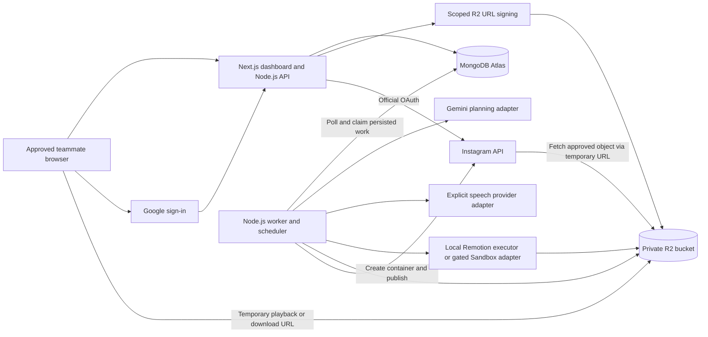
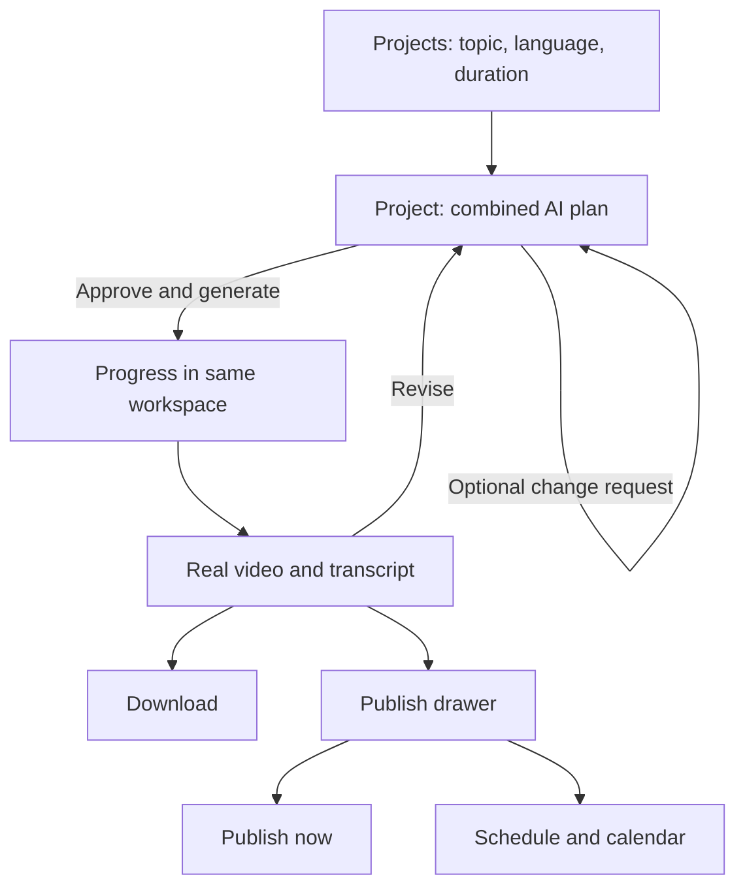
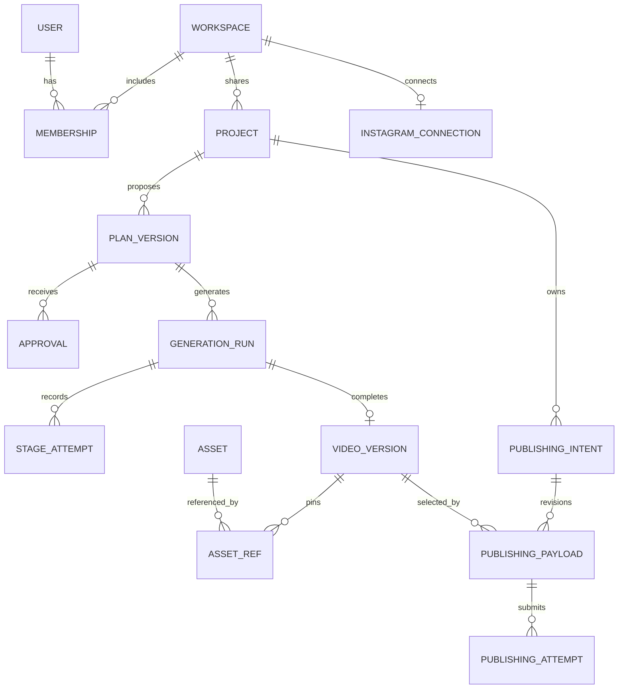
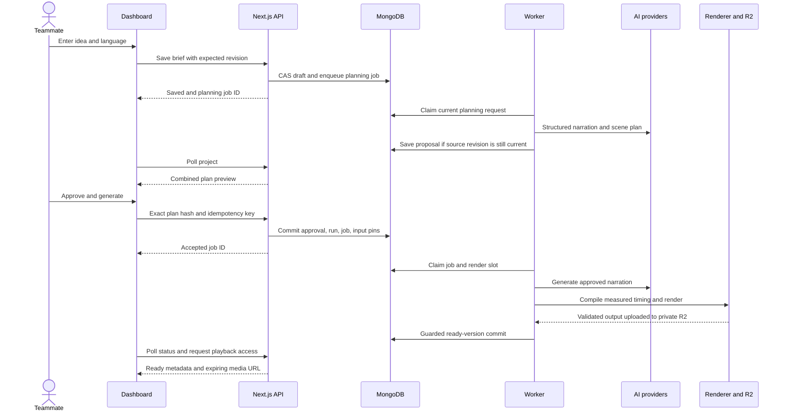
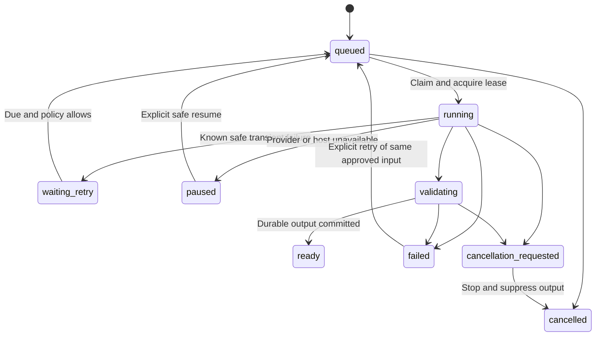
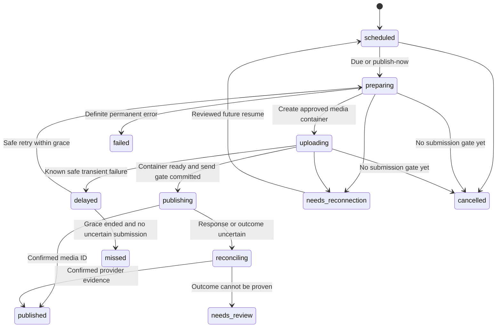
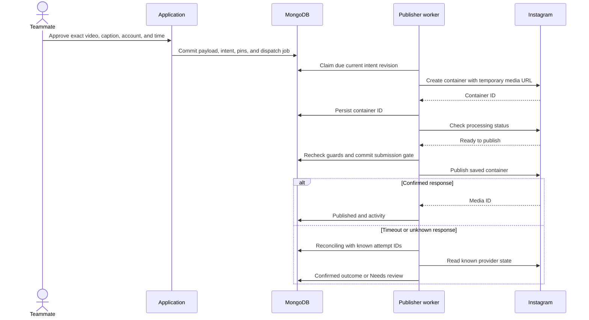

# VideoCraft — V1 System Design

## F11a execution increment — private persistence (21 October 2026)

A separate operator-local storage worker discovers committed rendered-local output, validates its exact run/approval/artifact and bounded local files, and stages a durable storage bundle. It does not hold the physical render slot or invoke speech/rendering. Fixed-key create-only R2 PUTs followed by actual GET checksum verification run outside transactions. Storage owner/epoch/180-second leases and live project guards fence metadata writes; deterministic same-byte recovery is distinct from render termination recovery. Migration 011 records five private artifacts and a stored checkpoint, not a ready video. Failed uploads retry storage only; partial objects remain private. Playback/downloads, ready-video asset pins and cleanup remain F11b/c. The CLI, bounds, indexes and failure semantics are specified in README/API_DESIGN/DATABASE_DESIGN. The S3 SDK is installed in the web/server dependency tree; root renderer React versions are unchanged.

F09b/F10b execution increment (21 October 2026): a real local worker (`npm run web:generation -- worker`) now bridges MongoDB-approved immutable input to pinned free-only ElevenLabs PCM phrases and the isolated React18 renderer. Single process ownership, 90-second fenced run leases, durable pre-request speech attempts, conservative provider holds, no-resend unknown-outcome recovery and best-effort running cancellation are implemented. Metadata/free-account observations and provider/render/file calls occur outside transactions; submission/finalization fences commit inside. Local audio hashes/attempt provenance settle before rendering; terminal artifact/run/pointer/activity state commits atomically. Already-approved team work outlives its initiating member's session/access. No synthetic progress is reported.

Local completion is `rendered_local`, not a ready/publishable video; the API exposes no filesystem path/media URL. The root live engine supplies verified decoded clips and file hashes, never user-asserted source metadata. Worker startup checks local browser/media binaries, fonts/build and license/key presence; each speech send additionally verifies real current free-account/premade-voice/model access and reservation coverage. Diagnostic engines are not offered by the runtime CLI. F11 must add R2 persistence and authorized playback/downloads before claiming a complete dashboard video-delivery flow. See API/database deployed slices and Project Status for verification and live-test limits.

F10a renderer increment (21 October 2026): `src/pipeline/selected-renderer.ts` is an isolated root/React18 adapter for the resolved selected-language contract. It validates the exact input hash, clip coverage/text/source metadata, measured PCM limits and installed web-font SHA256 pins before rendering. Trusted sequence/cycle/comparison components and canvas font metrics produce bounded headings/labels and two-line captions. A sample-count timeline supplies phrase-only anchors; no fabricated word timestamps or cross-language captions exist. Fixed output is 1080×1920/30fps H.264/yuv420p with AAC48k. Local exports are validated for codecs/dimensions/duration/signal/profile, and receive unique folders, canonical input/timing/layout/build/audio hashes and explicit diagnostic/failed/cancelled manifests.

The CLI exposes offline diagnostic mode only; it never receives provider credentials inside render props or registers a generation worker. Offline samples cannot satisfy the pinned neural voice, dashboard-ready or publication gates. The internal evaluation adapter trusts source metadata supplied by its server caller; authoritative speech submission/provenance and uncertain-outcome recovery belong to F09b/F10b before enabling admission. Local scratch/output is not durable R2 storage. No DB/API schema change or Next/React dependency merge is part of this increment. The original root v1 renderer remains separate. See [Project Status](PROJECT_STATUS.md) for actual render evidence and remaining work. Font/layout preparation follows Remotion's [calculateMetadata](https://www.remotion.dev/docs/calculate-metadata) and [resolved composition props](https://www.remotion.dev/docs/props-resolution) APIs.

F07 implementation note (20 October 2026): the local dashboard now has a separate MongoDB-backed planning worker (`npm run web:planning -- worker`). It snapshots saved brief/settings, calls Gemini outside transactions, validates bounded selected-language output and commits an immutable proposal guarded against newer edits. One global planning slot, durable submitted attempts and configuration-bound short-lived free quota are implemented. There is no inference in web handlers and no in-memory-only work queue. See the explicit staged proposal/API/database contracts at the top of API_DESIGN.md and DATABASE_DESIGN.md. The existing root video prototype is unchanged; dashboard review/edit/approval/render integration remain subsequent features. Conversation persistence is deferred rather than simulated.

## Document control

| Field | Value |
|---|---|
| Version | 1.0 |
| Date | 19 October 2026 |
| Status | Proposed implementation design for review; creating this document does not implement or deploy the application |
| Product baseline | [PRD.md](PRD.md), version 1.2, plus subsequent user-approved free-voice test |
| Pipeline reference | [PIPELINE_TECHNICAL_DESIGN.md](PIPELINE_TECHNICAL_DESIGN.md) |
| Existing implementation | [README.md](README.md) and [ARCHITECTURE.md](ARCHITECTURE.md), which describe the local prototype |
| Audience | Engineers, implementation agents, and the internal team |
| Scope | Complete internal V1: dashboard, accounts, shared workspace, planning, production, revisions, storage, Instagram connection, publication, calendar, and operations |
| Budget boundary | Initial experiments use permitted free allowances and existing local compute; no paid activation, top-ups, or purchases authorized |

This is the application system design. The existing `ARCHITECTURE.md` remains a description of the prototype, not a competing production specification. The PRD controls product scope; this document defines how to implement it. Provider contracts and plan eligibility must be checked again when integrating or deploying.

**Scope clarifications:** A single `language` selection controls both narration and subtitles: `en → en`, `te → te`. Earlier references to translation, an independent caption mode, or cross-language output in the pipeline document and isolated PRD table rows are superseded by the user's later decision and the PRD's explicit single-language requirements. Accent and voice remain separate compatible controls. One narrator per generated V1 video is the default. Experimental alternating-voice support is not a required dashboard feature.

No further product answer is needed to write this design. Infrastructure access, exact deployment configuration, and provider usage rights are tracked as implementation/deployment gates in section 23; they are not additional customer workflow steps.

## Contents

1. [Goals, boundaries, and evidence](#1-goals-boundaries-and-evidence)
2. [Architecture decisions](#2-architecture-decisions)
3. [System architecture and deployment](#3-system-architecture-and-deployment)
4. [Dashboard and user experience](#4-dashboard-and-user-experience)
5. [Application modules and repository layout](#5-application-modules-and-repository-layout)
6. [Identity and workspace authorization](#6-identity-and-workspace-authorization)
7. [Data model and immutable snapshots](#7-data-model-and-immutable-snapshots)
8. [MongoDB indexes and transaction boundaries](#8-mongodb-indexes-and-transaction-boundaries)
9. [API contracts](#9-api-contracts)
10. [Creation, approval, and revision flows](#10-creation-approval-and-revision-flows)
11. [AI, scene, and timing contracts](#11-ai-scene-and-timing-contracts)
12. [Durable jobs and worker execution](#12-durable-jobs-and-worker-execution)
13. [Media storage, uploads, and playback](#13-media-storage-uploads-and-playback)
14. [Instagram authorization and credentials](#14-instagram-authorization-and-credentials)
15. [Publishing correctness](#15-publishing-correctness)
16. [Scheduling and calendar](#16-scheduling-and-calendar)
17. [Security and privacy](#17-security-and-privacy)
18. [Failure handling, deletion, and recovery](#18-failure-handling-deletion-and-recovery)
19. [Observability, capacity, and performance](#19-observability-capacity-and-performance)
20. [Configuration and release operations](#20-configuration-and-release-operations)
21. [Verification and acceptance](#21-verification-and-acceptance)
22. [Implementation and migration plan](#22-implementation-and-migration-plan)
23. [Outstanding gates and decision register](#23-outstanding-gates-and-decision-register)
24. [Requirements traceability and references](#24-requirements-traceability-and-references)

## 1. Goals, boundaries, and evidence

### 1.1 Product goals

- Keep the experience **Plan → Generate → Publish** inside one project workspace.
- Convert an educational idea into a reviewed, narrated, animated 30/60/90-second explainer.
- Support English and Telugu with same-language subtitles, reliable Telugu shaping, and explicit voice compatibility.
- Give individual approved teammates access to one shared project library, brand kit, and Instagram connection.
- Preserve exact approvals, previous good videos, and scheduled publishing snapshots.
- Support download, publish-now, and one-time scheduling without browser-dependent execution.
- Save projects and show useful failure/retry states without requiring public-scale infrastructure.

### 1.2 Exclusions

No customer billing, subscriptions, credit balances, member generation allowances, public registration, multiple workspaces/brands/accounts, advanced roles, timeline editor, arbitrary scene code, avatars, music, photorealistic generation, recurring autonomous posting, other social networks, dedicated backups, disaster recovery, or autoscaling. Operational provider allowance checks are server controls, not customer monetization features.

### 1.3 Evidence from this workspace

| Finding | Evidence and implication |
|---|---|
| Real Telugu neural narration works | `output/elevenlabs-water-cycle/manifest.json`: ElevenLabs `eleven_v3`, built-in Alice, 10 successful speech requests |
| A real narrated render completed | 31.701 seconds, 1080×1920, H.264/AAC, 48 kHz audio, measured mean signal approximately −21.94 dBFS |
| Local execution duration measured once | 271.8 seconds for speech/bundling/render/validation in that run; not a cloud benchmark or a 90-second render estimate |
| Audio/subtitle timing exists | Ten measured phrase windows, Telugu narration/subtitles, deterministic frame rendering; not word-level alignment or an automatic factual/phonetic accuracy guarantee |
| User reviewed the test positively | User said the video looks good; retain human pronunciation/content review in implementation QA |
| Preferred Telugu library voices are inaccessible on free API | Madhavi and Bharadwaj IDs were found and saved, but synthesis returned HTTP 402 `payment_required` |
| A free API alternative worked | Alice `Xb7hH8MSUJpSbSDYk0k2` succeeded; her source voice is British English, so this does not validate native Telugu or Indian-English accent quality |
| Current dashboard is local | Loopback HTTP server and filesystem projects; no Next.js accounts, durable distributed queue, R2 persistence, or Meta publishing has been demonstrated |
| Gemini generation remains unproved | Key/model metadata checks do not establish live structured planning quality, billing eligibility, or end-to-end generation |

The prototype is a reusable foundation, not proof that all PRD acceptance criteria are complete. Do not repeat the video feasibility work as a prerequisite for writing the dashboard; resolve remaining quality/integration checks during the planned implementation.

## 2. Architecture decisions

| ID | Decision | Reason and consequence |
|---|---|---|
| AD-01 | A modular Next.js application using TypeScript, App Router, and Node.js backend routes | One web/backend codebase; separate Express service unnecessary |
| AD-02 | A separate Node.js worker process sharing contracts/domain code | Speech and Chromium/FFmpeg work outlive HTTP requests; browser closure cannot terminate accepted work |
| AD-03 | MongoDB Atlas for application state, sessions, and persisted work | Low team volume does not justify Redis, Kafka, or an independent queue service |
| AD-04 | Private Cloudflare R2 for media; MongoDB stores asset metadata | Avoid database blobs and proxying full video downloads through application functions |
| AD-05 | Auth.js Google sign-in, MongoDB adapter, database sessions, explicit membership checks | Match PRD; authentication alone never grants workspace access |
| AD-06 | Immutable approved input and output snapshots, mutable project draft pointer | New work cannot overwrite a ready video or a scheduled payload |
| AD-07 | One authorized render at a time; independent lightweight planning/publishing work | Fit internal use and protect free allowances without allowing rendering to block scheduled publication |
| AD-08 | Explicit provider/voice selection and capability registry | No silent change after approval; free metadata access is not proof of synthesis permission |
| AD-09 | Polling for UI progress and a persisted worker scheduler | Simple recovery/reconnection; no WebSocket infrastructure or browser timers required |
| AD-10 | Trusted React/SVG scene templates and validated declarative props | AI selects a visual representation but never supplies executable renderer code |
| AD-11 | At-least-once work discovery, fenced database commits, conservative external publication | No false exactly-once promise; an ambiguous publish is reconciled rather than blindly repeated |
| AD-12 | Local/existing team worker initially; Sandbox is a replaceable execution adapter | Reuse measured execution while cloud allowance, rights, and performance are still unverified |

Version-pin dependencies at implementation, commit the lockfile, and record framework/worker/renderer contract versions in releases. Retain Auth.js as the agreed choice; any future migration is a separate engineering decision, not an implicit change to this document.

## 3. System architecture and deployment

### 3.1 Component view



MongoDB is the source of truth for commands, state, and approvals. R2 is the source of durable media bytes. The browser is a presentation/editing client. Provider responses become application state only after validation and a successful guarded database commit.

### 3.2 Execution topology

| Process | Initial location | Owns | Does not own |
|---|---|---|---|
| Next.js | Local development, then Vercel when plan terms/configuration permit | Auth, authorization, validation, short DB transactions, URL signing, UI, OAuth callbacks | Full video rendering, long sleeps, browser-lifetime scheduling |
| Worker coordinator | Existing team machine/process initially | DB polling, provider calls, stage orchestration, reconciliation, scheduler, heartbeats | User sessions or public unauthenticated administration |
| Render child | Per-job local directory and isolated child process | Pinned Remotion composition, local fonts/assets, media output and QA | Arbitrary model code, general internet browsing, database credentials |
| Sandbox adapter | Deferred until verified | Same render task contract, explicit resource/deadline controls | Permanent filesystem storage or the authoritative job queue |
| MongoDB/R2 | Separate development/production resources | Durable records and media | A substitute for worker availability or a backup guarantee |

The coordinator can have a one-job render loop and a separate asynchronous scheduler/publisher loop in the same deployed worker program. Rendering runs in a child process, so CPU work and encoding cannot block scheduling timers in the coordinator. Initially cap planning and publishing concurrency at one each; these are adjustable operational limits.

The web app must not spawn a detached renderer after returning `202`. Persist a job first. An already running worker discovers it even if the HTTP function exits immediately afterward. Optional wake-up hints can reduce latency but are never required for correctness.

### 3.3 Hosting and zero-spend implications

Vercel remains the intended web host. Its Hobby plan is restricted to personal, noncommercial use; do not assume a private business/team tool qualifies. An eligible existing plan or another explicit deployment decision is needed before commercial team deployment. This does not authorize purchasing a plan. [Vercel Hobby terms](https://vercel.com/docs/plans/hobby)

Hobby Cron cannot satisfy minute-level scheduling: its documented minimum is daily with hour-level timing precision. Therefore it is not the V1 publishing clock. Start with a scheduler loop on an existing running worker. A continuously available permitted host is required before claiming reliable hosted scheduling. [Vercel Cron limits](https://vercel.com/docs/cron-jobs/usage-and-pricing)

Remotion supports a Vercel Sandbox route, but the existing local run does not establish its setup, price, resource fit, or performance. Keep it behind the render executor interface and validate allowances and R2 upload before enabling it. [Remotion on Vercel](https://www.remotion.dev/docs/vercel), [Sandbox quotas](https://vercel.com/docs/sandbox/pricing)

If the team machine sleeps, persisted jobs remain safe but execution stops. Display worker unavailable, queue generation, and pause new scheduling if availability cannot support it. Restart recovery follows the lateness/reconciliation rules in section 16. A laptop experiment is not an always-on deployment.

### 3.4 Trust boundaries

- Browser → application: authenticate, verify membership, validate every request; never trust client workspace/actor/provider IDs.
- Application/worker → MongoDB: least-privilege application identities, TLS, indexed scoped queries.
- Worker → providers: configured allowlisted endpoints and explicit capability/allowance checks.
- Renderer → media: staged vetted local inputs; no arbitrary URLs, HTML, JS, or secrets from prompts.
- R2 → browser/Meta: narrowly scoped expiring bearer URLs for specific assets, not a public bucket.

## 4. Dashboard and user experience

### 4.1 Routes and surfaces

| Route | Surface | Main content |
|---|---|---|
| `/sign-in` | Access | Google sign-in; explain denied team access without exposing member list |
| `/projects` | Signed-in landing | Idea input, New project, shared library, latest ready/draft/job indicators |
| `/projects/[projectId]` | Primary workspace | Combined idea conversation, plan preview, generation progress, real player, revisions, publish drawer |
| `/calendar` | Calendar/activity | Month/list views, zone selector, scheduled/active/resolved intent details |
| `/settings` | Team settings | Shared brand/defaults/timezone, compatible voice options, Instagram connection/health |

No dedicated script editor, storyboard editor, alignment screen, provider configuration wizard, or timeline is required. Operations details expand inline and errors expose support IDs rather than stack traces. API secrets stay in server configuration, not a settings text box.



### 4.2 UI state rules

- Language and duration are visible. Accent/voice are separate, filtered by compatibility and usage policy. For Telugu, offer only configured compatible delivery options; never expose a fake universal Indian-accent switch.
- Defaults: English, Indian accent preference, 60 seconds, beginner audience, `Asia/Kolkata`; branding is off until the shared kit is configured. If no tested Indian-English voice is available, show that limitation and an explicit evaluation alternative; do not label Alice as an Indian voice.
- Brief input autosaves after approximately two idle seconds. Saved/unsaved status and server revision are visible. Approval is disabled while saving, offline, or stale.
- AI planning returns one combined review; optional direct narration edits invalidate prior approval.
- Progress reflects persisted stages. Render percentage comes only from actual renderer progress; other stages show running/waiting without invented percentages.
- Latest draft, active job, latest ready version, and publishing intent are separate UI objects. A failed revision must not replace the video player with an empty error state.
- Playback includes seek/volume, actual duration, selected narrator, transcript, version picker, MP4 download, and SRT download.
- A free-provider evaluation-only video can be reviewed/downloaded with its usage notice. Publishing remains unavailable until the asset's intended use is permitted.
- Post caption means Instagram text; video subtitles mean the text synchronized to narration. Use distinct labels and fields.
- Mobile stacks the same workspace; project review, approval, playback, scheduling, and errors must not depend on hover. Status announcements are accessible and rate-limited. Honor reduced motion in the dashboard.

### 4.3 Client data and cache

Use server-rendered initial data and small client components for editors/player/calendar. A single query/cache layer handles revalidation; choose its library during implementation, not multiple overlapping state frameworks. Persist server state as authoritative; local memory holds unsaved edits.

Poll active project/job status about every 3 seconds while visible, reduce to 15 seconds in background, and stop after terminal state. Calendar/connection health polls can be slower. On reauthentication, tab focus, or network recovery, reload current revisions. Responses containing private state use `Cache-Control: private, no-store`; no cross-user shared server cache for workspace records.

Keep a session-scoped recovery copy of unsaved text if needed, clear it after save/logout, and provide Copy unsaved text on failure. It never counts as a saved approval. Do not persist API tokens, signed URLs, or full provider payloads in browser storage.

## 5. Application modules and repository layout

### 5.1 Logical modules

| Module | Responsibility |
|---|---|
| Identity/workspace | Session, approved membership, actor context, safe redirects |
| Projects/conversation | Brief, optional brainstorming, autosave, conflicts, duplication/deletion |
| Planning/versions | Structured output, validation, immutable proposals, settings hashes, approvals |
| Brand/voices | Shared brand revisions, decoded logo assets, font/theme and provider capability catalog |
| Production | Job lifecycle, stage checkpoints, audio/timing/compiler/renderer/validation |
| Media | Asset catalog, R2 object lifecycle, upload finalization, scoped playback/download signing |
| Instagram | Official OAuth, account identity, encrypted token lifecycle, publishing adapter |
| Publishing/calendar | Immutable payload revisions, due work, cancellation races, attempts, reconciliation |
| Activity/operations | Persistent user-facing events, sanitized diagnostics, worker health, provider pauses |

### 5.2 Proposed layout, not files created by this document

Implementation note (F01, 20 October 2026): the Next.js application now uses `apps/web/src` with an independent package/lockfile, while the existing React 18/Remotion prototype stays at root `src`. The module boundaries below remain the intended responsibilities; the new web application uses React 19 and does not import renderer/provider code into its browser bundle. See PROJECT_STATUS.md for implemented modules and verification.

```text
src/
  app/                         # Next.js pages, layouts, API route handlers
  components/                  # Project workspace, plan, player, calendar, settings
  server/
    auth/  authorization/      # Session + membership guard
    projects/  planning/       # Domain commands and queries
    versions/  approvals/      # Immutable input contracts and approval service
    media/  branding/          # Asset policies, signing, logo validation
    jobs/  publishing/         # Queue/state machines, intents/attempts
    instagram/  activity/      # OAuth and external publishing adapter
    db/  configuration/        # Collections, indexes, transactions, capability flags
  contracts/                   # Zod/JSON schemas shared by web and worker
  pipeline/                    # Existing provider/audio/timing code, refactored as needed
  video/                       # Existing trusted Remotion components, extended templates
workers/
  coordinator.ts               # Poll loops, claims, scheduler, reconciliation
  executors/                   # Local render and optional Sandbox implementation
  tasks/                       # Planning, generation, publication, cleanup, token refresh
tests/                         # Unit, database concurrency, contract, browser, media tests
```

Use the MongoDB Node driver and explicit Zod domain validation; an additional ORM is not necessary. Route handlers call domain services rather than duplicating business rules in pages, API routes, and workers. Auth.js adapter collections remain adapter-owned.

## 6. Identity and workspace authorization

### 6.1 Google sign-in

F02 implementation checkpoint (20 October 2026): pinned `next-auth@5.0.0-beta.32`, `@auth/mongodb-adapter@3.11.3`, and MongoDB Node driver 6.21.0. The v5 package is explicitly a prerelease; upgrades require focused auth regression checks. Adapter schema remains library-owned. Google account linking persists only identity keys, not API/refresh/ID tokens. Database expiry enforces the seven-day absolute session deadline even if Auth.js renews a browser cookie. Live OAuth/MongoDB acceptance remains pending local setup; PROJECT_STATUS.md distinguishes implemented code from demonstrated integrations.

1. Auth.js starts Google OAuth with its supported state/PKCE/session protections; use the installed library's implementation rather than custom OAuth for sign-in.
2. Require Google `email_verified` and an exact normalized email in `TEAM_ALLOWED_EMAILS`. Do not grant access by email suffix alone.
3. Identify the account by provider + immutable Google subject, not email as a primary identity.
4. Upsert membership in the single configured workspace only after the allowlist check. A disabled membership cannot be reactivated just by signing in again; an operator must deliberately restore it.
5. Create a database session with secure HttpOnly cookie, appropriate SameSite policy, and HTTPS in hosted environments. Proposed absolute session lifetime: seven days, with revocation on account/membership removal.
6. Persist only identity/session data needed for sign-in. No Google Drive or other Google service scope is needed for this product.

Auth.js documents Google verified-email claims and the MongoDB adapter. Application membership remains our own enforcement layer. [Google provider](https://authjs.dev/getting-started/providers/google), [MongoDB adapter](https://authjs.dev/getting-started/adapters/mongodb)

### 6.2 Authorization contract

Every page data load, API operation, Server Action if introduced, download signer, and OAuth completion uses:

```text
requireWorkspaceContext(request)
  -> authenticate current database session
  -> confirm exact email remains approved and membership is active
  -> resolve configured workspace and stable actor ID
  -> return server-owned {userId, workspaceId, membershipId}
```

Scope resource queries by both `_id` and `workspaceId`, and exclude deleted projects. Resolve asset ownership through the project and current workspace before signing. Return non-enumerating `404` for inaccessible resource IDs; use `401` for missing session and `403` for denied team access.

All active teammates can create/edit/review/generate/download/connect/publish/cancel shared work, as agreed. No separate project-owner ACL is introduced. Allowlist/secrets/deployment maintenance remains an operator task outside the product UI; this is not a new role hierarchy. Show an impact warning for shared Instagram disconnect.

Removal ends new user access immediately on the next authorized request and revokes sessions. It does not delete shared projects, undo historical approvals, or automatically cancel team-approved jobs/posts. A remaining teammate can cancel them. Already issued direct R2 links remain bearer-valid until expiry; do not claim instant link revocation from removing a member.

Mutations require same-origin request checks and CSRF protection appropriate to the session mechanism. A middleware redirect alone is insufficient authorization. [Next.js authorization guidance](https://nextjs.org/docs/app/guides/authentication)

## 7. Data model and immutable snapshots

### 7.1 Conventions

- Application IDs: server-generated UUID strings, separate from Auth.js adapter IDs. External Meta IDs remain strings, never JavaScript numbers.
- Dates: BSON UTC `Date` values; API timestamps are ISO 8601. Persist IANA timezone and offset separately for schedules.
- Mutable documents have monotonically increasing `revision`. Use compare-and-swap, never last-write-wins for user edits.
- Immutable documents are insert-only after validation; administrative corrections create a new record with provenance.
- Authoritative references use IDs; checksums verify bytes. Do not treat R2 multipart ETags as content SHA-256.
- Limit briefs/references, plan JSON, messages, and provider output sizes before persistence. Proposed command JSON limit 128 KiB; total plan snapshot limit 512 KiB; reject excess explicitly.
- Application text can contain technical terms in another script; Telugu text must include meaningful Telugu script, not merely pass a one-character regex. Language validation does not prove pronunciation.

### 7.2 Collections

| Collection | Essential fields | Mutability/ownership |
|---|---|---|
| Auth.js collections | Users, accounts, sessions, adapter-required indexes | Adapter-owned; never add workspace authority through client-controlled account fields |
| `workspaces` | `_id`, name, timezone, defaults, `brandKitId`, configuration revision | One workspace; includes settings editor/timestamps |
| `memberships` | workspace/user IDs, normalized email, active/disabled state, timestamps | Unique pair; history survives membership removal |
| `brand_kits` | workspace, revision, colors, validated logo asset, font/theme IDs, actor | Revisions snapshotted into video input |
| `projects` | workspace, display title, brief, audience, revision, current proposal/latest ready IDs, planning request ID, created/updated actors, deletion state, publish guard | Mutable shell; `latestReadyId` changes only on valid output commit |
| `messages` | workspace/project, message ID, ordered sequence, role, text, related planning request | Bounded conversation context; model text never becomes system policy |
| `plan_versions` | workspace/project, schema, selected-language plan, settings snapshot, input hash, source draft revision, creator, parent version | Immutable approved-candidate snapshot; previous proposals preserved |
| `approvals` | workspace/project, actor, scope, referenced snapshot/hash, timestamp, command ID | Immutable generation or publishing approvals |
| `generation_runs` | workspace/project, plan version/approval/input hash, run revision, status, checkpoint refs, job ID, final asset IDs | Mutable execution record; inputs immutable, verified attempts append |
| `jobs` | kind, workspace, target IDs/revisions, dedupe key, state, `nextRunAt`, attempt count, lease owner/epoch/expiry, cancellation flag, errors | Durable queue records, not process memory |
| `stage_attempts` | job/run/stage, attempt ID, request fingerprint, provider request ID, state, artifact IDs, error classification | External-effect/checkpoint audit; secrets excluded |
| `worker_slots` | slot ID, job ID, lease epoch/owner/expiry | Global render-capacity guard |
| `worker_heartbeats` | worker ID, release, capabilities, last seen, execution host/mode | Availability and stale-worker diagnostics |
| `assets` | workspace/project, kind, object key, SHA-256, size/MIME, media metadata, dependencies, usage policy, lifecycle state | Immutable bytes; lifecycle moves staged/available/deleting/deleted |
| `asset_refs` | asset ID, owner type/ID, purpose | Transactional pins for versions, active runs, schedules, brand revisions |
| `video_versions` | workspace/project, run/input hash, MP4/poster/SRT/transcript/manifest asset IDs, actual media metrics, renderer/build, usage policy, ready timestamp | Immutable ready output record |
| `instagram_connections` | workspace, external account ID/handle/type, status, token ciphertext/key ID/expiry, scopes, revision, authorizing actor | One configured connection slot; generation/epoch changes on disconnect/account change |
| `oauth_transactions` | hashed random state, session/user/workspace, safe return route, expiry, consumed flag, expected connection revision | One-time OAuth state; TTL cleanup is not the validity check |
| `publishing_intents` | workspace/project/account ID, permanent creation command ID, current approved payload revision, state, active slot, UTC due instant, revision, attempts/container/media IDs | One unresolved intent per project/destination; durable command identity survives HTTP idempotency expiry |
| `publishing_payloads` | intent/revision, ready version/asset hashes, caption, cover offset, account/connection identity, UTC/local zone data, actor approval | Immutable snapshot for each approved scheduling/payload change |
| `publishing_attempts` | intent/payload revision, immutable request fingerprint, state, send gate, container/media IDs, request correlation, error/outcome evidence | Persist before external side effect; uncertain attempts remain discoverable |
| `activity_events` | stable dedupe key, workspace/project, actor/system, event type, reference IDs, user-safe message, timestamp | Persistent in-app notifications/history; optional per-user read position |
| `provider_controls` | provider/model capability, operational pause reason, checked-at/expiry, free allowance reservations | Shared service operation; no customer credits or billing |
| `idempotency_records` | workspace, actor, method/route/key hash, payload hash, result reference, expiry | Protect command retries; domain uniqueness remains after TTL cleanup |

Large word/character timings, render props, and manifests are R2 JSON artifacts referenced by metadata, not unbounded arrays inside a project document. No event-sourcing platform or database-per-user is required.

### 7.3 Relationships



### 7.4 Hashes, approval, and reuse

Compute `generationInputHash = SHA256(canonicalJson({...}))` from schema version, selected-language narration/captions/scenes, voice provider/model/ID/settings, accent selection, duration target/profile, brand assets/colors/fonts, template versions, compiler/timing policy, and renderer contract version. Canonical JSON uses sorted object keys, preserved array order, explicit defaults, UTF-8 and defined Unicode normalization. Do not hash ordinary `JSON.stringify` across independently constructed objects and assume canonical equality.

Editable project display title, activity messages, conversation, and Instagram post caption are not generation inputs. The on-video title is an input. Server validates and computes hashes; client hashes are hints only. Historical snapshots do not read current defaults or current brand assets.

Speech cache identity includes exact spoken text, language, provider/model/voice, settings, pronunciation mapping, synthesis adapter version, normalization, and any neighboring context supplied to the provider. Include workspace scope and permitted-use policy in cache access. Brand-only edits can reuse audio; narration or context changes invalidate the affected clips. Timing changes propagate downstream even when later audio clips are reused.

Publishing hash covers selected immutable ready video/asset checksum, external account ID, caption, cover selection, share-to-feed setting, approved time/zone, and usage-policy decision. It is distinct from generation approval. New draft edits never mutate an existing publishing payload.

Duplication creates a new project/brief/proposal with provenance and actor, never copies approval or active schedules. If existing assets are reused, create separate references and recheck rights; deleting one project must not remove assets still pinned by the other.

## 8. MongoDB indexes and transaction boundaries

### 8.1 Required indexes

All index definitions are migrations, created before traffic rather than on every request. Include workspace scope in application queries even where a globally unique UUID makes it redundant.

| Collection | Key/index | Purpose |
|---|---|---|
| `memberships` | unique `(workspaceId, userId)` | No duplicate membership |
| `projects` | `(workspaceId, deletedAt, updatedAt desc, _id)` | Stable paginated library |
| `messages` | unique `(projectId, sequence)` | Ordered conversation, no conflicting sequence |
| `plan_versions` | unique `(workspaceId, projectId, versionNumber)` | Immutable version identity |
| `generation_runs` | unique `(workspaceId, planVersionId, inputHash)` | Double approval returns the same logical run |
| `jobs` | unique `dedupeKey`; `(kind, state, nextRunAt, priority, _id)`; `(state, leaseExpiresAt)` | Discovery, unique work, recovery |
| `stage_attempts` | unique `(jobId, stage, attemptNumber)` | Unambiguous stage history |
| `video_versions` | unique `generationRunId`; `(workspaceId, projectId, readyAt desc)` | One final ready record per logical run |
| `assets` | unique `objectKey`; `(workspaceId, projectId, lifecycleState)` | Immutable storage keys and cleanup |
| `asset_refs` | unique `(assetId, ownerType, ownerId, purpose)`; `(ownerType, ownerId)` | Pins and deletion discovery |
| `instagram_connections` | unique `workspaceId` | One shared connection slot |
| `publishing_intents` | unique `(workspaceId, projectId, accountId)` with partial filter `{activeSlot:true}` | One unresolved intent per project/destination |
| `publishing_intents` | unique `(workspaceId, creationCommandId)` | A delayed replay cannot create a second post after the original intent resolves or HTTP idempotency expires |
| `publishing_intents` | `(workspaceId, scheduledAtUtc, _id)`; `(state, nextActionAt)` | Calendar and due reconciliation |
| `publishing_payloads` | unique `(intentId, revision)` | Immutable approval snapshots |
| `publishing_attempts` | unique `(intentId, payloadRevision, attemptNumber)` | Durable external effect identity |
| `publishing_attempts` | unique `(accountId, providerMediaId)` with partial filter where media ID is a string | Prevent linking one confirmed post to conflicting intents |
| `activity_events` | unique `dedupeKey`; `(workspaceId, createdAt desc, _id)` | Duplicate-safe notifications/history |
| `oauth_transactions` | unique `stateHash`; TTL `expiresAt` | One-time state lookup/cleanup |
| `idempotency_records` | unique `(workspaceId, userId, routeScope, keyHash)`; TTL `expiresAt` | Command retry contract |

Use equality filters such as `activeSlot:true` for partial uniqueness rather than relying on unsupported index operators or a mutable list of status names. Set `activeSlot:false` only after a terminal, non-ambiguous outcome. `needs_review`, `reconciling`, `delayed`, and `needs_reconnection` retain the slot until resolved/cancelled safely.

TTL deletion is asynchronous. Enforce expiration in queries/logic, not by assuming expired OAuth or idempotency rows have disappeared.

### 8.2 Atomic operations

Use a verified replica-set/Atlas configuration supporting transactions and majority-acknowledged writes for authoritative multi-document transitions. The initial free deployment must be checked for these operations. MongoDB single-document conditional updates are atomic; coordinated multi-document invariants require an explicit transaction. [MongoDB atomicity](https://www.mongodb.com/docs/manual/core/write-operations-atomicity/)

| Command | Transaction contents |
|---|---|
| Create planning request | CAS project draft/request revision, insert job, persist command result/activity |
| Approve and generate | CAS/touch the project guard under the expected saved revision/proposal/settings hash; insert approval, get-or-create logical run and job, pin required input assets, persist idempotent result |
| Complete generation | Check active job epoch, cancellation, live project; insert ready video, finalize assets/pins, update latest-ready pointer if applicable, mark job ready, release slot, emit activity |
| Create/schedule intent | Check ready version and rights; insert immutable publishing payload and approval, claim active intent slot, pin media, insert dispatch job/result/activity |
| Reschedule/replace/cancel | CAS intent revision/state; insert a new approved payload when needed, invalidate old dispatch job revision, adjust pins, persist result/activity |
| Begin provider submission | Check intent revision, live project and same connected account; touch project/connection guards, persist attempt and irrevocable send gate, advance intent state |
| Delete project | Tombstone project, invalidate queued work/unstarted intents and revisions, set cancellation flags, create cleanup job/activity; preserve in-flight reconciliation |
| Start cleanup | Check no pins and asset lifecycle `available`, atomically mark `deleting`; refuse new references to `deleting` assets |

Never perform network calls to Gemini, speech, R2, or Meta inside a database transaction. Reserve IDs and object keys before uploading. Keep transactions short; retry driver-classified transient DB failures with bounded retries. Unique-key collisions read and return the winning domain result rather than creating duplicate work.

The `jobs` collection is itself the durable queue. Domain state and corresponding job insertion happen in the same transaction, removing the database-to-external-queue dual-write gap. A future external queue would require an outbox; it is not needed for V1.

Reads alone do not create cross-document mutual exclusion. Approval/ready/publishing commits must write the relevant live-project guard as well as check it, including historical-ready commits that do not advance `latestReadyId`. Deletion writes that same project document. Connection/disconnect races likewise touch the same connection guard. Asset pin creation/removal writes the asset guard as described in section 13.5. These shared writes force a transaction conflict instead of allowing snapshot write skew.

## 9. API contracts

### 9.1 Shared conventions

- Application routes use `/api/v1`; Auth.js and the provider callback have their own fixed integration paths.
- Browser sends session cookies; server derives user/workspace. Worker accesses domain services/database with its own server credentials, not a user's browser session.
- Strict Zod schemas reject unknown fields. Reject an independent `captionLanguage`, translated-caption request, arbitrary provider endpoint, asset path, workspace ID, or actor ID in generation commands.
- Mutating user commands use `Idempotency-Key`; a repeated key with different content returns `409 IDEMPOTENCY_MISMATCH`. Default record lifetime: 24 hours; domain unique keys continue to protect generation/publication afterward.
- Editable resources return `ETag`/revision; updates require `If-Match` or an explicit expected revision. Missing preconditions return `428`; stale revision returns `409` with current revision, editor, and update time.
- Editor ETags track actual user-editable content revisions, separately from internal job heartbeats and project/connection guard counters; background polling does not constantly invalidate an unchanged draft.
- List endpoints use stable cursor pagination, proposed default 20/max 50 items; do not load all project histories/media at once.
- IDs, timezone, Unicode length, captions, and content limits are validated before commands commit. Provider-specific validation can be stricter than product limits.
- Normal response envelope: `{data, requestId}`. Errors: `{error:{code,message,retryable,action,requestId,fieldErrors?}}`; no raw provider response or secret.

Use the PRD's proposed text bounds: idea/change request 2,000 characters, pasted references 20,000, project display title 120, post caption 2,000; on-video titles/labels use stricter template layout bounds. Define user-visible length by grapheme-aware counting and also enforce encoded-byte/decoder limits server-side. Search is title-only initially, with escaped literal matching and bounded pagination; client input cannot inject MongoDB operators or regex programs.

External publishing creation additionally carries a permanent `creationCommandId` stored on the intent with a unique index. Preserve it beyond the temporary HTTP idempotency record. A replay returns its original intent even after publication; a new intentional repost needs a new reviewed command and acknowledgement, not reuse of an expired HTTP key.

### 9.2 Endpoint inventory

| Method and route | Input/result | Main guard |
|---|---|---|
| `GET /api/auth/*`, provider-specific Auth.js methods | Library-managed Google sign-in/session/sign-out | Auth.js protections and allowlist callback |
| `GET /api/v1/me` | Actor, workspace, approved capabilities/defaults | Active membership |
| `GET /api/v1/projects` | Cursor, bounded search/filter → shared project summaries | Workspace/deletion filter |
| `POST /api/v1/projects` | Idea, audience, language, target → saved project | Schema + idempotency |
| `GET /api/v1/projects/:id` | Draft, proposal, ready pointer, active job, intent summaries | Workspace + live project |
| `PATCH /api/v1/projects/:id` | Saved brief/display title/settings, expected revision | CAS; no implicit rendering |
| `POST /api/v1/projects/:id/duplicate` | New project → draft without approvals/schedules | Ownership scope + idempotency |
| `DELETE /api/v1/projects/:id` | Expected revision → tombstone/cleanup status | In-flight publication handling |
| `GET/POST /api/v1/projects/:id/messages` | Conversation and bounded user change request | Scoped validated text |
| `POST /api/v1/projects/:id/brainstorm` | Topic/context → `202` planning job reference | Current brief + free-provider gate |
| `POST /api/v1/projects/:id/plans` | Current brief revision → `202` structured planning job | Latest draft/request match |
| `POST /api/v1/projects/:id/revisions` | Base plan/ready version + change request → proposal job | No modification of existing ready version |
| `GET /api/v1/projects/:id/versions` | Immutable proposals/outputs, paginated | Workspace |
| `GET /api/v1/plans/:versionId` | Combined scene/narration/settings snapshot | Workspace/project |
| `POST /api/v1/plans/:versionId/edits` | Direct text/settings edits → new proposal snapshot | Expected project/proposal revision |
| `POST /api/v1/projects/:id/generations` | Saved plan ID, input hash, expected project revision → approval/run/job | Exact current proposal + compatible provider |
| `GET /api/v1/jobs/:id` | User-safe stage/progress/attempt state | Workspace/project |
| `POST /api/v1/jobs/:id/cancel` | Expected job revision → best-effort cancellation | Correct state and epoch |
| `POST /api/v1/jobs/:id/retry` | Same immutable input → resume/requeue logical run | Failed stage, allowance, no ambiguous publish retry |
| `GET /api/v1/videos/:id` | Ready metadata, transcript, versions, usage policy | Scope and available assets |
| `POST /api/v1/assets/:id/access` | Purpose `playback`/`download` → short-lived URL/expiry | Ready version/brand association and membership |
| `GET/PATCH /api/v1/workspace/settings` | Shared defaults, expected revision | Active member; supported choices |
| `GET/PUT /api/v1/workspace/brand` | New brand revision | Validated logo/font/color refs + CAS |
| `POST /api/v1/uploads`, `POST /api/v1/uploads/:id/finalize` | Reserved logo upload → decode/validation status | Size/type, reserved key, same workspace |
| `GET /api/v1/voices` | Compatible catalog for language/accent/use | Server capability/rights checks; no keys |
| `GET /api/v1/integrations/instagram` | Handle, health, affected intents, safe expiry metadata | Membership; no credentials |
| `POST /api/v1/integrations/instagram/connect` | Safe return route → official OAuth URL | Persist one-time state and expected connection revision |
| `GET /api/integrations/instagram/callback` | Provider code/state → return to originating route | One-time state + session binding + account check |
| `POST /api/v1/integrations/instagram/disconnect` | Connection revision, impact acknowledgement | Pause pending shared intents atomically |
| `POST /api/v1/projects/:id/post-caption` | Approved explanation → editable caption suggestion job | Does not change rendered video |
| `POST /api/v1/publishing-intents` | Ready video, caption, cover, destination, now/schedule → intent | Publishing approval + active-slot uniqueness + rights |
| `GET /api/v1/publishing-intents/:id` | Snapshot, state, safe error, confirmed link | Workspace/project |
| `POST /api/v1/publishing-intents/:id/revisions` | Expected revision, caption/time/cover/replacement → new approved payload | Only before submission gate; idempotency |
| `POST /api/v1/publishing-intents/:id/cancel` | Expected revision → confirmed cancellation or checking status | Never promise remote cancellation after send gate |
| `POST /api/v1/publishing-intents/:id/resume` | Same-account reconnect, approved revision → safe future work | Explicit review; no late auto-post |
| `POST /api/v1/publishing-intents/:id/reconcile` | Ask to refresh known provider status | Read/reconciliation only; never blind new publish |
| `GET /api/v1/calendar` | Bounded UTC range/zone → intents | Workspace, range bounds |
| `GET /api/v1/activity` | Cursor/read position → persistent notices | Workspace; filter deleted project details |
| `GET /api/v1/operations` | User-safe worker/provider/job health | Internal member; excludes secrets/log bodies |

Worker-only task controls are not public browser endpoints. If a hosted trigger endpoint is later added, use a distinct scheduler credential, verify it constant-time, limit its action to dispatching persisted due work, and never allow arbitrary command execution.

### 9.3 Approval request example

```json
{
  "planVersionId": "plan-uuid",
  "generationInputHash": "server-returned-sha256",
  "expectedProjectRevision": 12
}
```

The server resolves the voice/model/language/brand/template from that immutable plan, not from a second unrelated client settings object. Return `202` with stable `generationRunId`, `jobId`, and status URL; an idempotent replay can return the existing terminal result.

### 9.4 Error mapping

| HTTP | Example code | UI behavior |
|---|---|---|
| 400/422 | `INVALID_LANGUAGE`, `INVALID_PLAN`, `INVALID_TIME` | Inline correction, preserve user input |
| 401/403 | `SESSION_EXPIRED`, `TEAM_ACCESS_DENIED` | Reauthenticate/deny; jobs continue |
| 404 | `RESOURCE_NOT_FOUND` | Non-enumerating unavailable resource |
| 409 | `STALE_REVISION`, `ACTIVE_INTENT_EXISTS`, `SUBMISSION_STARTED` | Reload/resolve existing resource, no duplicate command |
| 413 | `INPUT_TOO_LARGE` | Explain supported limit |
| 429 | `SERVICE_CAPACITY_WAIT` | Show queue/backoff; not a user credit/payment prompt |
| 503 | `PROVIDER_PAUSED`, `WORKER_UNAVAILABLE` | Explain current integration availability; retain content |

Provider HTTP 402 does not become a customer checkout flow. Classify it as unavailable voice/provider access and let the user explicitly select an eligible alternative, creating a new approved snapshot.

## 10. Creation, approval, and revision flows

### 10.1 Topic to ready video



### 10.2 Planning races and brainstorming

Brainstorming returns three educational angles with hooks/objectives; selecting one saves a revised brief. Planning and revision requests record `requestId`, source draft/proposal revision, selected language, and conversation cutoff. The worker's result can become current only if all still match. A late result can be kept in history as superseded, but cannot replace new edits or receive accidental approval.

No input means no random topic generation. Broad/unsupported concepts become a visibly narrowed objective or supported simplification in the proposal. Contradictions and factual uncertainty appear as review notes. Pasted references are content, not instructions; V1 does not crawl supplied URLs or claim external fact verification.

### 10.3 Autosave and team conflicts

Autosave uses expected revision; responses include updated revision/actor/time. On conflict, retain local text and show the current shared revision with Reload/copy/resolve options. No automatic merge of narration, language, or visual settings. A mutation updates actor/time only after successful persistence. A network failure does not turn the UI's local text into a saved plan.

### 10.4 Approval and duration corrections

Generation approval binds the saved content and all rendering settings. Language, voice, spoken wording, captions, scene meaning, on-video title, duration target, style, or branding changes require a new proposal and approval. A project display-name change or Instagram post-caption edit does not invalidate the video.

Generate speech first and check measured duration. Proposed production acceptance windows remain 30–33, 57–63, and 87–90 seconds, with 30–90 hard bounds. The prototype's developer `--natural-duration` escape is not an end-user production option. If safe pause/layout adjustment cannot fit the approved script, set `needs_plan_revision`, retain reusable clips, and propose a reviewed shorter/expanded script. Never silently cut words, rewrite narration, stretch long empty holds, or accelerate it excessively.

### 10.5 Targeted revisions

Create a new proposal with parent version and change summary. Compute dependencies before synthesis: changed narration/voice regenerates affected speech; color/logo edits reuse compatible audio; new timing reflows every affected downstream offset; new caption appearance can reuse narration. Preserve the old ready output throughout. A failed new run remains separate.

Latest-ready pointer advancement is conditional on the intended current proposal/run and project remaining live. A late completed older run may be retained as a historical ready version but must not replace a newer selected result. The UI can explicitly select historical ready versions for download/publishing.

### 10.6 Download

Resolve current membership, project, video, and available asset; issue a purpose-specific expiring R2 URL with descriptive filename. Expired access is renewed without regenerating. If bytes are missing, mark asset unavailable and show recovery; do not silently rerender a historically published version.

## 11. AI, scene, and timing contracts

### 11.1 Plan schema v2

F08d implementation reconciliation (21 October 2026): `apps/web/src/server/rendering/contract.ts` implements a strict selected-language pre-audio contract tagged `contract:educational-diagrams-v1`, with a React-free bridge at `src/pipeline/render-contract.ts`. The stored F07 proposal remains a different staged shape. Current compilation supports only version-1 sequence/cycle/comparison diagram templates, exact same-language captions, phrase start/end anchors, explicit Alice/source-voice evaluation settings, pinned installed fonts/default colors and output/timing policies. GET render-input exposes an advisory safe check; generation remains disabled. Canonical generation hash covers the validated resolved snapshot and excludes keys/volatile availability. See API/DB F08d reconciliation for exact boundaries. F09 approval/queue persistence and F10 measured timing/renderer/metric layout fitting remain unimplemented; this is not a render or visual-quality acceptance result.

Migrate the prototype's always-bilingual fixtures to a selected-language application contract. Preserve fixtures for diagnostics. Do not make users approve both languages when requesting only one.

```typescript
type Language = 'en' | 'te';
type ApprovedPlan = {
  schemaVersion: 2;
  title: string;
  learningObjective: string;
  audience: string;
  language: Language;
  targetSeconds: 30 | 60 | 90;
  narration: Array<{segmentId: string; text: string; pronunciation?: string}>;
  captions: Array<{captionId: string; sourceSegmentId: string; text: string}>;
  scenes: Array<{
    sceneId: string;
    templateId: string;
    templateVersion: string;
    segmentIds: string[];
    props: ValidatedTemplateProps;
    events: Array<{
      eventId: string;
      segmentId: string;
      anchor: 'phrase_start' | 'phrase_end' | WordOccurrenceAnchor;
      offsetMs: number;
      action: ValidatedAnimationAction;
    }>;
  }>;
  suppliedReferences: Array<{referenceId: string; text: string; suppliedUrl?: string}>;
  reviewNotes: string[];
  settingsSnapshot: ResolvedVoiceBrandAndOutputSettings;
};
```

The types named `ValidatedTemplateProps`, `WordOccurrenceAnchor`, and `ValidatedAnimationAction` represent discriminated, application-owned schemas, not arbitrary JSON/code accepted from the model. `captionLanguage` is derived output metadata equal to `language`, never a second request choice. The F08d diagram subset is implemented as reconciled above; other families and verified word anchors remain proposed extensions.

Application checks include unique/stable IDs, complete narration-to-scene/caption coverage, no missing anchor occurrence, supported templates, bounded scene counts/text/props, unit/chart consistency, readable labels, and no unapproved asset/network references. Begin with 3–10 scenes as an engineering bound; extend only when validated, not as another user-facing setting.

Use Gemini structured output with the supported schema subset, then application validation and at most one structured repair attempt. Do not confuse syntactically valid JSON with correct educational claims. [Gemini structured output](https://ai.google.dev/gemini-api/docs/structured-output)

The PRD planning candidate is `gemini-3.8-flash`. Keep the exact ID in a reviewed server model registry, verify that the configured account supports the intended request/structured-output contract, and fail clearly if unavailable. This document does not upgrade models or treat a successful metadata request as a generation test.

### 11.2 Speech and capability registry

Each selectable voice entry stores provider/model/voice IDs, display name, tested languages/accents, sample artifact references, supported timing mode, access-test date, permitted-use policy, and enabled/disabled reason. Do not expose an option solely because a catalog metadata request succeeded.

- Initially expose Alice as an explicitly labelled free evaluation option where permitted. The real test used `eleven_v3` and 24 kHz PCM; resample the final audio track to 48 kHz.
- Preserve Madhavi/Bharadwaj configuration as unavailable for this free API account; do not repeatedly call them or falsely advertise them as free.
- Native Indian-English and native Telugu quality remain catalog-validation tasks. English requires a genuinely tested compatible voice before full language/accent acceptance.
- A provider/voice change is an explicit new proposal/approval, including during outages.
- Record `usagePolicy` such as `evaluation_only`, `publication_permitted`, or `review_required` on outputs, derived from the provider/account/use configuration. Unknown does not mean publication-permitted.
- Check current allowance and reserve a conservative estimate before generation. Reconcile reserved versus observed consumption when available. These shared service reservations prevent concurrent jobs overcommitting allowance; they are not customer credits.

ElevenLabs documents that Voice Library voices are unavailable through its free-tier API. The successful built-in voice test demonstrates access to that voice only. [Voice Library](https://elevenlabs.io/docs/eleven-creative/voices/voice-library)

### 11.3 Timing

Start with the proven phrase-audio path: synthesize natural short sentence groups, measure decoded samples, concatenate with explicit pauses, and derive phrase windows. Native character/word timing is an adapter enhancement; it must be normalized and validated before use. The single-voice timed TTS endpoint returns original and normalized alignment. [ElevenLabs timing endpoint](https://elevenlabs.io/docs/api-reference/text-to-speech/convert-with-timestamps)

Store timing with source sample rate, segment sample start/end, timing method, normalization mapping, and optional word occurrence IDs. Keep sample positions authoritative until compilation. Resampling, silence trimming, stitching, and inserted pauses all update the map.

```text
frame = round(samplePosition * fps / sampleRate)
eventFrame = anchorFrame + round(designedOffsetMs * fps / 1000)
```

At 30 fps, rounding alone is at most half a frame; this is not evidence of semantic synchronization. Validate the PRD's sampled 250/500 ms anchor targets by watching/listening to representative output. A word anchor cannot be fabricated from uniformly dividing a phrase duration. Use a phrase anchor only if its meaning is appropriate; otherwise obtain valid finer timing or revise the scene proposal.

Caption cues use exact approved narration in the same language, source segment IDs, monotonic measured timing, and at most two readable lines. Split/reflow within measured windows without dropping words or breaking Telugu grapheme clusters. If readability cannot fit, request a narration revision. Preserve visible spelling when a separately approved pronunciation spelling is needed for speech; map it explicitly to the displayed text.

### 11.4 Scene compiler and renderer

Implement the PRD's hook, labeled diagram, process, comparison, sequence, numeric example/chart, and recap families within one clean visual system. The prototype only proves specialized water-cycle and basic process-flow visuals. Additional families are explicit implementation work; do not represent every idea as a water-cycle drawing or unlabeled list.

Compilation resolves IDs, anchors, asset dependencies, chart units/data, local font metrics, safe areas, deterministic animation curves, and final frame count into a versioned timeline. Model-provided durations are estimates. Unsupported specialized diagrams require a visible supported simplification before approval.

Render at 1080×1920, 30 fps, H.264/yuv420p MP4, AAC/48 kHz approximately 128 kbps, narration only. Use quality-based encoding constrained by output size/bitrate requirements; the PRD's approximately 8 Mbps is a starting target, not a requirement to pad a low-complexity diagram to that bitrate. Keep 90-second output below the proposed 100 MB target and validate current Meta limits separately.

Bundle English/Telugu fonts locally. Enforce label/caption safe areas and layout bounds, not only CSS overflow hiding. The user-facing final renderer has no forced VideoCraft product watermark; brand content comes from the approved brand kit. Provider attribution/usage obligations are a separate policy and cannot be removed by treating them as a product watermark.

Output validation covers actual codecs, dimensions, fps/duration, audio presence/signal/clipping, missing assets/fonts, caption coverage, layout bounds, frame samples, and timing invariants. Signal checks cannot prove no omitted/extra words, factual correctness, or native pronunciation. Human review remains required; introduce verified speech-text checking only if the evaluation demonstrates a need.

## 12. Durable jobs and worker execution

### 12.1 State model



`needs_plan_revision` is a generation-run outcome requiring a new plan rather than retrying changed words under the old approval. Publishing has its own state machine in section 15. A UI project summary is derived from these independent domains.

### 12.2 Claim and lease protocol

1. Poll due jobs by kind/state/`nextRunAt`, prioritizing due publication/reconciliation over nonurgent maintenance. Default queue poll 5 seconds, scheduler scan 15 seconds.
2. Atomically claim with owner, incrementing lease epoch, lease expiry, attempt ID, and job revision. For generation rendering, acquire the single `render:global` slot in the same short transaction as the relevant job claim.
3. Proposed lease: 90 seconds; heartbeat every 15 seconds. Every checkpoint/ready commit filters owner + epoch + expected state and current project/cancellation conditions.
4. On heartbeat/lease loss, stop new provider calls, request render-child cancellation, and refuse final state writes. Stale workers may leave unreferenced artifacts but cannot make them Ready.
5. A sweeper examines expired leases. Safe local computation resumes from validated checkpoints; uncertain provider requests and publish attempts follow their specific recovery policy.
6. Release the slot on confirmed completion/cancellation. On process ambiguity, confirm the old render child/Sandbox is stopped before launching a replacement; otherwise hold the render queue and surface worker attention.

Database fencing guarantees authorized state commits, not magical cancellation of an already executing external process. One coordinator/executor is deployed initially, with no autoscaling. Do not claim physical render exclusivity under network partitions merely because a lease expired.

### 12.3 Stage checkpoints

| Stage | Checkpoint | Restart behavior |
|---|---|---|
| Validate input | Immutable plan/settings/approval hash | Revalidate on worker start |
| Speech | Per-segment checksum, provider/config fingerprint, request/attempt ID | Reuse valid saved clips; do not silently resubmit an uncertain request |
| Timing/captions | Sample/word map + cue artifact hash | Deterministic recompute from unchanged audio |
| Compile | Timeline/asset/template/compiler hash | Deterministic rebuild |
| Render | Temporary task directory, executor ID, output checksum | Resume upload if valid output survives; otherwise rerender trusted timeline |
| Media validation | Probe/layout/timing report | Rerun against actual output if needed |
| Persist | R2 keys/HEAD metadata/checksums, staged asset rows | Retry upload/catalog finalization without repeating speech |
| Ready commit | Video version/assets/pins and completed job | Transactionally publish internal state once |

Persist an attempt/request fingerprint before a provider request and its result immediately afterward. A crash after synthesis acceptance but before checkpointing may consume free allowance without a recoverable clip. Investigate provider history where supported, otherwise show a bounded explicit retry decision; comprehensive intermediate recovery is not a V1 guarantee.

### 12.4 Retries, timeouts, and cancellation

Proposed configurable defaults: planning/speech request timeout 90 seconds; render task deadline 15 minutes; overall generation deadline 20 minutes excluding queue time. Validate against actual 60/90-second runs before release. Database lease renewal is independent of these deadlines.

- Known-safe reads/upload retries: up to three attempts with jittered backoff; respect `Retry-After`.
- Invalid plan: one structured repair; then actionable failure.
- Provider 401/403/402, unsupported language/voice, or exhausted allowance: pause configuration path; no looping and no paid fallback.
- Provider 429: defer only when classified retryable and remaining allowance is known; surface waiting state. Do not assume it always means monthly exhaustion.
- Ambiguous TTS acceptance: no unbounded automatic resynthesis. Ambiguous publication: reconciliation only.
- Render/validation failure: retain input and valid audio; bounded rerender can reuse them.
- Cancellation: immediately cancel unclaimed jobs; claimed jobs set a persistent flag, stop at stage boundaries, abort network/child work when supported, and suppress late ready output. Never claim an already sent provider request was unconsumed.

Stage retries stay within the same logical run and approved input. An intentional new voice take with changed synthesis settings is a new plan/settings snapshot and approval, not an idempotency bypass.

## 13. Media storage, uploads, and playback

### 13.1 Object layout and immutability

```text
workspaces/<workspaceId>/projects/<projectId>/runs/<runId>/
  speech/<segmentFingerprint>.wav
  timing/<sha256>.json
  timeline/<sha256>.json
  renders/<attemptId>/<sha256>.mp4
  renders/<attemptId>/<sha256>.poster.jpg
  renders/<attemptId>/<sha256>.srt
  renders/<attemptId>/<sha256>.manifest.json
workspaces/<workspaceId>/brands/<brandRevisionId>/<assetId>.<extension>
```

Keys are generated server-side and never reused for different bytes. Do not put secrets, user emails, or full topic text in keys. Use isolated local directories per run/attempt; a worker retry must not share the prototype's mutable global bundle directory with another task.

### 13.2 Durable completion protocol

1. Reserve staged asset records/object keys and pin input assets while the run is active.
2. Render/validate locally or in the approved executor; calculate SHA-256 from actual bytes.
3. Upload MP4, poster, captions, timing/manifest, and required reusable assets to R2. Use supported create-once/conditional writes where appropriate; do not overwrite a ready artifact.
4. Check successful upload response/HEAD metadata and size/checksum strategy. A HEAD 404 alone does not settle an earlier still-in-flight upload's unknown outcome.
5. Commit available asset metadata, output pins, ready video, job outcome, and latest-ready pointer in the guarded MongoDB transaction.
6. Clean temporary files after durable completion. If the DB commit fails after upload, retry finalization or leave a discoverable staged orphan for maintenance.

`Ready` requires both valid media and durable referenced R2 bytes. Upload failure leaves the run in persistence/retry status; it does not show a broken ready player. Sandbox output must reach R2 before teardown. R2's object consistency does not create a transaction with MongoDB. [R2 consistency and conditional writes](https://developers.cloudflare.com/r2/reference/consistency/)

### 13.3 Private access

- Bucket public access is disabled; no `r2.dev` exposure or permanent public media URLs.
- Proposed playback URL lifetime: 15 minutes. Renew through the authorized API before expiry; preserve player seek time if replacing an expired source.
- Proposed download URL lifetime: 5 minutes, with content-disposition filename. Each access checks current membership and project/asset state.
- Meta-fetch URLs are minted near upload time for one approved MP4, initially valid for 2 hours with a renewal/recreation policy after definite processing failure. Actual compatibility/processing lifetime is a Meta integration gate.
- Signed URLs are bearer credentials: anyone holding one may fetch until expiry. Never log their query strings or include them in activity messages. Direct signed access cannot be instantly revoked per session; keep lifetimes short and protect the object.
- Serve video directly with tested `GET`/`HEAD` and byte-range support; avoid routing 100 MB exports through Vercel functions.

R2 S3 presigned URLs provide operation/object-specific temporary access. Use the supported S3 endpoint rather than assuming they work on a custom domain. [R2 presigned URLs](https://developers.cloudflare.com/r2/api/s3/presigned-urls/)

Configure CORS for exact development/production origins, required GET/HEAD/PUT methods, and necessary headers such as Range/content-type/checksum. Expose only needed response headers. CORS is a browser policy, not authentication; Meta server fetches do not rely on CORS. [R2 CORS](https://developers.cloudflare.com/r2/buckets/cors/)

### 13.4 Brand uploads

Reserve a short-lived upload for PNG/JPEG/WebP, maximum 5 MB and 4096×4096 decoded pixels. Sign a reserved object key, not an arbitrary client path. After upload, independently check actual byte size, signature, successful decode, dimensions, and decompression limits; a declared MIME type or signed content-type alone is insufficient. Reject SVG/HTML/polyglot/invalid data, strip unnecessary metadata, preserve transparency/aspect ratio, and create a validated immutable brand asset. Brand updates require a new revision.

Use only curated locally bundled fonts; prevent arbitrary font URLs. Production layout validates text contrast and provides a visible supported color correction before approval when branding would make content unreadable.

### 13.5 Pins and garbage collection

Every active generation input, ready version, brand revision, and unresolved publishing payload has `asset_refs`. Pin creation/removal updates an asset `referenceRevision` guard in the same transaction as the reference row. Cleanup checks the references and writes the same asset guard/lifecycle to `deleting`, so concurrent reference creation produces a write conflict. Checking references in one collection and only writing another without this shared guard is insufficient. New references require `available`; if cleanup already won, regenerate/reupload or choose another valid asset. Delete R2 outside the transaction, then finalize lifecycle state. Failed deletes retry idempotently.

Do not attach a bucket-wide expiration rule to completed videos or scheduled assets. Initial maintenance removes only definitely unreferenced staged/temporary outputs after a configurable grace period, proposed 24 hours. This grace is a cleanup buffer, not a retention/backup guarantee. Ready historical versions remain until explicit project deletion. Metadata audit necessary for uncertain publication can outlive hidden/deleted project content.

## 14. Instagram authorization and credentials

### 14.1 Selected integration

Use **Instagram API with Instagram Login** for one eligible Business/Creator account, as specified in the PRD. Keep it distinct from Facebook Login/Page-token tutorials. Intended permission set is identity/basic access and content publishing only, using the current Instagram business permission names validated in the selected app. Do not request messages/comments/insights for absent features.

Proposed adapter scopes are `instagram_business_basic` and `instagram_business_content_publish`; graph requests target the Instagram Login API host. Pin `META_GRAPH_VERSION` only after checking the app's supported version and successfully testing the intended account. Do not invent a latest version or mix permission names, hosts, and token types from different login products.

Meta's official collection documents professional-account publishing and the container/publish separation. Some collection examples use Facebook Login; those are not a reason to change our login route. Direct Instagram Login documentation was inaccessible/login-gated or rate-limited during this review, so exact app permissions, token exchange/refresh details, media constraints, cover support, and reconciliation fields remain contract-test gates. [Meta-maintained API collection](https://www.postman.com/meta/instagram/documentation/6yqw8pt/instagram-api?entity=request-23987686-1ff01566-3509-48bd-a0f4-8571a91ccfdf), [Instagram Login publishing reference](https://developers.facebook.com/docs/instagram-platform/instagram-api-with-instagram-login/content-publishing/)

### 14.2 OAuth flow

1. Member clicks Connect in Settings or the project publishing drawer. Save an opaque transaction with a cryptographically random state hash, session/user/workspace binding, safe relative return path, expected connection revision, and ten-minute proposed expiry.
2. Redirect to the official authorization flow. Credentials are entered only on Meta/Instagram; VideoCraft never collects Instagram passwords.
3. Callback checks state in constant time where applicable, expiry, one-time consumption, session binding, active membership, return path, and expected connection revision. Cancel/denial returns to the same project without losing content.
4. Exchange code and obtain the appropriate longer-lived credentials server-side using the verified current flow. No tokens in browser fragments, project prompts, or client state.
5. Retrieve external account identity/eligibility and actual granted scopes. Missing publishing permission or a personal account produces a useful recovery state, not Connected.
6. Encrypt credentials; update the single workspace connection with actor and revision. Concurrent OAuth callbacks cannot silently overwrite a newer connection.
7. A different external account requires a visible explicit replacement action. Existing intents keep their original account identity and remain paused; they do not inherit the replacement token/account.

No connection step is required for planning or export. Authorization alone never publishes. Use stable hosted callback URLs and separately configured local/development callbacks; do not rely on an unapproved redirect or a changed preview hostname.

### 14.3 Token lifecycle and disconnect

Store ciphertext using authenticated encryption, e.g. AES-256-GCM with random nonce, authentication tag, key version, and workspace/account/connection-generation bound as associated data. Keep encryption keys in server/worker secrets, never the same database row. Rotation reads old key versions and rewrites ciphertext with the active key; never lose old keys until migration completes.

Persist actual expiry/permission metadata returned by the selected flow. A maintenance task checks health and refreshes supported, unexpired tokens early according to verified provider rules. Expired/revoked tokens require reconnection; do not assume Google refresh-token semantics apply. Do not hardcode a lifetime as a substitute for the provider's returned expiry.

Disconnect increments connection generation/revision, prevents new submission gates, pauses unstarted affected intents, and removes credentials from normal use. In-flight publication is reconciled before final credential removal where permitted/needed. If access is already revoked, show Needs review when outcome cannot be determined. Reconnect to the same external account may resume future posts only after review; missed work never auto-publishes hours later.

## 15. Publishing correctness

### 15.1 Publishing payload

Each approved payload records ready video ID and MP4 SHA-256, post caption, cover frame/time offset and confirmed fallback behavior, share-to-feed choice if supported, external account ID/handle at approval, connection identity/generation, requested UTC instant or publish-now, original timezone/offset, user/approval IDs, usage policy, and payload hash.

Use a 2,000-character product caption bound, with stricter current provider checks if needed. The post-caption suggestion is editable text separate from subtitles and does not regenerate the video. Reject unsupported tags/covers/fields rather than claiming every Instagram UI feature is available. Cover selection comes from an existing video frame; validate the selected API's offset/cover mechanism and show a supported fallback before approval.

Only a ready asset with permitted intended publication use can pass preflight. The ElevenLabs free test is evaluation-only by default; it does not authorize commercial team posting. Upgrading an account later does not retroactively establish rights for earlier free-generated artifacts. Resolve the intended provider/use policy before public publishing tests. [ElevenLabs usage guidance](https://help.elevenlabs.io/hc/en-us/articles/13313564601361-Can-I-publish-the-content-I-generate-on-the-platform)

### 15.2 State machine



Publish-now can enter `preparing` directly. Other safe pre-submission states can transition to `cancelled`, `missed`, or `failed` under the rules below. In-flight requests are not forced into a misleading terminal state merely to simplify this diagram.

### 15.3 Dispatch and provider protocol

1. Resolve the approved payload, due time, active revision, live project, available pinned bytes, usage permission, same eligible external account, valid connection, and provider publishing capacity.
2. Create a `publishing_attempt` for container creation and record request fingerprint before sending. Mint a fresh bounded R2 fetch URL. Create a Reel media container using the approved payload and configured Instagram Login adapter.
3. Save the container ID immediately. Poll/requeue status checks without occupying the single render slot or keeping one HTTP request open indefinitely. Container ready is not Published.
4. When the container is ready, execute a **submission-gate transaction**: recheck intent/payload revision and cancellation, live project, connection generation/account, and lease; touch project and connection guard fields to conflict with concurrent deletion/disconnect; persist a unique send attempt with `submissionStartedAt`; set intent `publishing`.
5. Only the worker holding that attempt/epoch may make the one corresponding `media_publish` request. Persist confirmed media ID/status as soon as received.
6. A lost/unknown response becomes `reconciling`. No generic retry middleware is allowed around the publish request.
7. Retrieve the permalink separately. A confirmed published media ID without a link is still Published; link retrieval retries do not re-post.

Illustrative adapter operations to verify against the pinned Instagram Login version:

```text
createContainer(accountId, mediaUrl, caption, coverSelection) -> containerId
getContainerStatus(containerId) -> processing | ready | published | failed | expired
publishContainer(accountId, containerId) -> confirmedMediaId | uncertainOutcome
getPublishedMedia(mediaId) -> accountIdentity, status, optionalPermalink
reconcile(attemptWithKnownProviderIds) -> confirmed | definitelyNotPublished | unknown
```

These are application interfaces, not a guarantee that a particular provider endpoint returns all these fields. The Meta adapter must document what evidence supports each normalized outcome. A container `FINISHED` response, a matching recent caption, or absence from one paginated media query is insufficient by itself to prove a lost publish did or did not occur.

### 15.4 Idempotency, uncertainty, and cancellation boundary

One unresolved intent holds the unique active slot for `(workspace, project, account)`. Duplicate clicks/network retries return that intent. An intentionally different payload while it is active must revise it safely or produce a conflict, not create another side effect.

The durable submission gate is the cancellation boundary. If cancel/reschedule/delete/disconnect commits first, the stale worker cannot pass the gate. If the gate commits first, report Submission started / Checking outcome and reconcile; a worker may already be allowed to complete the external request. Do not return Cancelled while an authorized submission might still publish.

A worker crash between committing the gate and actually sending the network request creates an unavoidable uncertain interval. A replacement worker must not resend automatically: it may sacrifice automatic publication and require review rather than risk a duplicate. Lease fencing cannot revoke a remote call or provide provider idempotency that the API does not guarantee.

For unknown outcomes, query known container/media state using the verified adapter. If exact evidence proves publication, attach its media ID. If evidence proves no publication and no old worker can still submit, a bounded retry using the same approved payload may be allowed. If still unknown, retain `needs_review` and the active slot. Require a teammate to inspect the destination and record the resolution; explicit reposting after resolution records prior evidence and duplicate risk.

Creating a replacement expired upload container can be safe only before a publish attempt, or after the previous publication outcome is definitively resolved. Orphan containers are not posts, but their known IDs/attempts remain recorded. Do not recreate a container merely because a publish response timed out.

After a terminal resolved outcome, release the active slot. An acknowledged intentional repost creates a new intent, with a notice showing prior account/version/publication time. Local edit/delete/cancel never edits or deletes an Instagram post.

### 15.5 Publishing sequence



## 16. Scheduling and calendar

### 16.1 Time semantics

- Default workspace timezone is `Asia/Kolkata`; store a real IANA zone rather than the ambiguous abbreviation IST.
- Client submits local date/time, zone, and explicit offset/disambiguation when required. Server uses a timezone-aware library with current IANA data to resolve and verify the UTC instant; never parse with the server machine's local timezone.
- Earliest schedule: ten minutes ahead; maximum horizon: thirty days. These are product rules. Earlier requests use Publish now.
- Reject nonexistent DST times; for ambiguous times present both offsets and require a selection. A client-supplied offset inconsistent with the zone/date is invalid.
- Persist original wall-clock input, zone, resolved offset, UTC instant, and approval. Workspace/browser timezone changes alter display defaults, not existing UTC instants.
- Calendar queries use bounded UTC start/end plus display zone. Compute local month boundaries correctly; format exact zone/offset in confirmation and details.

### 16.2 Execution

The worker scans persisted due jobs about every 15 seconds using server time, not a browser timer. Each job references intent ID and payload revision. Claims verify current state/revision and live project/connection. A stale dispatch job becomes a no-op. Rendering, retry delays, and provider polling cannot block the scheduler loop.

Create provider containers near execution, not when a post is scheduled thirty days ahead. Preflight health can warn earlier, but actual token/media/account checks run again at dispatch. Refresh signed URLs when definitively safe; never store a schedule with a download link expected to survive its full horizon.

Dispatch target is within 60 seconds when the worker/provider are healthy; this is not a promise of Instagram public visibility within that time. Track queue lateness separately from upload/processing/publish latency.

### 16.3 Delays, restart, and missed posts

Known-safe pre-submission failures retry with jitter within a fifteen-minute grace window and show Delayed. If no submission has begun and the window expires, mark Missed and require Post now/reschedule. A disconnected account becomes Needs reconnection with affected intents; same-account reconnection does not bypass lateness checks or auto-resume.

Already gated/in-flight/unknown attempts continue reconciliation even beyond the grace period. They cannot become definitely Missed merely because time elapsed. Worker restart discovers persisted due/expired-lease work, applies these rules, and never dumps all overdue posts to Instagram at startup.

### 16.4 Reschedule, replacement, and cancellation

Before the submission gate, a revision command CAS-updates the intent, appends an immutable approved payload, invalidates prior dispatch revisions, updates media pins, and returns the new schedule. Cancel sets a terminal state and removes future dispatch eligibility. After the gate, reject payload changes with `SUBMISSION_STARTED` and expose the actual checking/published outcome.

A newly generated video never replaces an existing scheduled version automatically. Selecting a new ready video and confirming its caption/cover/account/time is required. Calendar/list displays the scheduled snapshot, not the project's latest draft thumbnail.

### 16.5 Availability gate

The calendar can be developed against a local running scheduler, but full V1 scheduling is accepted only with the intended execution host remaining available while the browser is closed. Persist worker heartbeat and show unavailable/stale states. If no allowed zero-spend always-on host exists, label the build as a local scheduling experiment and keep hosted scheduling gated; do not silently reduce precision or purchase infrastructure.

## 17. Security and privacy

### 17.1 Controls

| Risk | Required control |
|---|---|
| Authenticated nonmember or guessed ID | Current membership guard, server-resolved workspace, scoped query and signer, non-enumerating resource errors |
| Stale session/allowlist removal | Database session revocation plus membership/allowlist check on every privileged operation |
| CSRF/OAuth mix-up/open redirect | Same-origin mutation checks, framework protections, one-time bound state, fixed callback/relative return paths |
| Prompt injection from pasted references | Treat as data; application instructions/schema boundaries; model cannot call arbitrary tools, URLs, or code |
| XSS in AI text/captions | Escape plain text; sanitize any deliberately supported rich text; no raw HTML injection |
| Renderer code execution/SSRF | Trusted templates, allowlisted asset IDs/local staging, constrained protocols/network, no model-generated JS/SVG/HTML execution |
| Media upload abuse | Byte/signature/decode/size/pixel bounds, fixed key reservation, no arbitrary SVG |
| Token/secret exposure | Server-only secrets, encrypted Meta credentials, redact headers/query strings/provider bodies/logs |
| Data leakage through caches | Private no-store API state; workspace-scoped asset cache and signing; no public buckets |
| Duplicate/incorrect posts | Immutable approval, account-bound payload, active-slot index, submission gate, uncertainty reconciliation |
| Provider allowance overspend | Explicit enabled capabilities, verified allowance, bounded reservations/concurrency, no automatic top-ups/fallback |
| Worker compromise/stale worker | Separate service identity, least privilege, release/capability checks, lease epochs, output commit guards |

API handlers importing database/provider keys must stay in server-only modules. No `NEXT_PUBLIC_` environment variable may contain secrets. Do not serialize environment objects or full Auth.js account rows into page props.

Workers retrieve only the credentials needed for their responsibilities. Render children receive staged media/props and minimal environment, not Google, MongoDB, or Meta secrets. Restrict file access to their task directory and the immutable renderer bundle. General outbound internet from render content is disabled where the executor supports it; otherwise stage resources and validate that compositions cannot introduce network URLs.

### 17.2 Provider privacy and usage

Explain in product privacy information that idea/reference text and narration are processed by selected AI providers. Do not promise zero retention, confidential processing, India-only residency, or provider-free training without the actual account terms. Use permitted non-sensitive samples during free evaluation. R2/MongoDB region choices and worker location are recorded in deployment configuration; targeting Indian audiences does not itself establish India-only data residency.

Provider/account usage policy is checked at selection and dispatch. Preserve the policy/version associated with generated assets; later account changes do not rewrite it. Restricted/unknown publication use blocks the publishing action while allowing the permitted review/export path. This is an integration permission boundary, not a customer subscription feature.

### 17.3 Network and secret operations

Use TLS and least-privilege MongoDB/R2 identities; configure Atlas network access for the actual Vercel/worker egress. Static egress is not assumed to be free. Verify the permitted connectivity arrangement before hosted release, rather than silently adding unrestricted production access or a paid networking dependency.

Environment secrets are injected separately into local, preview, and production services. Preview cannot use the production Instagram token or submit production posts. Token rotation preserves the ability to decrypt existing credentials during transition. Keep signing URLs/tokens out of browser telemetry, exceptions, screenshots, and downloadable manifests.

## 18. Failure handling, deletion, and recovery

### 18.1 Failure classes

| Failure | Persistent response | Recovery |
|---|---|---|
| Unsaved/conflicting edits | Draft stays unchanged server-side; client retains text | Resolve revision or retry save; approval blocked |
| Invalid/refused/late AI result | Failed/superseded planning request | Correct idea/reference or request new plan |
| Unsupported/paid-only voice | Provider capability unavailable | Explicit eligible choice, then reapprove |
| Bad speech/timing/long narration | Failed stage or Needs plan revision | Reuse valid assets; reviewed correction, never clipped output |
| Invalid Telugu layout/font | Validation failure | Fix trusted font/layout/template and rerender |
| Worker/renderer crash | Lease/checkpoint and attempt remain | Confirm old work stopped; safe stage recovery |
| R2 upload/DB commit failure | Staged assets; Ready blocked | Retry storage/finalization, not whole AI pipeline |
| Expired media URL | Ready version remains intact | Renew authorized access |
| Missing durable media | Asset unavailable; no silent Ready/republish | Inspect storage; explicit regeneration as new version if needed |
| Token expiry/account mismatch | Needs reconnection/review | Same-account authorization and reviewed future resumption |
| Media processing rejection | Known container failure | Correct constraints or bounded safe recreate before publish |
| Publish response lost | Reconciling with send attempt | Query evidence; Needs review if unresolved; no blind resend |
| Schedule deadline missed | Missed only when no uncertain submission | Explicit Post now/reschedule |

### 18.2 Project deletion

Deleting a live project immediately tombstones ordinary access and blocks new actions. In one guarded command invalidate queued planning/generation/dispatch revisions, cancel unstarted intents, request stopping active generation, and create cleanup work. Ask for the PRD's impact confirmation when active jobs/schedules exist; routine edits do not need extra dialogs.

Late AI/render results cannot restore the project or become visible. Remove ordinary media references when their owners are resolved. Retain narrow reconciliation pins/credentials/attempt metadata for already submitted publishing until its external outcome is known; then release and clean according to the explicit deletion operation. If deletion wins before the submission gate, publication cannot newly start. If the gate already won, explain that deleting local content cannot retract an in-flight external post.

If an upload completes after cleanup begins, record or rediscover its staged object under the reserved run prefix and delete when safe. Failed object deletions remain retryable. Do not report guaranteed immediate destruction across in-flight provider requests or already issued bearer URLs.

### 18.3 Membership and connection changes

Membership removal ends that person's access but keeps shared projects, approvals, and schedules with their actor IDs. Team connection changes pause affected pending intents; a different account is never substituted. Shared brand/default changes only affect subsequent proposals. Deletion of a brand asset that is pinned by a historical video/schedule is refused or deferred until references are released.

### 18.4 Recovery scope

Keep ordinary saved documents, immutable media references, stage history, user-safe errors, and bounded retry. No dedicated backups, RPO/RTO commitment, cross-region failover, or disaster-recovery milestone is introduced. If all copies of media are lost, the product reports that fact; regeneration produces a new explicitly reviewed version and never silently replaces published history.

## 19. Observability, capacity, and performance

### 19.1 Correlation and activity

Every command/job/stage/publish attempt carries request, workspace, project, immutable version, job/run, attempt, and provider correlation IDs where available. Log allowlisted metadata: stage, status classification, elapsed time, retry count, model/voice/template version, media size/duration, and safe error code. Redact authorization headers, codes/tokens, signed URL query strings, raw credentials, and unnecessary narration/reference content.

Activity is persisted in-app: plan ready, saved conflict, generation ready/failed/cancelled, schedule changed, provider unavailable, needs reconnection/review, missed, and confirmed published. Use stable dedupe keys. Critical event insertion accompanies the domain transaction so worker restarts cannot create a second Published notice or silently lose the only failed-post notification. No email/Slack integration is introduced.

User errors include a short support/correlation ID and a practical next action. Detailed sanitized stage logs are operator diagnostics, not the normal creation UI. A basic operations view shows worker heartbeat, active/queued work, provider pause/access status, and unresolved publishing attempts.

### 19.2 Measurements and targets

| Measure | Initial goal / interpretation |
|---|---|
| Planning time | Approximately 30 seconds as a prototype goal; account/network/model dependent |
| 60-second generation time | Approximately five minutes excluding visible queue; not established by the one 31.7-second run |
| API response | Return accepted job promptly after persistence; no full render request waiting |
| UI progress visibility | Around one polling interval after persisted change; actual render percentage only |
| Schedule dispatch | Within 60 seconds when healthy, separate from Meta public appearance |
| Subtitle/visual alignment | At least 95% sampled anchors within 250 ms of intended anchor/offset; none beyond 500 ms uncorrected |
| Output correctness | Required codecs/dimensions, 30–90-second hard bounds and target windows, readable captions, complete narration |
| Publication correctness | Zero wrong-account/unapproved-version incidents in acceptance; no automatic duplicate submission after unknown outcome |
| Access boundary | No nonmember access to scoped records or new signed URLs |

Record queue wait, planning/speech/alignment/render/upload/validation time independently. Do not use one successful local run as a p95 claim. Capture failures and cancelled runs separately from successful latency samples.

### 19.3 Capacity and storage estimates

Initial team is small; one render is authorized at a time, while planning/publishing remain responsive. Queue position is work ahead, not a customer generation allowance. Admission can pause when the host/provider is unavailable; all accepted jobs remain persisted.

At a nominal 8 Mbps video plus 128 kbps audio, 90 seconds is approximately 91.4 MB before container overhead. Actual diagram encodes can be far smaller: the observed 31.701-second test is about 1.54 MB. Measure actual totals and include audio/intermediates/posters in R2 allowance calculations; do not promise unlimited free storage.

For a single renderer, approximate throughput is `3600 / measuredMeanJobSeconds`, excluding downtime/provider throttling; the one 271.8-second run is insufficient for a general capacity promise. No public load-test or autoscaling work is required. Use queue depth/age, worker heartbeat, storage bytes, provider allowance/access checks, and repeated stage failures to guide internal operation.

## 20. Configuration and release operations

### 20.1 Configuration inventory

Names below are proposed application configuration; the existing prototype uses some different legacy names. Only blank/example values belong in source control.

| Area | Configuration | Exposure |
|---|---|---|
| Application | `APP_URL`, environment name, configured workspace ID, default timezone | Safe public origin only; workspace resolved server-side |
| Auth | `AUTH_SECRET`, `AUTH_GOOGLE_ID`, `AUTH_GOOGLE_SECRET`, `TEAM_ALLOWED_EMAILS` | Server only; allowlist not sent to browser |
| MongoDB | `MONGODB_URI`, database name, migration version | Server/worker only |
| R2 | Account endpoint, bucket, scoped access key/secret | Server/worker only; render child uses staged resources |
| Planning | `GEMINI_API_KEY`, reviewed planning model, free-tier/operator confirmation, enable flag | Server/worker only |
| Speech | `ELEVENLABS_API_KEY`, reviewed model, voice catalog IDs and use policies; explicit alternate-provider configuration | Server/worker only; safe catalog/sample data exposed |
| Rendering | Executor `local`/`sandbox`, browser path, resource/deadline limits, Remotion eligibility confirmation | Worker/executor only |
| Worker | Worker ID, release/contract version, poll/lease/concurrency settings | Server/worker only; safe heartbeat metadata exposed |
| Meta | App ID/secret, exact callback URI, pinned graph version, credential encryption key ring | Server/publisher only |
| Operations | Production publishing enable flag, provider pauses, allowance thresholds, optional trigger secret | Server/worker only |

Keep development `.env.local` ignored, plus environment-specific deployment secrets. A populated key does not automatically enable chargeable or unverified use. Expose only approved capability summaries to the UI, e.g. language options, available narrator/sample, evaluation-only restriction, and worker availability.

### 20.2 Environments and deployment order

1. **Local development:** existing renderer plus Next.js locally; isolated development data/assets. Real free test credentials only within approved sample use. No real scheduled production posting.
2. **Preview:** separate DB/bucket prefix/provider account policies; Meta mutations disabled by default or limited to an explicitly configured test account. Production tokens cannot be inherited automatically.
3. **Internal deployment:** Vercel web application under eligible terms, verified MongoDB/R2 connectivity, existing continuously available permitted worker, correct OAuth origins/callbacks, and reviewed publication-use policy.

Prefer app/DB placement close enough to avoid excessive round trips; benchmark actual Atlas/Vercel region combinations available in the selected plans. Document chosen regions and data flows. Do not buy a region/networking tier or assert India residency to satisfy an assumed requirement.

Deploy database validators/indexes and compatible shared contracts before dependent application/worker releases. Reuse a cached MongoDB client/pool in the serverless runtime; configure bounded pool size and query timeouts. Validate transaction/index support and connectivity using the actual account.

Deploy worker with a pinned renderer bundle/build fingerprint, browser/FFmpeg/font dependencies, per-job directories, process supervision appropriate to the selected host, heartbeat, and clean shutdown. On shutdown stop claiming new work, preserve attempts/checkpoints, cancel or drain owned render work, and never mark an unknown external publication safely failed.

### 20.3 Compatibility and rollback

Use additive schema changes and explicit `schemaVersion`/`contractVersion`. Workers claim only supported task versions. Store template/compiler/renderer build hashes with artifacts. Do not render an old approved plan using silently changed visual semantics; keep its compatible renderer or create a reviewed migrated proposal.

Release migrations are versioned and idempotent. Roll back application/worker code only while stored schemas remain compatible; otherwise pause affected jobs and deploy a repair. Existing ready MP4s remain playable independently of a model/template upgrade. A code rollback never rolls back a confirmed Instagram publication.

### 20.4 Operational runbook

| Situation | Operator action |
|---|---|
| Worker offline | Inspect heartbeat/process, restart approved worker, review overdue/uncertain tasks before dispatch |
| Free allowance unavailable | Pause provider; preserve queue, choose permitted explicit alternative or wait; no automatic payment |
| Stale render lease | Confirm prior process/Sandbox stopped; inspect checkpoint; release/requeue safely |
| Storage failure | Keep Ready blocked; inspect staged objects/checksum and retry finalization |
| Publish uncertainty | Open attempt/container/media evidence; reconcile; never clear active slot merely to retry |
| Token expiry | Same-account official reconnect, review affected schedules and lateness |
| Bad renderer release | Pause generation, retain ready outputs, roll back compatible bundle or migrate/reapprove |
| Project cleanup fails | Retry scoped object deletion; preserve active/reconciliation pins |

No dedicated monitoring vendor or alerting subscription is required. In-app persistent status and sanitized logs are sufficient for the agreed internal stage, provided unresolved external actions remain visible.

## 21. Verification and acceptance

### 21.1 Test layers

| Layer | Required verification |
|---|---|
| Domain/unit | Strict contracts, canonical hashing, language derivation, anchor resolution, duration bounds, template props, usage policy, state transitions |
| Database integration | Actual unique/partial indexes, transactions, CAS conflicts, asset pin/cleanup races, lease fencing, command dedupe; use a real supported MongoDB test setup |
| Provider contracts | Structured planning, speech decoding/timing, 401/402/403/429 classification, bounded retry/no paid fallback; mocks do not count as live access |
| HTTP/auth | Session/nonmember denial, scoped reads/writes/signing, CSRF/origin checks, upload finalization, pagination, no secret serialization |
| Browser | Desktop/mobile Plan → Generate → Download; optional edits, save conflict, reconnect, calendar, keyboard/focus/reduced motion |
| Media | Both languages/durations, Telugu shaping/conjuncts, real audio/captions/timing/layout, codec/profile/size, full human review |
| Publishing integration | Actual intended eligible account OAuth, container, publication confirmation/permalink, reconnect, same-account guards, R2 provider fetching |
| Scheduling/fault injection | Browser closed, worker restarts, stale tasks, cancel/replace races, DST times, missed window, ambiguous remote effects |

The prototype's TypeScript check and 15 automated tests passed after the free-voice integration. They validate parts of the local code, not the future auth/database/publishing system. The new design needs its own meaningful integration tests during implementation; no application tests were required merely to write this document.

### 21.2 Required concurrency and failure scenarios

| Scenario | Expected outcome |
|---|---|
| Two members approve the same plan simultaneously | One logical run/job; correct actor approval history; no duplicate synthesis command |
| Save races with plan result | Only result for current brief/request becomes current; unsaved edits retained |
| Two tabs change narration/language | Stale save rejected; no silent overwrite or invalid approval |
| Worker lease expires during render/upload | Old worker cannot make output Ready; new execution waits for safe ownership |
| Cancel/delete races with ready commit | One guarded result; tombstoned project never reappears |
| Upload succeeds but DB finalization fails | Retry finalization; no second speech generation or lost referenced output |
| Cleanup races with a new schedule pin | Either pin succeeds and asset stays, or deletion wins and scheduling rejects unavailable asset |
| Double publish click / delayed HTTP retry | Existing active intent returned; no second publish |
| Cancel/reschedule/disconnect wins before gate | Old dispatch cannot submit |
| Gate wins before cancel/disconnect/delete | UI reports checking/in-flight outcome; no false cancellation |
| Crash after gate before response | Reconciliation/Needs review, never an automatic resend |
| Provider accepted post but response lost | Confirm exact known provider evidence or retain uncertainty |
| New ready version appears after schedule | Schedule keeps old approved version until explicit replacement |
| Different Instagram account connected | Old intents paused; no silent retargeting |
| Worker resumes after one hour offline | Known unsubmitted posts become Missed; uncertain posts reconcile; no startup posting flood |
| Token/connection lost during uncertain publish | Preserve Needs review and attempt history; no unsafe clearing/repost |
| Free voice produces audio but intended use is restricted | Permit evaluation review/export as applicable; block prohibited publication |
| Wrong/missing Telugu font or unreadable long caption | Reject/fix render, not successful truncated captions |

### 21.3 Language and educational acceptance set

Include English/English and Telugu/Telugu at 30, 60, and 90-second targets. Cover process, comparison, sequence, labeled diagram, numeric example with units, and unfamiliar Indian names. Include broad/contradictory topics, repeated phrases, long Telugu labels, negation, precise numbers, pronunciation corrections, unsupported visuals, and corrupt logos.

Watch/listen to complete representative outputs; not just posters. Sample at least the meaningful visual and subtitle anchors in each scene and record intended offset versus actual audio. Meet the PRD's 95%/250 ms target and correct any >500 ms displacement. Check captions on a real phone, at most two lines, no broken graphemes or clipped vowel marks. Human reviewers confirm educational accuracy and voice suitability. No external customer-validation campaign is required.

### 21.4 Release acceptance

Complete V1 requires all PRD capabilities including the intended team's real Instagram connection, publication, and durable scheduling under the chosen available host. A working export-only milestone is useful but remains an intermediate build. Real provider output, R2 bytes, independent user sessions, and confirmed external posts are required for their respective acceptance scenarios; mocked states cannot satisfy them.

## 22. Implementation and migration plan

### 22.1 Delivery order

| Milestone | Build | Exit evidence |
|---|---|---|
| D0 — Contracts and shell | Next.js routing/layout, shared schemas, data/index migrations, server-only modules | Documented boundaries and test DB constraints, no secrets in client |
| D1 — Team dashboard | Auth.js Google, allowlist/membership, shared Projects/Settings, autosave/conflict handling, brand revisions | Two individual approved accounts see shared work; nonmember denied |
| D2 — Complete creation loop | Gemini proposal jobs, combined review, approval/run queue, existing renderer worker, R2 persistence, real playback/download | A new topic reaches Ready from the dashboard without CLI commands |
| D3 — Revisions/recovery | Version selection, dependency reuse, cancellation, restart safety, deletion/pins, activity | Old ready version preserved; concurrency/failure tests pass |
| D4 — Publish now | Official Instagram Login, encrypted token lifecycle, eligible media/rights preflight, submission gate/reconciliation | Intended approved version/account posted once with confirmed ID |
| D5 — Calendar | Timezone-aware schedule, due worker, reschedule/cancel/replace, missed/reconnect/reconciliation states | Browser closed and worker-restart/race checks on intended host |
| D6 — Internal handoff | Language/template quality set, accessible mobile review, deployment health/runbook | PRD AC-01–AC-26 reviewed; remaining limits documented honestly |

Build reusable template families during D2/D3; do not postpone them until after claiming generic educational-video support. Gemini account/free-tier and publication-rights checks run in parallel with development rather than blocking all dashboard implementation. No new paid service is a dependency without a separate decision.

### 22.2 Reuse the prototype

- Preserve existing examples/output and keep the local server available for reference while the application is built.
- Extract typed provider/audio/timing/compiler/renderer logic rather than copying local HTTP security and filesystem persistence into the deployed app.
- Replace `.cache/pipeline.lock` and process-memory active flags with persisted jobs, leases, and the render slot; per-attempt bundle directories eliminate shared mutable output collisions.
- Adapt existing single-language user controls and matching-caption behavior; reject legacy cross-language parameters at the new API boundary.
- Extend trusted `src/video` components, retain local fonts and sample-based timing, and add the missing template schemas/layout validation.
- Replace local manifests as the authoritative job store with MongoDB. Retain manifests as immutable media/provenance artifacts in R2.
- Keep CLI tooling for diagnostics; product actions use the same domain services/contracts and do not depend on someone opening a terminal.

### 22.3 Existing sample import

Import local samples only through an explicit operator command after the authenticated app/database exist. Validate manifest/media/hash/language, upload selected files, mark them `prototype_import` and their actual provider/use policy, then create version/asset records with import provenance. Do not invent historical user approvals or interpret the current manifest's generic `accent: Indian` setting as evidence that Alice speaks an Indian accent.

Only matching-language sample pairs are visible. No automatic scan/upload of all local files or `.env.local`. An imported free evaluation sample remains evaluation-only. Local cross-language experiments can remain on disk without entering V1's shared library.

## 23. Outstanding gates and decision register

### 23.1 Established decisions

The product name, language/subtitle behavior, simple three-stage workflow, internal shared workspace, Google sign-in, preferred database/storage/web stack, no V1 billing, no dedicated backup/scaling work, and permission to test free built-in voices are established. This design does not reopen those decisions or ask users to configure system internals on every project.

### 23.2 Gates before enabling the corresponding integration

| Gate | Current position | Required evidence / implementation default |
|---|---|---|
| Gemini planning | Configured key and metadata checks; real generation/eligibility not demonstrated | Verify model/request contract and eligible free project; produce/review a new structured plan; do not flip confirmation blindly |
| Voice catalog | Alice Telugu test succeeded; preferred Telugu library voices require paid API | Keep explicit free evaluation option; validate Indian-English/Telugu quality and sample compatibility before enabling claimed accents |
| Publication rights | Free evaluation succeeded, commercial-use permission not established | Configure a permitted provider/use path and asset policy before team/business publication; no automatic upgrade or retroactive rights assumption |
| Render host | Local path measured; Sandbox not benchmarked | Use existing local worker; measure 60/90-second resource fit before changing executor |
| Web hosting | Vercel chosen; actual account/plan applicability not checked here | Verify eligible existing hosting terms; keep local if zero-spend deployment cannot qualify |
| Always-on scheduler | Local loop is feasible; continuous host not selected/validated | Existing permitted always-on worker, or explicit later hosting decision; no Hobby Cron timing promise |
| MongoDB/R2 | Chosen, not integrated into the prototype | Test transactions/indexes/egress credentials, private upload, byte-range playback, signed access and cleanup |
| Meta app/account | No demonstrated authorization/publication in this prototype | Select/pin exact Instagram Login API version/scopes, valid callbacks/app access, account eligibility, token lifecycle, container fields/cover/status behavior |
| Meta fetch/reconciliation | Designed protocol, no live provider proof | Test R2 fetch lifetime/ranges and exact evidence for ambiguous submission; unknown remains Needs review |
| Remotion eligibility | User confirmed organization total headcount ≤3 | Preserve current eligibility confirmation; recheck if organization/use changes; no automatic paid license activation |

These are execution gates, not missing sections of the design. None authorizes purchases, plan changes, deployment, or real posting merely by creating this document. Keep affected features truthful and independently gated while the rest is built.

### 23.3 Engineering defaults to validate

Single render slot; planning/publishing concurrency one each; queue poll 5 seconds; scheduler scan 15 seconds; lease 90 seconds/heartbeat 15 seconds; UI active poll 3 seconds; seven-day proposed session lifetime; 15-minute playback URL; 5-minute download URL; 2-hour initial Meta media-fetch URL; 24-hour command-idempotency/temporary orphan grace; target duration windows and generation deadlines in sections 10–12. These are our configurable defaults, not provider limits, guaranteed service levels, or customer usage plans.

## 24. Requirements traceability and references

### 24.1 Functional and acceptance coverage

| PRD requirement | Design coverage | Acceptance |
|---|---|---|
| FR-01 Account/workspace | Sections 4, 6–9, 17 | AC-17, AC-24 |
| FR-02 Projects | Sections 4, 7–10, 18, 22 | AC-01, AC-02, AC-07, AC-19 |
| FR-03 Idea planning | Sections 4, 9–11 | AC-01, AC-02, AC-06 |
| FR-04 Plan/approval | Sections 7–12 | AC-02, AC-06, AC-09, AC-12 |
| FR-05 Brand/style/voices | Sections 4, 7, 11, 13 | AC-04, AC-08, AC-20, AC-21, AC-23 |
| FR-06 Production | Sections 10–13, 19, 21 | AC-03–AC-06, AC-09, AC-16, AC-22, AC-23, AC-25 |
| FR-07 Revisions/playback | Sections 4, 7, 10–13, 18 | AC-07, AC-08, AC-16 |
| FR-08 Download | Sections 6, 9, 10, 13 | AC-01, AC-17 |
| FR-09 Instagram | Sections 14–18, 23 | AC-10, AC-15, AC-17 |
| FR-10 Publishing/calendar | Sections 7–9, 14–16, 18 | AC-10–AC-15 |
| FR-11 Persistence/recovery | Sections 7–10, 12–13, 18, 20 | AC-09, AC-13, AC-14, AC-16, AC-19, AC-24 |
| FR-12 Internal operations | Sections 3, 11–12, 17–23 | AC-18, AC-25, AC-26 |

### 24.2 Edge-case coverage

| PRD edge cases | Design treatment |
|---|---|
| EC-01–EC-08 | Input/language limits, supported simplification, factual notes, untrusted references, bounded structured validation/refusal: sections 9–11, 17 |
| EC-09–EC-13 | Planning request identity, idempotency, shared CAS edits, session-independent jobs, unsaved text recovery: sections 4, 6–10, 12 |
| EC-14–EC-21 | Free/provider pauses, stage attempts/checkpoints, speech validation, pronunciation mapping, measured duration and real anchor requirements: sections 11–12, 18–19 |
| EC-22–EC-27 | Trusted template simplification, layout/logo validation, durable upload-before-ready, preserved prior video, renewable access: sections 10–13, 18 |
| EC-28–EC-32 | OAuth recovery, eligibility/expiry/account identity, timezone/DST rules: sections 14–16 |
| EC-33–EC-40 | Claims/revisions, immutable scheduled payload, submission-gate race handling, bounded fetch/container recovery, uncertainty, link retrieval, external-post boundary: sections 8, 12, 15–16 |
| EC-41–EC-46 | Tombstone and late-result guards, in-flight reconciliation pins, settings snapshots, unavailable assets, acknowledged repost, preserved UTC: sections 7–8, 13, 15–16, 18 |
| EC-47–EC-50 | Compatible language/model catalog, same-language captions, semantic/number preservation, validated Telugu shaping and cue readability: sections 4, 9, 11, 21 |

### 24.3 References and verification boundary

Primary references below were consulted on 19 October 2026 where accessible. Product/engineering defaults are our design, not statements of provider guarantees. No provider account, billing plan, or Meta application was changed while writing this document.

- [Next.js authentication/authorization](https://nextjs.org/docs/app/guides/authentication): authorization near data access, beyond navigation guards.
- [Auth.js Google provider](https://authjs.dev/getting-started/providers/google) and [MongoDB adapter](https://authjs.dev/getting-started/adapters/mongodb): chosen identity integration.
- [MongoDB atomicity/transactions](https://www.mongodb.com/docs/manual/core/write-operations-atomicity/) and [partial indexes](https://www.mongodb.com/docs/manual/core/index-partial/): conditional writes and uniqueness constraints.
- [R2 presigned URLs](https://developers.cloudflare.com/r2/api/s3/presigned-urls/), [CORS](https://developers.cloudflare.com/r2/buckets/cors/), and [consistency](https://developers.cloudflare.com/r2/reference/consistency/): media access and durable-write behavior.
- [Vercel Hobby plan](https://vercel.com/docs/plans/hobby) and [Cron limits](https://vercel.com/docs/cron-jobs/usage-and-pricing): hosting eligibility and scheduler limitations.
- [Remotion on Vercel](https://www.remotion.dev/docs/vercel) and [Sandbox quotas](https://vercel.com/docs/sandbox/pricing): optional render execution path, not verified local-to-cloud equivalence.
- [Gemini structured outputs](https://ai.google.dev/gemini-api/docs/structured-output): planning contract; exact account/model access remains an integration gate.
- [ElevenLabs timed TTS](https://elevenlabs.io/docs/api-reference/text-to-speech/convert-with-timestamps), [Voice Library](https://elevenlabs.io/docs/eleven-creative/voices/voice-library), and [usage guidance](https://help.elevenlabs.io/hc/en-us/articles/13313564601361-Can-I-publish-the-content-I-generate-on-the-platform): timing, free API restrictions, and generated-asset use policy.
- [Meta-maintained collection](https://www.postman.com/meta/instagram/documentation/6yqw8pt/instagram-api?entity=request-23987686-1ff01566-3509-48bd-a0f4-8571a91ccfdf): professional account/container publishing reference. Its mixed login examples require selecting the intended Instagram Login path.
- [Instagram Login publishing](https://developers.facebook.com/docs/instagram-platform/instagram-api-with-instagram-login/content-publishing/), [business login](https://developers.facebook.com/docs/instagram-platform/instagram-api-with-instagram-login/business-login/), and [token refresh](https://developers.facebook.com/docs/instagram-platform/reference/refresh_access_token/): authoritative implementation references; direct retrieval was inaccessible/login-gated/rate-limited in this review, so detailed live contracts are not claimed verified.

### 24.4 Change history

| Version | Date | Change |
|---|---|---|
| 1.0 | 19 October 2026 | Initial complete V1 application design, based on PRD v1.2 and the real free-voice prototype; no application implementation changes |
